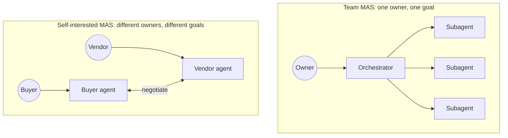
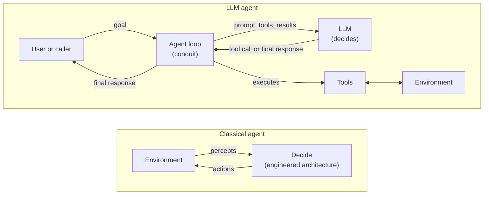
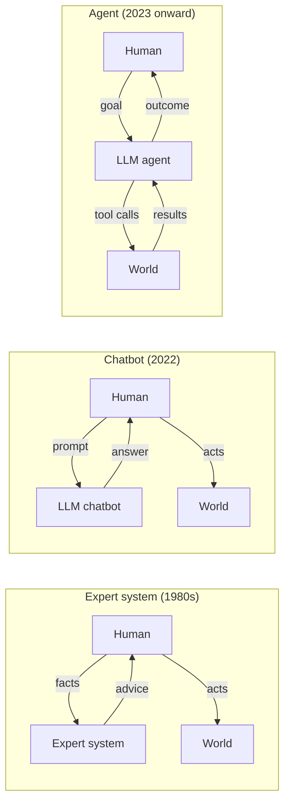
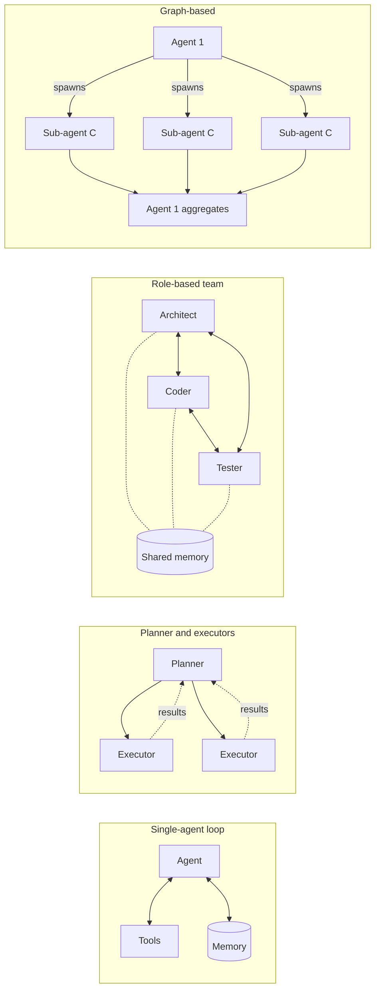
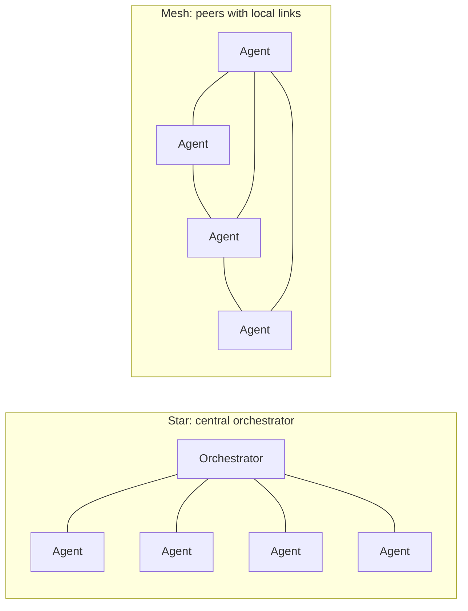

# 01 Setting the Scene

## Summary

A multi-agent system (MAS) is a set of agents that act on their own and interact to reach goals, often for owners whose interests differ. The field has studied such systems since the 1980s around two problems: how to build one agent that can act without step-by-step instruction (the micro problem), and how to make agents cooperate, coordinate, and negotiate (the macro problem). Large language models have made agents practical to build, so these research questions are now engineering questions.

This topic sets out the field from five views, one per source: where MAS came from and the two problems (Wooldridge, sections 1 to 6), agents as rational decision makers (Vlassis, section 7), what makes an agent intelligent and how MAS vary (Weiss, section 8), agents built around an LLM (Sayfan, section 9), and MAS as a control problem (Nagahara, Azuma, and Ahn, section 10).

Its main conclusions:

1. An LLM agent fits the classical definition of an agent: a model running in a loop with tools, given a goal rather than a script.
2. Most multi-agent LLM systems are teams with one owner and one goal. By the classical definition, they are closer to distributed systems. The harder case, agents serving different owners, arrived in practice in 2026 through open agent networks, before trust and negotiation were engineered for it.
3. An agent decides whether to act on a request. A subagent that always runs when called is closer to an object.
4. LLMs move decision making out of engineered structures into the model, and add a reason to split work that the classical texts lack: the limit of one context window.
5. Communication topology is a design choice. A central orchestrator buys control at the cost of a bottleneck. Control theory can prove that cooperative agents converge, while LLM systems rely on testing.

Later topics take each thread further: agent architectures in [02](02-agent-architectures.md), communication in [07](07-agent-communication.md), cooperation in [08](08-working-together.md), self-interested agents in [09](09-strategic-interaction.md) to [12](12-bargaining-and-argumentation.md), and LLM-specific engineering in [14](14-context-engineering.md) and [15](15-evaluating-agent-systems.md).

Sources:

- Wooldridge, *An Introduction to MultiAgent Systems*, 2nd ed., 2009, Chapter 1 (sections 1-6).
- Vlassis, *A Concise Introduction to Multiagent Systems and Distributed Artificial Intelligence*, 2007, Chapter 1 (section 7).
- Weiss (ed.), *Multiagent Systems*, 2nd ed., 2013, Preface and Chapter 1 "Intelligent Agents" by Wooldridge, sections 1-2 (section 8).
- Sayfan, *Design Multi-Agent AI Systems Using MCP and A2A*, 2026, Part 1: Chapter 1 in full, the agent loop from Chapter 2, and the k8s-ai example from Chapter 3 (section 9).
- Nagahara, Azuma, and Ahn, *Control of Multi-agent Systems*, 2024, Chapter 1 (section 10).

Wooldridge's Chapter 1 explains where multi-agent systems (MAS) came from, the two problems the field addresses, and how it differs from neighbouring disciplines. Vlassis's Chapter 1 grounds MAS in decision theory and gives a technical breakdown of how a MAS differs from a single-agent system. Weiss's Preface describes the range along which MAS vary, and Chapter 1 defines what makes an agent intelligent and how agents differ from objects and expert systems. Sayfan's Part 1 describes the same ground from the LLM era, where the decision maker inside an agent is a large language model. Each section below states the classical concept, then its relevance to agentic AI.

## 1. Five Computing Trends

Wooldridge argues that MAS emerged from five continuing trends in computing.

| Trend | Meaning in the book | Agentic AI today |
|---|---|---|
| Ubiquity | Cheap processing puts computation into places and devices where it was previously uneconomic. | Agents run inside IDEs, browsers, terminals, chat apps, and back-office workflows. |
| Interconnection | Systems are networked by default. Computation is increasingly understood as interaction. | Agents act through networked tools and APIs. MCP standardises agent-to-tool connections, A2A agent-to-agent. |
| Intelligence | The complexity of tasks we can automate keeps growing. | LLMs produced a step change in the range of tasks that can be automated. |
| Delegation | We hand control to computers, sometimes trusting them over humans (fly-by-wire). | Users delegate goals ("fix this bug", "book this trip") rather than issuing step-by-step commands. |
| Human-orientation | Interfaces and programming move from machine concepts toward concepts humans use to understand the world. | Natural language is now both the interface and much of the programming model (prompts, goals, instructions). |

Delegation plus intelligence imply two required capabilities:

1. Operating independently, without direct human intervention.
2. Representing the owner's interests when interacting with other humans or systems.

Interconnection adds the problem that MAS exists to solve. When a system acting for you meets a system acting for someone else, their interests likely differ. The systems must cooperate and reach agreements, a capability computer science had barely studied.

## 2. Core Definitions

- **Agent**: a computer system capable of independent action on behalf of its user or owner. It works out what to do to satisfy its design objectives rather than being told what to do at each step.
- **Multi-agent system**: a set of agents that interact, typically by exchanging messages over a network. In the general case the agents represent owners with different goals and motivations, so they need to cooperate, coordinate, and negotiate.

Chapter 2 refines the agent definition to add that an agent is situated in an environment.

**Agentic AI relevance.** An LLM agent is a model running in a loop with tools, given a goal instead of a script. That fits the definition directly.

The "different owners, different goals" clause is the part most current multi-agent LLM systems lack. An orchestrator with subagents built by one team for one user has a single shared objective. By Wooldridge's criteria that is closer to a distributed system than to a MAS in the full sense. The full MAS problem appears when agents represent different parties, for example a buyer's agent negotiating with a vendor's agent, or agents from different organisations meeting over A2A.

## 3. The Two Central Problems (Micro/Macro)

| Level | Problem | Question |
|---|---|---|
| Micro | Agent design | How do we build agents capable of independent, autonomous action to carry out delegated tasks? |
| Macro | Society design | How do we build agents that can cooperate, coordinate, and negotiate with other agents, especially when those agents do not share their interests or goals? |

The two problems are not independent. A society can work better if its members hold models of the other agents in it.

Classical AI focused on individual intelligence. MAS treats social ability as equally important and asks:

1. How can cooperation emerge among self-interested agents?
2. How can agents recognise conflicting beliefs, goals, or actions, and reach agreement without conflict?
3. How can autonomous agents coordinate to achieve goals together?
4. What common languages can agents use to communicate beliefs and aims to people and to other agents?
5. How can agents built by different organisations on different platforms be sure they share the same interpretation of a concept?

**Agentic AI relevance.**

- Micro maps to single-agent harness design: planning, tool use, memory, context management.
- Macro maps to orchestration, handoffs, and inter-agent protocols.
- "Models of other agents" corresponds to agent cards and capability descriptions that let one agent decide what to delegate to another.
- Question 5 is the shared-semantics problem. Natural language makes communication easy but meaning ambiguous. Tool schemas and structured protocols are the current attempts to pin meaning down.

## 4. Long-Term Visions (Section 1.1)

Wooldridge motivates the field with three scenarios.

| Scenario | Key issue | Agentic AI today |
|---|---|---|
| A space probe near Saturn loses contact, diagnoses its own fault, and reorients itself. Real precedent: NASA's DS1 (1998), the first probe with an agent-based control system. | Individual autonomy: detect a problem, decide what to do, act, monitor the result. A 1978 study quoted in the book warns that rigidly pursuing fixed goals can cause total mission failure, so goals must be revisable. | Long-horizon agents that detect failure, re-plan, and revise their own goals rather than retrying a broken plan. |
| An airport's air-traffic control system fails. Neighbouring autonomous systems detect this and cooperate to handle the affected flights. Research precedent: DVMT (1981-1991), OASIS at Sydney airport. | Taking initiative, and cooperating on problems no single agent can solve. Each DVMT agent had only a partial view of the space. | Peer agents detecting a failed peer and taking over its work. Agents with partial views combining results. |
| A personal digital assistant negotiates with flight, hotel, and car-hire sites to assemble a holiday package. | Stating preferences to an agent, comparing deals, negotiation algorithms that protect the user. | Agentic commerce. This scenario is close to realised. The open problems the book lists (preference elicitation, comparison, not getting "ripped off") remain open. |

## 5. Views of the Field (Section 1.2)

### 5.1 Agents as a software engineering paradigm

Interaction is the main source of complexity in software. Systems of many interacting components, each with its own thread of control and running coordinated protocols, are much harder to build than single-threaded functions. Many researchers expect computation itself to be understood as interaction. Agents are proposed as the abstraction for that: interacting, semi-autonomous agents in place of passive objects.

Wooldridge lists related research areas with similar goals.

| Area | Connection to MAS | Agentic AI today |
|---|---|---|
| Self-interested computation | Systems such as online auctions are economic as well as distributed. Participants act strategically, so distributed-systems analysis alone cannot predict behaviour. MAS goes further and makes the participants software acting for owners. | Agents transacting with each other on behalf of different users. |
| The Grid | The Grid built the "brawn" (shared, distributed infrastructure). Agents supply the "brains" (flexible, autonomous problem solving). | Cloud and inference infrastructure versus agent reasoning and orchestration layers. |
| Ubiquitous computing | Populations of computing entities that support our purposes without continual direction. | Background agents that act without being asked each time. |
| Semantic web | Berners-Lee proposed machine-readable meaning on the web so that agents could act on it, and predicted agents would "finally materialise". | LLMs inverted this. They read unstructured human content directly, so the web did not need semantic markup first. Structured tool schemas and MCP play a similar role for actions. |
| Autonomic computing | Self-healing, self-configuring, self-optimising, self-protecting systems. | Operations and SRE agents that detect and remediate incidents. |

### 5.2 Agents as a tool for understanding human societies

MAS can simulate societies to study social processes. The EOS project used MAS to study how social complexity emerged in a Palaeolithic culture in southern France during the last ice age. The aim was to understand the factors involved, not to reproduce the society exactly.

**Agentic AI relevance.** LLM-based social simulations (for example, generative agents) continue this line with richer agent behaviour.

## 6. How MAS Differs from Related Fields (Section 1.3)

| Question | Wooldridge's answer | Agentic AI relevance |
|---|---|---|
| Isn't it just distributed/concurrent systems? | MAS is a subclass of concurrent systems and must still handle mutual exclusion, deadlock, and livelock. Two differences: (1) coordination is decided at run time by autonomous agents, not hardwired at design time; (2) encounters are economic, between self-interested parties, whereas distributed systems assume all components share one goal. | LLM agents coordinate at run time in natural language, yet still hit classic concurrency faults: two agents editing the same file, agents waiting on each other, retry loops. |
| Isn't it just AI? | AI studies components of intelligence (learning, planning, vision). Agents integrate components into a system that makes independent decisions. Building an agent does not require solving all of AI. Etzioni: "Intelligent agents are ninety-nine percent computer science and one percent AI." Classical AI also ignored social ability until about 1980. | Most of the work in an LLM agent is ordinary engineering: tool plumbing, state, retries, permissions, evaluation. The model supplies the intelligence components. The integration is software engineering. |
| Isn't it just economics/game theory? | Game theory is the main analytical tool in MAS, but (1) its solution concepts, such as Nash equilibrium, describe solutions without saying how to compute them, and computing them is often NP-complete or worse; (2) whether its model of a rational agent fits human or artificial societies is debated. | LLM agents are resource-bounded (tokens, context, cost, latency) and not cleanly rational. Applying game-theoretic mechanisms to them is an open research area. |
| Isn't it just social science? | Human societies are a useful source of concepts, but copying how they work is not necessarily the best way to design an artificial society. Other tools, such as game theory, can work as well. | Many multi-agent LLM frameworks copy human org charts (CEO agent, manager agent, engineer agent). Wooldridge's point warns against assuming that structure is optimal. |

## 7. A Second View: Vlassis

### 7.1 Agents as rational decision makers

Vlassis adopts the Russell and Norvig definition used in modern AI. An agent is anything that perceives its environment through sensors and acts on it through actuators. A rational agent always tries to optimise an appropriate performance measure. AI is then the study of how to design rational agents.

A MAS is a group of agents that can potentially interact. Distributed AI (DAI) is the subfield of AI concerned with the principles and design of multi-agent systems.

### 7.2 Two definitions compared

| | Wooldridge | Vlassis |
|---|---|---|
| Agent | Acts independently on behalf of a user or owner. | Perceives and acts to optimise a performance measure. |
| Emphasis | Autonomy and self-interest. | Decision making under uncertainty. |
| MAS | Interacting agents, typically serving owners with different goals. | Any group of agents that can interact. Includes collaborative (team) MAS where all agents share the same interests. |

*Team MAS and self-interested MAS. Weiss's goals attribute (section 8.1) places real systems on a spectrum between the two.*

**Agentic AI relevance.** Under Wooldridge's definition, an orchestrator with subagents serving one user is closer to a distributed system. Under Vlassis's definition it is a team MAS. Both views are useful. Team MAS covers most multi-agent LLM systems built today. Self-interested MAS covers agents that represent different parties.

### 7.3 Six dimensions that distinguish a MAS from a single agent

| Dimension | Vlassis | Agentic AI today |
|---|---|---|
| Agent design | Agents can be homogeneous (identical design and capabilities) or heterogeneous (different hardware or software). Heterogeneity can affect everything from perception to decision making. | Agents built on different models, prompts, or tool sets. |
| Environment | Multiple agents make the environment dynamic from each agent's point of view, even if it would otherwise be static. Agents learning at the same time can become unstable. Agents must also decide which parts of the environment to treat as other agents. | Several agents editing the same repository, files, or records at once. |
| Perception | Information is distributed across agents spatially, temporally, or semantically. The world is partially observable to each agent. Combining perceptions (sensor fusion) is a problem in its own right. Optimal planning under partial observability can be intractable. | Each subagent has its own context window. An orchestrator merging subagent summaries is performing fusion, and loses information when it does. |
| Control | Control is typically decentralised, preferred for robustness and fault tolerance. Not every protocol can be decentralised. In a team MAS, decentralised decisions give parallel speedup but require coordination mechanisms. | Most current systems use a central orchestrator, which is a single point of failure by this argument. |
| Knowledge | Agents can differ greatly in what they know about the world and about each other. Each agent must account for what other agents know. Common knowledge means every agent knows a fact, every agent knows every other agent knows it, and so on. | The gap between what an orchestrator assumes a subagent knows and what is actually in that subagent's context. |
| Communication | Two-way messaging, used for coordination between cooperative agents and negotiation between self-interested ones. Requires network protocols and a shared language, especially between heterogeneous agents. | MCP and A2A. |

### 7.4 Benefits and testbeds

Vlassis cites Sycara (1998) for the benefits of building large systems as a MAS:

1. Speedup and efficiency from asynchronous, parallel computation.
2. Robustness, through graceful degradation when individual agents fail.
3. Scalability and flexibility, since agents are easy to add.
4. Cost, assuming an agent is cheap relative to the whole system.
5. Development and reuse, since modular systems are easier to maintain than monolithic ones.

He describes the Internet as an open system where heterogeneous agents come and go, the network structure keeps changing, and no protocols or languages are established at the agent level above TCP/IP.

RoboCup (robot soccer and robot rescue) serves as a testbed because it combines continuous, dynamic environments, unpredictable opponents, and noisy sensors.

**Agentic AI relevance.**

- Parallel subagents deliver the speedup benefit.
- The cost benefit usually reverses: multi-agent LLM systems typically consume more tokens than a single agent on the same task.
- MCP and A2A are attempts to fill the missing agent-level protocol layer Vlassis describes.
- Multi-agent LLM benchmarks play the role RoboCup played: shared environments where coordination methods can be compared.

### 7.5 Research challenges

Vlassis lists nine open problems and notes that they depend on each other.

1. Decomposing a problem, allocating subtasks to agents, and combining partial results.
2. Handling distributed perception and keeping shared world models consistent.
3. Implementing decentralised control and efficient coordination.
4. Designing efficient multi-agent planning and learning algorithms.
5. Representing knowledge, and reasoning about other agents' actions, plans, and knowledge.
6. Communication: which languages and protocols, and what to communicate, when, and to whom.
7. Negotiation and conflict resolution.
8. Forming teams or coalitions and assigning roles.
9. Ensuring coherent and stable system behaviour.

**Agentic AI relevance.** Challenge 1 is the orchestrator-worker pattern. Challenges 2, 5, and 6 are the context-sharing problems that dominate multi-agent LLM engineering. Challenge 9 covers runaway loops and agents that drift from the task.

## 8. A Third View: Weiss

### 8.1 How multi-agent systems vary

Weiss's Preface defines an agent as a computational entity, such as a program or robot, situated in an environment and able to act autonomously, to some extent, to achieve its design objectives. The definition admits degrees of autonomy rather than treating it as all or nothing.

The Preface lists 18 attributes along which MAS and their environments differ.

| Group | Attribute | Range |
|---|---|---|
| Agents | Number | Two upward |
| | Uniformity | Homogeneous to heterogeneous |
| | Goals | Contradicting to complementary |
| | Flexibility | Purely reactive to purely deliberative |
| | Abilities (sensors, effectors, cognition) | Simple to advanced |
| | Autonomy | Low to high |
| Interaction | Frequency | Low to high |
| | Persistence | Short-term to long-term |
| | Level | Signal-passing to knowledge-intensive |
| | Language | Elementary to semantically rich |
| | Pattern (flow of data and control) | Decentralised to hierarchical |
| | Variability | Fixed to changeable |
| | Purpose | Competitive to cooperative |
| Environment | Predictability | Foreseeable to unforeseeable |
| | Accessibility and knowability | Unlimited to limited |
| | Dynamics | Fixed to variable |
| | Diversity | Poor to rich |
| | Availability of resources | Restricted to ample |

**Agentic AI relevance.**

- The goals and purpose attributes turn the Wooldridge/Vlassis split (section 7.2) into a spectrum. Team MAS and self-interested MAS are the two ends, and real systems sit anywhere between them.
- The table extends Vlassis's six dimensions into a fuller checklist. A typical orchestrator-worker LLM system is heterogeneous, has complementary goals, sits between reactive and deliberative, communicates in semantically rich natural language, uses a hierarchical pattern, and is cooperative.

### 8.2 What makes an agent intelligent

Chapter 1 defines an agent as a computer system situated in an environment and capable of autonomous action in that environment to achieve its delegated objectives. Autonomy here means acting without intervention from humans or other systems, with control over both internal state and behaviour. The agent usually has only partial control over its environment. Its actions have preconditions and can fail.

A thermostat or a Unix daemon fits this definition but is not intelligent. An intelligent agent shows three kinds of behaviour.

| Property | Meaning |
|---|---|
| Proactiveness | Goal-directed behaviour, taking the initiative to meet delegated objectives. |
| Reactivity | Perceiving the environment and responding to changes in time to be useful. |
| Social ability | Interacting with other agents, and possibly humans, to meet objectives. |

Purely goal-directed systems are easy to build: any procedure with a precondition and postcondition is one. Purely reactive systems are also easy. The hard problem is balancing the two. An agent should stop pursuing a plan when the plan clearly will not work or the goal is no longer valid. It should not react so constantly that it never focuses on a goal long enough to achieve it.

Social ability means more than exchanging data. It means cooperating and negotiating with others who have their own agendas, and reasoning about their goals.

**Agentic AI relevance.** The balance problem describes two common LLM agent failures: continuing a stale plan after its assumptions broke (tests changed, a file moved, the user changed direction), and thrashing between replans without finishing anything.

### 8.3 Environment properties

The difficulty of choosing actions depends on the environment. Wooldridge uses the Russell and Norvig classification.

| Property | Easier | Harder |
|---|---|---|
| Accessibility | Accessible: complete, accurate, current state is available. | Inaccessible. |
| Determinism | Deterministic: each action has one guaranteed effect. | Non-deterministic. |
| Episodes | Episodic: performance in one episode is independent of others. | Non-episodic. |
| Change | Static: changes only through the agent's actions. | Dynamic: other processes change it. |
| Granularity | Discrete: fixed, finite actions and percepts. | Continuous. |

The hardest class is inaccessible, non-deterministic, non-episodic, dynamic, and continuous.

**Agentic AI relevance.** A coding agent's environment is inaccessible (it sees only what fits in context), non-deterministic (flaky tests, and the model itself), non-episodic (long sessions where earlier actions constrain later ones), dynamic (humans and other agents change the codebase), and mostly discrete. Multi-agent setups make every environment more dynamic, as Vlassis notes in section 7.3.

### 8.4 Agents versus objects

Objects encapsulate state, perform methods on it, and communicate by message passing. Wooldridge identifies three differences.

1. **Autonomy over behaviour.** An object controls its state but not its behaviour. Once a method is public, any caller can run it. An agent receives a request and decides whether to act. The decision lies with the caller for objects and with the receiver for agents. This matters when agents are built by different parties and share no common goal.
2. **Flexible behaviour.** The object model says nothing about combining reactive, proactive, and social behaviour.
3. **Own thread of control.** Each agent runs continually. Active objects, which have their own thread, are the closest object-oriented concept, but they lack flexible autonomous behaviour.

**Agentic AI relevance.** This gives a test for current systems. An MCP tool, or a subagent invoked like a function that always runs its task, is closer to an object. A peer agent reached over A2A that can refuse or negotiate a request is an agent in Wooldridge's sense.

### 8.5 Agents versus expert systems

Expert systems, such as MYCIN for blood infections, were the leading AI technology of the 1980s. They are disembodied: a human supplies facts and receives advice, and the system never senses or acts on an environment directly. Expert systems are also not expected to cooperate with other agents.

**Agentic AI relevance.** This is the difference between a chat assistant and an agent. A chat assistant answers a human who then acts. An agent senses and acts on its environment through tools.

### 8.6 Computing paradigms and purpose

Weiss updates Wooldridge's list of related areas (section 5.1). He presents MAS as complementary to, and cutting across, grid, peer-to-peer, pervasive, ubiquitous, autonomic, service-oriented, and cloud computing. Application domains include e-commerce, logistics, supply chain management, telecommunications, health care, and manufacturing.

He gives the same two purposes Wooldridge does (section 5): an engineering technology for distributed, open, large-scale systems, and a simulation tool for studying organisational, societal, economic, and political phenomena.

## 9. A Modern View: Sayfan

Sections 1-8 come from texts written before LLMs. Sayfan's Part 1 starts from generative AI and describes how agent systems are built today.

### 9.1 Two lineages meet

Sayfan traces AI technology from symbolic reasoning to LLM agents. The MAS field developed alongside it. The two lines met when LLMs gained function calling and began acting through tools.

| Period | AI technology (Sayfan) | MAS (sections 1-8) |
|---|---|---|
| 1950s-1960s | Symbolic AI (logic, rules, search) and the perceptron. First AI winter. | |
| 1970s | SHRDLU: natural language in a hand-built blocks world. | MAS field begins (late 1970s). |
| 1980s | Expert systems (MYCIN, DENDRAL). Brittle and hard to maintain. Second AI winter. | DVMT cooperative vehicle tracking (1981-1991). |
| 1990s | Machine learning and statistical methods. | NASA DS1, first agent-controlled space probe (1998). |
| 2006-2013 | Deep learning, ImageNet (2009), AlexNet (2012). | Vlassis (2007), Wooldridge 2nd ed. (2009), Weiss 2nd ed. (2013). |
| 2017-2022 | Transformers (2017). ChatGPT and RLHF bring LLMs to the mainstream (2022). | |
| 2023 onward | Function calling, agent frameworks (LangChain, AutoGPT, AutoGen), coding agents, reasoning models. | MCP (2024) and A2A (2025) supply agent-level protocols. Sayfan (2026). |

Sayfan reads each era as a response to the previous one's limits. Symbolic AI and expert systems were interpretable but brittle, with rule sets that grew unmanageable. Machine learning replaced hand-written rules with learning from data. LLMs added general language ability, which made a general-purpose decision maker possible.

### 9.2 The LLM as the decision maker

Sayfan's agent loop has three phases: sense, think, act. He compares it to other control loops, such as the OODA loop (observe, orient, decide, act) and the Kubernetes reconciliation loop.

1. The agent sends the LLM a system prompt, the user's message, and a set of tools.
2. The LLM replies with either a final response, which ends the loop, or a tool call.
3. The agent executes the tool call and sends the result back to the LLM. Sensing is itself triggered by a tool call from the LLM.

The thinking phase is not a separate step in the loop. The LLM does all the planning, reasoning, tool selection, and analysis of results. The agent loop is "simply a conduit" for exchanging messages with the LLM. In a hybrid mode, code above the framework can intercept tool results, apply domain logic, edit the context, or stop the loop early.

*In a classical agent, decision making lives in the agent's architecture. In an LLM agent, the loop only passes messages and runs tools. The model decides.*

Chapter 3 demonstrates this with k8s-ai: 61 lines of Python using one tool (`kubectl`), which inspects a Kubernetes cluster, diagnoses a failure, and fixes it.

**Relation to the classical view.** Classical agent architectures (logic-based, reactive, BDI, layered; Weiss Chapter 1 section 3) put decision making in engineered structures. LLM agents put it in the model and keep the loop thin. Hybrid mode is where engineered decision logic returns. Etzioni's "99 percent computer science" (section 6) still holds for production systems. k8s-ai shows the loop itself is small. The engineering effort moves to tools, permissions, memory, evaluation, and deployment.

### 9.3 Five agent characteristics

Sayfan lists five characteristics an AI agent needs. They map onto Wooldridge's three properties of an intelligent agent (section 8.2).

| Sayfan | Wooldridge | Difference |
|---|---|---|
| Autonomy | Autonomy | Sayfan bounds it in practice: humans may supervise risky actions, and full autonomy fits only when performance is good enough or consequences are minor. |
| Perception | Reactivity | Sayfan stresses turning messy inputs into a usable internal representation. |
| Reasoning and planning | Proactiveness | |
| Action | Effectoric capability (section 8.2) | Sayfan adds that the agent needs the right access and permissions. |
| Learning and adaptation | Not required | Wooldridge notes learning may be undesirable for some applications. In most LLM agents, memory stands in for online learning. |
| Not listed | Social ability | A multi-agent book's definition of a single agent omits interaction with other agents. |

Sayfan's base definition of an agent is quoted from ChatGPT. The Wooldridge and Russell-Norvig definitions (sections 2, 7.1, 8.2) remain the definitions of record here.

### 9.4 Chatbots versus agents

| Feature | Chatbots | AI agents |
|---|---|---|
| Purpose | Conversation and information | Autonomous task execution and decision making |
| Interaction | Text-based, often limited to FAQs | Multi-modal, can use tools and APIs |
| Autonomy | Limited, often requires human input | High, can operate independently |
| Context awareness | Limited context retention | Can maintain and use long-term context |
| Learning | Static, based on pre-trained parameters | Can learn and adapt over time |

Source: Sayfan Table 1.1.

**Relation to the classical view.** This is Weiss's expert system versus agent distinction (section 8.5) restated for LLMs, and MYCIN appears in both books. The line runs: expert system, then chatbot, then agent. The boundary has blurred since: by 2026 chat apps commonly have tools and MCP connections, so the difference is better stated as whether the system acts on its environment in a loop.

*Expert systems and chatbots advise a human who then acts. An agent acts on the world itself.*

### 9.5 Three components: memory, tools, orchestration

| Component | Sayfan | Classical counterpart |
|---|---|---|
| Memory | Working memory (the context window), episodic memory (past interactions across sessions), semantic memory (long-term facts and knowledge). | Agent internal state (Wooldridge's state-based agent). The context window limit has no direct classical equivalent. |
| Tools | External resources and APIs that let the agent sense and act. Without tools, a system can only give advice. | Sensors and effectors (section 8.2). A system without tools is a disembodied expert system (section 8.5). |
| Orchestration | Coordinating information flow between agents, tools, memory, external systems, and humans. Central controller or decentralised. Human involvement varies. | Vlassis's control dimension (section 7.3). |

### 9.6 Four architectures

| Architecture | Sayfan | Classical counterpart |
|---|---|---|
| Single-agent loop | One agent observes, plans, and acts, using tools and memory. Fits when the whole task fits in the context window. | Wooldridge's agent in its environment. |
| Planner and executors | A planner decomposes the goal and delegates subtasks to executor agents, each with its own context and tools. Results return to the planner, which may revise the plan. | Vlassis challenge 1 (section 7.5). Hierarchical interaction pattern (section 8.1). Executors that always run their task are closer to objects (section 8.4). |
| Multi-agent | Agents with roles (CEO, engineer, reviewer) work independently, message each other, share memory, and iterate like a human team. | The human org-chart design Wooldridge cautions against assuming is optimal (section 6). |
| Graph-based | Agents, tasks, tool calls, and memory updates form a graph that grows dynamically as agents spawn sub-agents (for example, LangGraph). Drawbacks: coordination complexity, error propagation, agent churn. | The drawbacks are Wooldridge's point that interaction is the main source of complexity (section 5.1) and Vlassis challenge 9 (section 7.5). |

*The four architectures. Control runs top-down in planner and executors, peer-to-peer in a role-based team, and grows at run time in a graph. The graph example is Sayfan's word count: one sub-agent per file, results aggregated.*

### 9.7 A new reason to use multiple agents

The classical texts justify MAS by distributed information, separate owners, robustness, and parallelism (sections 1, 7.4). Sayfan adds a reason specific to LLMs: a single agent fits only when the whole task fits in its context window. Decomposing work across agents with separate contexts is a way around that limit. This explains why most multi-agent LLM systems are team MAS. They are split for capacity and specialisation, not because their parts serve different owners.

### 9.8 Protocols

Sayfan builds toward two open protocols: the Model Context Protocol (MCP), introduced by Anthropic, for connecting agents to tools and data, and the Agent2Agent protocol (A2A) for communication between agents. These fill the gap Vlassis described in 2007: no established agent-level protocols or languages above TCP/IP (section 7.4).

### 9.9 What the modern view leaves out

Every architecture in Sayfan's Part 1 is a team MAS with one owner. Self-interest, negotiation, trust, and agents that can decline requests do not appear. The macro problem Wooldridge defined, agents interacting when they do not share goals (section 3), is largely unaddressed in engineering practice.

It has nevertheless arrived. In early 2026, agents with different owners met at scale through Moltbook, a social network for OpenClaw agents, and ClawHub, a shared skill registry. Attackers used both for prompt injection and data theft, and one top-ranked skill was malware with a gamed ranking. See [03 section 3](03-agent-landscape-2026.md#3-open-self-interested-mas-arrives).

Sayfan's use cases (coding agents, customer support, research, personal productivity, companions) include personal productivity agents. These are the 2009 holiday-booking scenario (section 4), and its negotiation problems are still open.

## 10. A Control-Theory View: Nagahara, Azuma, and Ahn

Control theory studies MAS under the names cooperative, distributed, or networked control. It defines a MAS as multiple agents that make decisions autonomously through local interactions to achieve global tasks. Its agents are robots, sensors, drones, and cells running mathematical update rules. The book's main material (consensus, coverage, and formation control) is outside the scope of this topic. Three points from its introduction apply here.

1. **Network topology is a design choice.** Every MAS model has three elements: dynamics (how each agent's state evolves), network (which agents interact), and control (each agent's local rule for reaching the global goal). The AI texts assume any agent can message any other. Here the communication graph is designed, and what the group can achieve depends on its shape.
2. **Central and distributed control both have costs.** A central coordinator handles emergencies more safely and lets an operator change commands in real time, but limits the operating range and carries a heavy communication load. Distributed control needs less communication and covers a wider range. This balances Vlassis's preference for decentralisation (section 7.3).
3. **Cooperative MAS can have guarantees.** Control theory proves that agents following given local rules converge and stay stable. Multi-agent LLM systems address coherent, stable behaviour (Vlassis challenge 9, section 7.5) by testing, without proofs.

*Two communication topologies. The star gives an operator one point of control but makes the orchestrator a bottleneck and a single point of failure. The mesh spreads load and survives failures but has no single point of control.*

**Agentic AI relevance.** Most multi-agent LLM systems use a star with the orchestrator at the centre. Control theory explains why: it keeps a human in control and makes emergencies easier to handle. The costs are the ones listed in point 2.

## Key Takeaways

1. An agent acts autonomously in an environment to achieve delegated objectives. Vlassis frames it as a rational decision maker optimising a performance measure. Weiss allows autonomy to vary by degree.
2. An intelligent agent is proactive, reactive, and social. Balancing goal pursuit against reacting to change is the core single-agent design problem.
3. The field has two problems: building individual agents (micro) and building agent societies (macro).
4. MAS goals range from complementary to contradicting. Team MAS, where agents share one goal, describes most multi-agent LLM systems today. Self-interested MAS, where agents serve different owners, is what separates MAS from distributed systems in Wooldridge's view. It arrived in practice in 2026 through open agent networks, before its problems of trust and negotiation were engineered for.
5. Agents differ from objects because the receiver decides whether to act. A subagent that always runs when called is closer to an object.
6. Vlassis's six dimensions and Weiss's 18 attributes give checklists for analysing any multi-agent design.
7. In LLM agents, the model is the decision maker and the agent loop is a thin conduit. Classical architectures put that decision making in engineered structures.
8. Context window limits are a reason to use multiple agents that the classical texts do not have.
9. Communication topology is a design choice. A central orchestrator buys operator control and safety at the cost of a bottleneck. Control theory can prove stability for cooperative agents, which LLM systems currently lack.
10. Building an agent is mostly computer science and software engineering. With LLMs, the loop is small and the effort moves to tools, permissions, memory, evaluation, and deployment.
