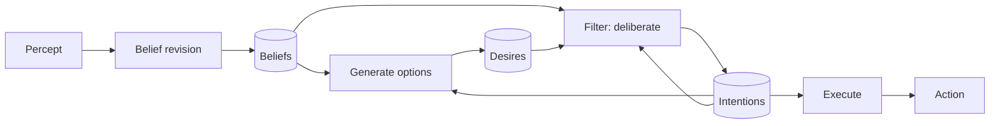
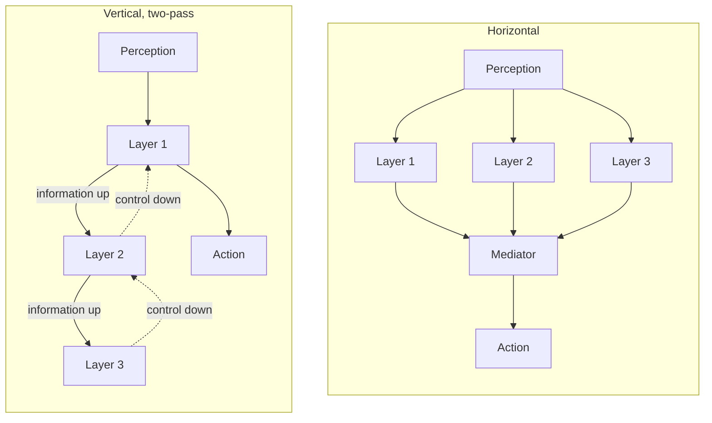

# 02 Agent Architectures

Sources:

- Weiss (ed.), *Multiagent Systems*, 2nd ed., 2013, Chapter 1 "Intelligent Agents" by Wooldridge, section 3. Primary source for this topic.
- Wooldridge, *An Introduction to MultiAgent Systems*, 2nd ed., 2009, Chapters 3-5 (deductive reasoning, practical reasoning, reactive and hybrid agents). Covers the same architectures in more depth.
- Sayfan, *Design Multi-Agent AI Systems Using MCP and A2A*, 2026, Chapter 2, for the LLM agent loop.

An agent architecture is a map of an agent's internals: its data structures, the operations on them, and the control flow between them. It answers the micro-level question from [01 section 3](01-setting-the-scene.md#3-the-two-central-problems-micromacro): how do we build an agent that decides for itself what to do?

Wooldridge describes four classes, distinguished by how the agent decides what to do. Each section below states the classical architecture, then its relevance to agentic AI. Section 6 places LLM agents among them.

| Architecture | How the agent decides |
|---|---|
| Logic-based | Logical deduction from a database of beliefs. |
| Reactive | A direct mapping from situation to action. |
| Belief-desire-intention (BDI) | Manipulating data structures that represent beliefs, desires, and intentions. |
| Layered | Several software layers, each reasoning about the environment at a different level of abstraction. |

## 1. Logic-Based Architectures

Symbolic AI holds that intelligent behaviour comes from giving a system a symbolic representation of its environment and desired behaviour, then manipulating that representation. Logic-based agents take this to its limit: beliefs are formulae of first-order logic, and choosing an action is theorem proving.

The agent holds a belief database, such as `Open(valve221)` or `Temperature(reactor4726, 321)`, and a set of deduction rules. To choose an action, it tries to prove `Do(a)` for each possible action `a`. If it proves one, it performs that action. If not, it looks for an action that is at least not forbidden. Otherwise it does nothing. The rules are the agent's program, and the theory is directly executed rather than refined into code.

Wooldridge identifies four problems.

1. **Calculative rationality.** Deduction takes time and may not terminate. The action chosen was optimal when the agent started deciding, but the world may have changed by the time it finishes. This is unacceptable in environments that change faster than the agent decides.
2. **Translating perception into symbols.** Turning raw sensor data, such as an image, into logical statements is hard and largely unsolved.
3. **Representing change.** Reasoning about how a situation changes over time is extremely difficult.
4. **Procedural knowledge is awkward.** Even a 3x3 vacuum-cleaning world needs a cumbersome set of rules to say what to do.

The approach's lasting appeal is a clean logical semantics: you can state exactly what the agent will do and why.

**Agentic AI relevance.**

- Calculative rationality applies directly to LLM agents. A long reasoning step acts on the state the agent saw when it started. If a file, test result, or user instruction changes during that time, the chosen action may be stale.
- LLMs largely remove problem 2. They read text, logs, and images directly without a hand-built translation to symbols.
- LLM agents give up the main benefit. Their decisions have no formal semantics, so they cannot be proven correct. This is the same gap as the missing guarantees in [01 section 10](01-setting-the-scene.md#10-a-control-theory-view-nagahara-azuma-and-ahn).

## 2. Reactive Architectures

In the mid-to-late 1980s, some researchers rejected symbolic AI. Their approaches share three ideas: no symbolic representations or reasoning, intelligence tied to the agent's interaction with its environment, and intelligent behaviour emerging from simpler behaviours.

### 2.1 The subsumption architecture

Rodney Brooks's subsumption architecture is the best-known reactive architecture. It has two defining features.

1. **Task-accomplishing behaviours.** Each behaviour maps perception directly to action, in the form `situation → action`, with no symbolic reasoning.
2. **A priority hierarchy.** Several behaviours can fire at once. Lower layers inhibit higher ones, so the lower a layer, the higher its priority. Urgent behaviours, such as obstacle avoidance, sit at the bottom.

Wooldridge's example is Luc Steels's planetary explorers: robots collecting rock samples on a planet where terrain blocks direct communication. Each robot follows prioritised rules: avoid obstacles, drop samples at the base, head back up the mothership's signal gradient when carrying samples, pick up samples, and otherwise move randomly. Because samples cluster, robots also drop "radioactive crumbs" on the way home to form trails. Others follow and thin the trails, so a trail to an exhausted site fades away. The robots cooperate without exchanging messages, by leaving information in the environment.

Reactive architectures are simple, cheap to compute, robust to the loss of an agent, and elegant. Wooldridge lists their unsolved problems.

1. The local environment must contain enough information to choose a good action, since the agent has no model of the world.
2. Decisions use only local, current information, so the agent takes a short-term view.
3. Emergent behaviour is hard to understand, so there is no principled way to engineer it. Building such agents takes trial and error.
4. Agents with more than about ten behaviours become too complex to understand.

### 2.2 Markov decision processes

Markov decision processes (MDPs) model sequential decisions in a stochastic environment. An MDP has states, actions, transition probabilities `p(s' | s, a)`, and a reward `r(a, s)` for each action in each state. The Markov assumption is that outcomes and rewards depend only on the current state, not on history. A policy maps each state to an action. The optimal policy maximises expected reward, with future rewards discounted. Value iteration finds it by repeatedly estimating the value of each state until the estimates converge.

**Agentic AI relevance.**

- Guardrails behave like subsumption layers. A low-level rule, such as "never force-push to main" or "stop when a test deletes data", overrides whatever the model planned.
- Steels's crumbs are indirect communication through a shared environment. Multi-agent LLM systems often coordinate the same way: through a shared repository, task board, or files, rather than direct messages.
- Problem 3 describes prompt engineering. Behaviour emerges from the model and prompt, and is tuned by experiment rather than designed from principles.
- MDPs are the framework behind reinforcement learning, which is used to train LLMs (RLHF, [01 section 9.1](01-setting-the-scene.md#91-two-lineages-meet)) and to frame agent tasks as sequences of decisions with a reward for success.

## 3. Belief-Desire-Intention (BDI) Architectures

BDI architectures come from the philosophy of practical reasoning: deciding, moment by moment, what to do next to further one's goals. Practical reasoning has two parts:

- **Deliberation:** deciding what goals to achieve.
- **Means-ends reasoning:** deciding how to achieve them.

An agent considers its options, chooses some, and commits to them. The chosen options become intentions.

### 3.1 The role of intentions

| Property | Meaning |
|---|---|
| Intentions drive means-ends reasoning | Having an intention leads the agent to work out how to achieve it, and to try another way if the first fails. |
| Intentions constrain deliberation | The agent does not consider options that conflict with its intentions. |
| Intentions persist | The agent keeps an intention until it is achieved, becomes impossible, or its reason disappears. |
| Intentions shape beliefs about the future | The agent plans on the assumption that its intentions will succeed. |

### 3.2 Commitment versus reconsideration

An agent must sometimes drop intentions, so it must sometimes stop to reconsider them. Reconsidering costs time and computation.

- An agent that reconsiders too rarely keeps pursuing intentions that are impossible or pointless.
- An agent that reconsiders too often never spends enough time acting to achieve anything.

This is the balance between proactive and reactive behaviour from [01 section 8.2](01-setting-the-scene.md#82-what-makes-an-agent-intelligent), made concrete. Kinny and Georgeff tested it with "bold" agents, which never reconsider, and "cautious" agents, which constantly reconsider. The deciding factor was the rate at which the world changes.

| World change | Better strategy | Why |
|---|---|---|
| Slow | Bold | Cautious agents waste time reconsidering while bold agents work toward their goals. |
| Fast | Cautious | Cautious agents notice doomed intentions and take new opportunities. |

### 3.3 The BDI cycle

A BDI agent has seven components: beliefs, a belief revision function, an option generation function, desires (current options), a filter function (deliberation), intentions, and an execute function. Each cycle runs:

1. Revise beliefs from the new percept.
2. Generate options (desires) from beliefs and current intentions. This is means-ends reasoning: intentions are refined into more concrete options, building a hierarchical plan.
3. Filter: drop intentions that are achieved, impossible, or too costly. Keep the rest. Adopt new ones from the options.
4. Execute an intention that corresponds to a directly executable action.

In practice, intentions are often kept as a stack. Abstract intentions sit at the bottom and concrete ones at the top. An intention is pushed when adopted and popped when achieved or abandoned.

*The BDI cycle. Intentions feed back into both option generation and filtering.*

BDI underpins one of the most successful agent architectures, the Procedural Reasoning System (PRS). PRS was used for fault diagnosis on the space shuttle's reaction control system and for air traffic management at Sydney airport. Its modern descendants include the AgentSpeak language and its Jason implementation.

**Agentic AI relevance.** BDI maps closely onto how coding agents work today.

| BDI | LLM agent |
|---|---|
| Beliefs | The context window and memory. |
| Belief revision | Adding tool results and new messages to the context. |
| Desires | The approaches the model considers. |
| Filter | The model deciding whether to continue its plan or replan. |
| Intentions | The plan or to-do list the agent commits to. |
| Execute | A tool call. |

The commitment-versus-reconsideration result gives a principled starting point for research backlog item R8 (detecting a stale plan): match how often an agent reconsiders to how fast its environment changes. A coding agent working alone on a stable branch can be bold. One sharing a repository with other agents and humans should be cautious.

## 4. Layered Architectures

An agent must be both reactive and proactive. Layered architectures give each kind of behaviour its own subsystem and arrange the subsystems into interacting layers. There are usually at least two layers, one reactive and one proactive.

### 4.1 Horizontal and vertical layering

| Type | Structure | Strength | Weakness |
|---|---|---|---|
| Horizontal | Every layer connects to perception and action, and each suggests actions. | Conceptually simple: one layer per behaviour. | Layers compete, so a mediator must decide which layer controls the agent. With n layers each suggesting m actions, there are m^n interactions to consider. The mediator is a bottleneck. |
| Vertical, one-pass | Control flows through each layer in turn. The last layer produces the action. | At most m²(n-1) interactions between layers. | Not fault tolerant: a failure in any layer breaks decision making. |
| Vertical, two-pass | Information flows up the layers, then control flows back down. | Same reduced interaction count. Resembles how organisations pass information up and commands down. | Same lack of fault tolerance. |

*Horizontal layers compete through a mediator. Vertical layers pass information up and control down.*

### 4.2 Two examples

- **TouringMachines (horizontal).** Three layers each suggest actions. The reactive layer uses situation-action rules, such as avoiding the kerb. The planning layer elaborates plan skeletons from a library rather than planning from scratch. The modelling layer represents other agents, predicts conflicts with them, and posts new goals to resolve those conflicts. Control rules decide which layer controls the agent. They can suppress what a layer perceives or censor the actions it suggests.
- **InteRRaP (vertical, two-pass).** A behaviour layer handles reactive behaviour, a local planning layer handles the agent's own plans, and a cooperative planning layer handles interaction with other agents. Each layer has its own knowledge base at its level of abstraction. Input arrives at the bottom. If a layer cannot handle a situation, it passes control up (bottom-up activation). A higher layer uses the facilities of lower layers to achieve its goals (top-down execution).

Layered architectures are the most popular general class. Layers map naturally onto reactive, proactive, and social behaviour. The cost is that they lack the clear semantics of logic-based approaches, and layer interactions must be managed.

**Agentic AI relevance.**

- Sayfan's hybrid mode ([01 section 9.2](01-setting-the-scene.md#92-the-llm-as-the-decision-maker)) is a layered architecture. Deterministic code forms one layer and the LLM another. The code can intercept tool results, edit the context, or stop the loop.
- TouringMachines' censor rules correspond to permission systems and hooks that block or filter an agent's proposed actions before they run.
- InteRRaP's bottom-up activation corresponds to escalation. A rule or cheap model handles routine cases, then hands off to a stronger model or a human when it is not competent to decide.
- Both examples have a social layer that models other agents. Most LLM agents have no explicit equivalent. Knowledge of other agents lives only in the prompt or context.

## 5. Comparison

| Architecture | Strengths | Weaknesses |
|---|---|---|
| Logic-based | Clear semantics. Behaviour can be specified and reasoned about. | Slow (calculative rationality). Hard to ground perception in symbols. Awkward for procedural and temporal knowledge. |
| Reactive | Simple, cheap, robust. | Short-term view. Emergent behaviour is hard to engineer. Does not scale beyond about ten behaviours. |
| BDI | Intuitive. Clear functional decomposition. Proven in demanding applications. | Efficient implementation is hard. Must tune commitment to the environment. |
| Layered | Natural mapping to reactive, proactive, and social behaviour. Most popular in practice. | Unclear semantics. Layer interactions must be managed. |

## 6. Where LLM Agents Fit

An LLM agent does not belong cleanly to any of the four classes. Its decision maker is a learned model reasoning in natural language, not deduction, fixed rules, or explicit belief-desire-intention structures. Each class still describes part of it.

| Architecture | What carries over to LLM agents |
|---|---|
| Logic-based | Calculative rationality: decisions made on state that may be stale by the time they are executed. |
| Reactive | Guardrails that override the model. Coordination through a shared environment. Behaviour tuned by experiment. |
| BDI | The plan or to-do list as intentions, and the commitment-versus-reconsideration trade-off. |
| Layered | Hybrid mode, permission layers, and escalation from cheap to capable models or to humans. |

The classical architectures put decision making in engineered structures. LLM agents put it in the model. As production systems add plans, permissions, and escalation around the model, they rebuild parts of these architectures in a new form.

## Key Takeaways

1. Agent architectures differ in where decisions are made: deduction, direct mapping, practical reasoning over beliefs, desires, and intentions, or a stack of layers.
2. Calculative rationality, choosing an action that was optimal when deciding began, applies to LLM agents with long reasoning steps.
3. Reactive systems are robust and cheap, but their emergent behaviour is hard to engineer. Prompt engineering faces the same problem.
4. The BDI trade-off between commitment and reconsideration has an empirical answer: reconsider more often when the world changes faster.
5. Layered architectures are the practical choice classically, and LLM systems with code layers, permission hooks, and escalation are layered architectures in a new form.
6. LLM agents gain flexible perception and reasoning but lose the formal semantics that logic-based agents offered.
