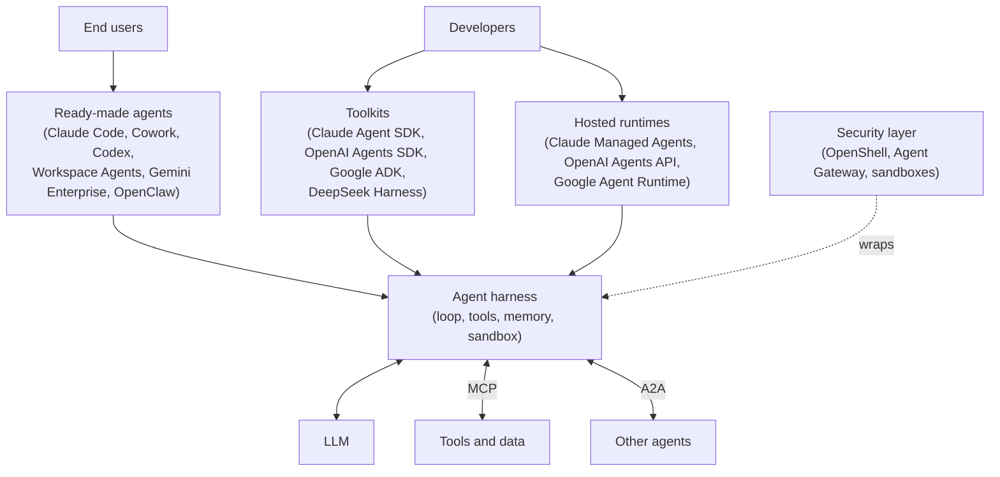

# 03 Agent Landscape 2026

Snapshot as of 1 November 2026. Products in this space change monthly: in 2026 alone Google renamed Vertex AI, Anthropic renamed its SDK, and OpenAI announced the shutdown of Agent Builder. Expect the product details here to go stale. The concepts they map to, in [01](01-setting-the-scene.md) and [02](02-agent-architectures.md), do not.

This doc covers three things:

1. The common three-layer structure behind the major vendors' agent products.
2. OpenClaw, the open-source, self-hosted agent that made always-on personal agents mainstream.
3. Evidence that open, self-interested multi-agent systems have arrived in practice, and what went wrong.

## 1. A Common Three-Layer Structure

Anthropic, OpenAI, and Google each sell the same agent harness three ways: as ready-made agents, as a toolkit to build your own, and as a hosted runtime that runs the harness for you. A security layer and two protocols sit around it.

*The same harness is packaged three ways. Security layers wrap it, MCP connects it to tools, and A2A connects it to other agents.*

| Layer | Anthropic | OpenAI | Google | NVIDIA |
|---|---|---|---|---|
| Ready-made agents | Claude Code (coding). Cowork (knowledge work, generally available April 2026). | Codex. Workspace Agents in ChatGPT (April 2026). | Gemini Enterprise app (absorbed Agentspace). Antigravity (coding). Gemini CLI. | None. |
| Toolkit | Claude Agent SDK (renamed from Claude Code SDK). | Agents SDK (sandboxes and memory added April 2026). | Agent Development Kit (ADK), model-agnostic. | Agent Toolkit. |
| Hosted runtime | Claude Managed Agents (beta since April 2026): agents, environments, sessions, events. Cloud or self-hosted sandboxes. Scheduled runs. | Agents API: OpenAI runs a managed Codex harness with context compaction and multi-agent orchestration. | Agent Runtime in Gemini Enterprise Agent Platform, "an evolution of Vertex AI" (April 2026). | None. |
| Security and governance | Sandboxed environments in Managed Agents. | Sandboxes in the Agents SDK. | Agent Identity, Agent Registry, Agent Gateway (policy enforcement on tool calls). | NemoClaw and OpenShell (March 2026): an isolated sandbox with rule-based limits on network access and privacy, wrapped around OpenClaw. |

OpenAI is retiring Agent Builder, part of its 2025 AgentKit, at the end of November 2026, in favour of the Agents SDK and Workspace Agents.

DeepSeek takes a different route. DeepSeek Harness (`dsh`, MIT licence, developer preview) is an open-source harness rather than a hosted product. It is built on an "everything-is-a-plugin" architecture: the model adapter, tool registry, session log, and the agent loop itself are plugins that can be replaced through configuration. It contains no model and sends requests to DeepSeek, Anthropic, OpenAI, or local models. Reported release was 13 August 2026, and it quickly became the most-starred open-source CLI agent.

**Relation to 01 and 02.** The harness is the thin agent loop from [01 section 9.2](01-setting-the-scene.md#92-the-llm-as-the-decision-maker), now a commodity. The vendors compete on what surrounds it: memory, sandboxes, permissions, identity, and hosting. This matches takeaway 10 in 01: the effort moves from the loop to everything around it. DeepSeek Harness takes this furthest: the loop is one replaceable plugin among others, and the harness works with any vendor's model.

## 2. OpenClaw

### 2.1 What it is

OpenClaw is an open-source personal agent created by Peter Steinberger. It was first published in November 2025 and renamed several times (Warelay, Clawdbot, Moltbot) before settling on OpenClaw on 30 January 2026. In February 2026 Steinberger joined OpenAI and a nonprofit OpenClaw Foundation took over the project. The Foundation released OpenClaw 2.0 in August 2026.

It runs on the user's own machine, connects to an external LLM such as Claude, GPT, or DeepSeek, and is used through chat apps such as WhatsApp, Telegram, Signal, Slack, and Discord. Agents of this kind are now commonly called "claws". The name has spawned many derivatives, including at least five unrelated projects called NeoClaw. None of these is treated as a reference here.

### 2.2 Architecture

OpenClaw represents the agent as a workspace of plain Markdown files.

| Part | What it does |
|---|---|
| Gateway | Routes messages between chat channels and the agent. Runs the heartbeat. |
| Bootstrap files | `AGENTS.md` (operating rules), `SOUL.md` (persona), `USER.md` (the owner's preferences), `MEMORY.md` (durable facts), plus dated notes in a `memory/` folder. Loaded into context each turn. |
| Skills | Folders containing a `SKILL.md` file with instructions for a task. Bundled, installed globally, or placed in the workspace, where they take precedence. Shared through the ClawHub registry. |
| Heartbeat | A timer that runs the agent without a user message. The agent reads `HEARTBEAT.md`, a checklist of things to check, and replies `HEARTBEAT_OK` if nothing needs attention. If `HEARTBEAT.md` is empty, the run is skipped to save API calls. |

### 2.3 Mapping to classical concepts

| OpenClaw part | Concept | Where covered |
|---|---|---|
| Heartbeat | Proactiveness: acting on the agent's own initiative, not only in response to a message. A chat-driven LLM agent lacks this. | [01 section 8.2](01-setting-the-scene.md#82-what-makes-an-agent-intelligent) |
| Skipping empty heartbeats, `HEARTBEAT_OK` | Event-triggered control: act or communicate only when a condition requires it. | [01 section 10](01-setting-the-scene.md#10-a-control-theory-view-nagahara-azuma-and-ahn) |
| `MEMORY.md`, `USER.md`, daily notes | Beliefs, revised as the agent works. | [02 section 3.3](02-agent-architectures.md#33-the-bdi-cycle) |
| Skills library | A plan library, as in PRS and TouringMachines' plan schemas. | [02 sections 3.3, 4.2](02-agent-architectures.md#42-two-examples) |
| `AGENTS.md` rules and tool policies | Censor rules on what the agent may do. | [02 section 4.2](02-agent-architectures.md#42-two-examples) |
| Acting for one owner through their accounts | Wooldridge's agent acting on behalf of an owner. | [01 section 2](01-setting-the-scene.md#2-core-definitions) |

OpenClaw is the closest mainstream product to the agent Wooldridge described in 2009: always on, proactive, acting for one owner, and interacting with other people's systems.

## 3. Open, Self-Interested MAS Arrives

[01 section 9.9](01-setting-the-scene.md#99-what-the-modern-view-leaves-out) notes that the architectures in the literature are team MAS with one owner. The OpenClaw ecosystem put agents with different owners in contact at scale in early 2026. The problems the MAS field predicted appeared without the defences it proposed.

| Event (2026) | What happened | MAS concept |
|---|---|---|
| Moltbook (launched late January) | A social network where OpenClaw agents with different owners post and interact. Attackers used it to steer other agents toward posts containing prompt injections. A database misconfiguration exposed its production data. | An open system where heterogeneous agents come and go ([01 section 7.4](01-setting-the-scene.md#74-benefits-and-testbeds)). Agents with conflicting goals interacting ([01 section 3](01-setting-the-scene.md#3-the-two-central-problems-micromacro)). |
| Malicious ClawHub skills (from late January) | Cisco found the top-ranked skill on ClawHub sent user data to an external server and used prompt injection to bypass the agent's safety rules. Its ranking had been gamed. Hundreds of malicious skills followed. OpenClaw added VirusTotal scanning in February. | Trust and reputation: an agent must decide whom and what to trust. Gamed rankings are a reputation attack. (Weiss Ch. 9, on the learn backlog.) |
| MoltMatch (February) | A user's agent created a dating profile and screened matches without being told to. | Delegation and bounded autonomy: the agent acted beyond what its owner intended ([01 section 9.3](01-setting-the-scene.md#93-five-agent-characteristics)). |
| NemoClaw and OpenShell (March) | NVIDIA wrapped OpenClaw in a sandbox with rule-based limits, calling it "the missing infrastructure layer beneath claws". | The censor layer added after deployment ([02 section 4](02-agent-architectures.md#4-layered-architectures)). |

## 4. Product Features Mapped to Concepts

| Feature | Vendor | Concept | Where covered |
|---|---|---|---|
| Dreams: review past sessions to merge duplicates, replace stale or contradicted entries, and surface insights in an agent's memory store (research preview) | Anthropic | Belief revision | [02 section 3.3](02-agent-architectures.md#33-the-bdi-cycle) |
| Scheduled deployments (cron), OpenClaw heartbeat | Anthropic, OpenClaw | Proactiveness | [01 section 8.2](01-setting-the-scene.md#82-what-makes-an-agent-intelligent) |
| Steer or interrupt a running session | Anthropic | Human control in a central topology | [01 section 10](01-setting-the-scene.md#10-a-control-theory-view-nagahara-azuma-and-ahn) |
| Multi-agent orchestration in hosted runtimes | Anthropic, OpenAI | Team MAS, planner and executors | [01 section 9.6](01-setting-the-scene.md#96-four-architectures) |
| Agent Gateway, OpenShell, sandboxes | Google, NVIDIA, all | Censor layer, permissions | [02 section 4.2](02-agent-architectures.md#42-two-examples) |
| Agent Identity, Agent Registry, A2A 1.0 | Google | Identity and discovery in an open MAS. The prerequisites for trust and reputation. | [01 section 9.8](01-setting-the-scene.md#98-protocols) |
| Skills (`SKILL.md`) | Anthropic, OpenClaw, Google | Plan library | [02 section 3.3](02-agent-architectures.md#33-the-bdi-cycle) |

## Key Takeaways

1. The major vendors have converged on the same structure: ready-made agents, a toolkit, and a hosted runtime around a common harness. The harness is a commodity, and DeepSeek's open-source harness makes even the loop a replaceable plugin. Memory, security, identity, and hosting are where products differ.
2. Classical concepts are returning as product features: belief revision as memory consolidation, proactiveness as heartbeats and schedules, plan libraries as skills, and censor rules as security runtimes.
3. OpenClaw is the closest mainstream product to the classical picture of an agent: proactive, always on, and acting for one owner.
4. Open MAS with self-interested parties arrived in early 2026 through Moltbook and ClawHub. Trust, reputation, and bounded delegation failed in practice before they were engineered in.

## Sources

Vendor and project documentation:

- [Claude Managed Agents overview](https://platform.claude.com/docs/en/managed-agents/overview)
- [Claude Managed Agents: Dreams](https://platform.claude.com/docs/en/managed-agents/dreams)
- [OpenAI agents guide](https://developers.openai.com/api/docs/guides/agents)
- [Gemini Enterprise Agent Platform overview](https://docs.cloud.google.com/gemini-enterprise-agent-platform/overview)
- [Gemini Enterprise Agent Platform release notes](https://docs.cloud.google.com/gemini-enterprise-agent-platform/release-notes)
- [NVIDIA announces NemoClaw for the OpenClaw community](https://investor.nvidia.com/news/press-release-details/2026/NVIDIA-Announces-NemoClaw-for-the-OpenClaw-Community/default.aspx)
- [OpenClaw heartbeat documentation](https://github.com/openclaw/openclaw/blob/main/docs/gateway/heartbeat.md)
- [OpenClaw HEARTBEAT.md template](https://docs.openclaw.ai/reference/templates/HEARTBEAT)
- [DeepSeek Harness repository](https://github.com/deepseek-ai/deepseek-harness)

Reporting and analysis:

- [OpenClaw, Wikipedia](https://en.wikipedia.org/wiki/OpenClaw)
- [Cisco: Personal AI agents like OpenClaw are a security nightmare](https://blogs.cisco.com/ai/personal-ai-agents-like-openclaw-are-a-security-nightmare)
- [The Hacker News: OpenClaw integrates VirusTotal scanning](https://thehackernews.com/2026/02/openclaw-integrates-virustotal-scanning.html)
- [Anthropic Managed Agents and Cowork GA](https://pasqualepillitteri.it/en/news/755/anthropic-managed-agents-cowork-ga-april-9-2026)
- [Introducing workspace agents in ChatGPT](https://openai.com/index/introducing-workspace-agents-in-chatgpt/)
- [OpenAI AgentKit: what to know before you build in 2026](https://kanerika.com/blogs/openai-agentkit/)
- [I/O '26 news for agent developers on Google Cloud](https://cloud.google.com/blog/topics/developers-practitioners/io26-news-for-agent-developers-on-google-cloud)
- [VentureBeat: NemoClaw brings security, scale](https://venturebeat.com/technology/nvidia-lets-its-claws-out-nemoclaw-brings-security-scale-to-the-agent)
- [DeepSeek Harness (dsh) explained (eesel)](https://www.eesel.ai/blog/deepseek-harness)
- [What is DeepSeek Harness? (DataCamp)](https://www.datacamp.com/blog/what-is-deepseek-harness)
- [State of CLI coding agents, mid-2026](https://blog.arcbjorn.com/state-of-cli-coding-agents-2026)
