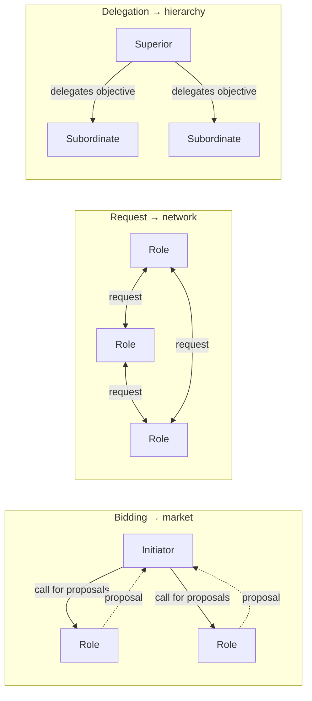
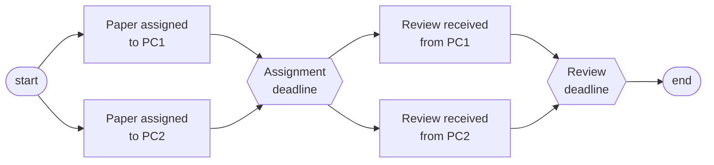
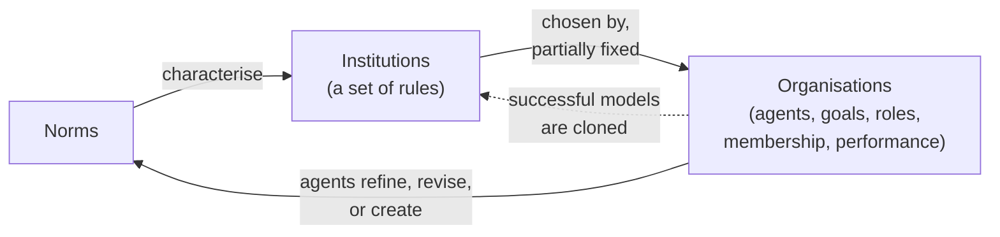

# 04 Multiagent Organisations

Sources:

- Weiss (ed.), *Multiagent Systems*, 2nd ed., 2013, Chapter 2 "Multiagent Organizations" by Virginia Dignum and Julian Padget. Primary source for this topic.

[01](01-setting-the-scene.md) and [02](02-agent-architectures.md) covered the micro problem: how to build one agent. This topic covers part of the macro problem from [01 section 3](01-setting-the-scene.md#3-the-two-central-problems-micromacro): how to get a society of agents to serve goals that none of them holds on its own.

Dignum and Padget's answer is the organisation. It is an entity separate from the agents in it, with its own goals, roles, and rules. A university is their example. It has goals (a place of learning), plans (admitting students), and a design (departments and positions), but it cannot do anything by itself. It depends on the people who fill its positions, and they depend on it to award their degrees.

Each section below states the classical concept, then its relevance to agentic AI.

## 1. Why Organisations

### 1.1 The commons problem

A MAS is often more than the sum of its agents. Dignum and Padget's example is a shared Internet connection. If every agent maximises its own access, bandwidth collapses for all of them. Something has to organise the agents: equal time slots, pay per minute, or a rota. That organisation may emerge from the agents' interactions, but often it is designed and imposed.

The organisation also makes the agents simpler. Knowing its role, an agent knows what others expect of it and what it can expect of them, which reduces uncertainty.

### 1.2 Agent-centric versus organisation-centric

| Approach | Where the organisation lives | Consequence |
|---|---|---|
| Agent-centric | Implicitly inside each agent's code and state. Visible only in the agents' interactions. | Hard to maintain, revise, and scale. A new agent must already know how to interact correctly, so the system is effectively closed. |
| Organisation-centric | In an explicit representation outside the agents: roles, goals, and rules. | New agents can read and reason about the organisation, so the system can be open. |

Organisation-centric approaches split into two kinds. **Structural** approaches treat the organisation as a means of coordination toward global goals (section 2). **Institutional** approaches treat it as a set of norms that regulate interaction (section 3). A third view, **emergence**, sees organisation as the observed result of simple agents interacting locally, often through the environment (stigmergy), with no design at all.

Structure has costs as well as benefits. It scopes interactions, reduces uncertainty, and manages redundancy. It also adds computation and communication overhead, reduces flexibility, and adds a layer of complexity.

**Agentic AI relevance.** Most multi-agent LLM systems are agent-centric. The organisation is spread across each agent's system prompt: the orchestrator's prompt says which subagents exist and when to call them, and each subagent's prompt describes its job. Nothing outside the prompts states the organisation's goals or rules, so a new agent cannot join without someone editing prompts. Role-based frameworks and declarative subagent definitions move part of the organisation into explicit configuration.

### 1.3 Three sources of inspiration

**Organisation as structure (organisation theory).** Structure exists to move information so decisions are made with less uncertainty, and to coordinate the parts. Mintzberg classifies organisations by the complexity of their environment and how fast it changes. Each form uses a different coordination mechanism.

| Form | Complexity | Pace of change | Coordination mechanism |
|---|---|---|---|
| Machine bureaucracy | Low | Low | Standardised procedures and outputs |
| Professional organisation | High | Low | Standardised skills and norms |
| Entrepreneurial startup | Low | High | Direct supervision and control |
| Adhocracy | High | High | Mutual adjustment in ad hoc teams |

Organisation theory's main contribution to MAS is separating collective concerns from individual ones. Horling and Lesser compare the forms used in MAS: hierarchies, coalitions, teams, federations, markets, and societies.

**Organisation as institution (social science).** A *norm* is a rule of conduct that links a group's abstract values to concrete behaviour. An *institution* is, in Ostrom's words, the "rules-in-use" that structure organisations and activities, or in North's, "the rules of the game in a society". In MAS, institutions are coordination artefacts outside the agents that regulate interactions in which agents make commitments, and help ensure those commitments are kept.

**Organisation as agent (economics).** An organisation can itself act in its environment. Agency theory, the principal-agent problem, studies delegation under incomplete and asymmetric information. It identifies two problems. First, the principal's and agent's goals may conflict, and the principal cannot cheaply check what the agent actually did. Second, they may have different attitudes to risk.

**Agentic AI relevance.**

- Mintzberg's table is a guide for choosing an LLM system's shape. A stable, simple task suits a fixed workflow (standardised procedures). A changing, complex task suits a team of agents that adjust to each other (adhocracy), at the cost of predictability.
- The principal-agent problem is the delegation problem in agentic AI. The owner cannot cheaply check what the agent did, which is why agents produce logs, traces, diffs, and summaries for review. The MoltMatch incident in [03 section 3](03-agent-landscape-2026.md#3-open-self-interested-mas-arrives) is an agent acting outside what its principal intended.

## 2. Autonomy versus Regulation

An organisation needs stability, predictability, and commitment to its aims. Autonomous agents pursue their own goals in their own way. Organisations cannot assume their agents will act as the organisation needs, just as MAS cannot assume agents will coordinate. In an open system, the organisation cannot inspect agents' internals or verify their aims, so it must secure its goals without relying on how agents are built.

Dignum and Padget state two requirements for an organisation framework in an open context:

1. **Internal autonomy.** The organisation's structure and interactions are described independently of the agents' internal design.
2. **Collaboration autonomy.** Interactions are specified without fixing every possibility in advance.

The second requirement is a trade-off. A more detailed specification lets more properties be checked and guaranteed at design time, but leaves agents fewer ways to reach the goal. A more abstract specification gives flexibility but demands more reasoning from agents, which must interpret it and decide how to coordinate. Choosing the level of detail is how the designer regulates agent autonomy.

**Agentic AI relevance.** This is the choice between a scripted workflow and an autonomous agent. A scripted pipeline of LLM calls is a detailed specification: predictable and testable, but brittle when something unexpected happens. An agent given a goal and tools is an abstract specification: flexible, but its path cannot be checked in advance. Most production systems sit between the two.

## 3. Structure: Roles, Dependencies, and Scenes

### 3.1 Organisation concepts

Organisational structure is "what persists when components or individuals enter or leave an organization". It is the collection of roles, relationships, and authority structures that govern behaviour. A *role* describes the capabilities, objectives, rights, and obligations of a position. A *concrete organisation* is one instance of a structure, with roles filled by specific agents, humans, or systems.

Any model of an organisation must represent three things.

1. **Environment.** The space the organisation exists in, which it cannot fully control. It is characterised by volatility, scarcity, unpredictability, and task complexity.
2. **Agents.** The entities that act and reason, defined by their capabilities.
3. **Structure.** Objectives, roles, relationships, and strategy. It varies in size, degree of centralisation, and formality.

### 3.2 The OperA framework

OperA is one organisation modelling language. Others include Tropos, MOISE, and ORG4MAS. OperA has three models:

1. The **Organisation Model** describes the desired behaviour: objectives, norms, roles, interactions, and ontologies.
2. The **Social Model** maps roles to actual agents through *enactment contracts*.
3. The **Interaction Model** describes the run-time interactions between role-enacting agents.

The chapter's running example is a conference: authors submit papers, a programme committee (PC) reviews them, a PC chair decides, and an organiser runs the event. Norms include submitting before the deadline and not reviewing your own paper. A role in OperA has an identifier, objectives, sub-objectives, rights, and norms. Weiss's Table 2.2 defines the PC member role:

| Field | PC member |
|---|---|
| Objective | `paper_reviewed(Paper, Report)` |
| Sub-objectives | Read the paper, write the report, have the report received by the organisation |
| Rights | Access the conference management system |
| Norms | Obliged to understand English. Obliged to review before the deadline. Forbidden to review a paper by a colleague. |

### 3.3 Role dependencies

Roles depend on each other for objectives. The PC chair depends on PC members for `paper_reviewed`. How the objective passes from one role to the other depends on the dependency type, and each type produces a different organisational form.

*Three dependency types. In bidding, the dependent role asks for proposals and picks the best. In a request, roles cooperate as peers. In delegation, the dependent role hands responsibility for the objective to subordinates.*

### 3.4 Scenes and landmarks

Interaction is divided into *scenes*, such as paper submission or the review process. A *scene script* names the roles involved, the desired results, and the norms. For the review scene, the PC chair is permitted to assign papers, and an assigned PC member is obliged to review before the deadline.

Scene scripts are declarative. They describe the interaction with *landmarks*, states that must hold, partially ordered, rather than exact message sequences. Many concrete protocols satisfy one landmark pattern, so agents choose their own actions to reach each landmark. An *interaction structure* orders the scenes, allows several to run at once, and records how roles change between scenes. For example, accepted authors become participants.

*The landmark pattern for the review scene, after Weiss Figure 2.5. Each box is a state to reach, not an action to take. The two reviewers' landmarks are unordered with respect to each other.*

### 3.5 Norms and communication

Norms are stated in a deontic logic: obligations, permissions, and prohibitions that are temporal, tied to roles, and conditional. For example, authors are obliged to submit before the submission deadline. Abstract norms are refined step by step into concrete rules, violations, and sanctions that can be checked. The *counts-as* relation links them, for example "submitting through the web form counts as submitting".

The communication structure fixes *what* agents talk about, through domain ontologies, and *how*, through agent communication languages with performatives and protocols.

**Agentic AI relevance.**

- An OperA role definition maps to a subagent definition. A subagent's name, description, allowed tools, and system prompt correspond to the role's identifier, objectives, rights, and norms. What LLM systems usually lack is the Social Model, an explicit contract recording which agent plays which role and on what terms.
- Separating the role from the agent means the same role can be filled by a different model. The organisation's goals still hold, but enactment differs, so results differ. Swapping a model behind a role is a change to the Social Model, and it should be tested as one.
- Delegation, and so hierarchy, dominates multi-agent LLM systems: an orchestrator hands tasks to subagents. Requests between peers appear in agent-to-agent protocols such as A2A. Bidding is rare. [R6](../research/README.md) explores it.
- Landmarks are how LLM agents are usually directed: goals and acceptance criteria, such as "the tests pass", rather than step-by-step scripts. A plan or to-do list is the agent's own landmark pattern. Landmarks give agents freedom while keeping checkpoints that can be verified.

## 4. Institutions: Norms, Permission, and Power

### 4.1 Norms, institutions, and organisations

Institutions are sets of norms. They underpin organisations by stating, outside the agents, the rules that govern behaviour.

*After Weiss Figure 2.7. A set of norms characterises an institution, such as a bank or a university. An organisation adopts an institution and fixes parts of it to suit its goals. Agents in the organisation change the norms over time, and successful organisational models become new institutions.*

An agent is usually subject to several institutions at once. They are designed independently, so their norms will sometimes conflict. In the worst case every available action violates a norm in one of them. Agents therefore need to be able to work out the consequences of an action before taking it.

### 4.2 Regimented versus regulated norms

| View | How norms work | Example | Trade-off |
|---|---|---|---|
| Regimented | Norms are constraints. Forbidden actions are impossible. | A metro gate that will not open without a ticket. | Easy to implement. Severely limits autonomy. |
| Regulated | Agents can violate norms. An institution monitors compliance and applies sanctions, and agents reason about whether to comply. | A fine for travelling without a ticket. | Preserves autonomy. Needs monitoring, enforcement, and agents that can reason about norms. |

A related device is the *governor*: an interface between an agent and the organisation that blocks any action the agent's role does not allow. It guarantees compliance, but it is rigid and hides the agent, so only the role's behaviour is visible.

### 4.3 Events, states, and counts-as

An institution can be modelled as a second state machine running alongside the environment. Agents' actions are events that change the environment. Some of those events are recognised as *institutional events*, and these change the *institutional state*: a set of facts about who holds which obligations, permissions, and powers. Interpreting a physical action as an institutional one is called *conventional generation*. The program chair clicking "close" counts as closing submission.

The institutional trace lets you ask not only "where are we?" but "how did we get here?"

Three kinds of institutional fact constrain action:

1. **Obligation.** A principal must bring about some state of affairs. Being assigned a paper creates an obligation to deliver a review before the review deadline. Delivering it discharges the obligation, and missing the deadline generates a violation event.
2. **Permission.** Whether an action is correct for this principal in this state. An action without permission is a violation, though some violations are benign and can be ignored.
3. **Power.** Whether an action counts as an institutional action at all. The program chair is empowered to close submission, but only after it has opened. A PC member performing the same action has no institutional effect.

### 4.4 InstAL

InstAL is an action language for specifying institutions, compiled to Answer Set Programming. It defines a normative system as events (exogenous, institutional, and violations), fluents (power, permission, obligation, and domain facts), a *generation relation* that maps real events to institutional events, and a *consequence relation* that adds and removes fluents. A specification can be used to check static properties, such as which states are reachable, or coupled to an agent-based simulation to explore emergent behaviour.

**Agentic AI relevance.**

- Agent permission systems are regimented norms. A sandbox that blocks a command makes it impossible, like the metro gate. Rules in a system prompt or `AGENTS.md` are regulated norms with no enforcing institution: the model can violate them and usually nothing records it. Production systems combine both, a pattern that [02 section 4](02-agent-architectures.md#4-layered-architectures) calls a censor layer. Gateways and runtimes such as NVIDIA's OpenShell act as governors.
- Permission and power are different, and agent systems often conflate them. An agent may be *permitted* to send a message for its owner, but whether that message *counts as* the owner's commitment, such as accepting a contract or a date, is a question of power. Agent identity and registry services ([03 section 4](03-agent-landscape-2026.md#4-product-features-mapped-to-concepts)) are the first step toward recording who is empowered to do what.
- An LLM agent is subject to several institutions at once: vendor policy, organisation policy, project instructions, user instructions, and the instructions inside any skill or tool output it reads. These are written independently and can conflict. Prompt injection is an untrusted source posing as an institution.
- The institutional trace corresponds to an agent's audit log. Session traces answer "how did we get here?", but they record environment events, not obligations, permissions, and violations. Obligations with deadlines and violation events are a more precise model for agent tasks with time limits than free-form logs.

## 5. Agents in Organisations

From the organisation's view, it often does not matter which agent fills a role, provided it has the capabilities. From the agent's view, a role description states what is expected, and the agent must decide whether to take it and how to enact it. *Organisation-aware agents* read the organisation's specification, reason about whether they can and want to play a role, and negotiate their participation. Dignum and Padget call this an open research problem.

A role-enacting agent must be able to:

1. Perform the role's functions and use the role's resources.
2. Communicate with other roles on the role's behalf.
3. Reason about which of its own plans achieve the role's objectives.

Agents enact roles differently depending on their social attitude. With a **social** enactment strategy, the agent pursues the role's objectives before its own goals. With a **selfish** strategy, it does the reverse. Many mixtures are possible, and each gives the organisation different performance.

**Agentic AI relevance.**

- Most LLM agents follow a social enactment strategy within one organisation: they are trained to adopt the task they are given. A personal agent acting for its owner inside someone else's system, such as an OpenClaw agent on Moltbook, is selfish relative to that system. Its owner's goals come first.
- Agent cards in A2A describe what an agent can do, which is the information an organisation needs to assign roles. The reverse step, an agent reading a role and deciding whether to accept it, is rarely implemented. [R7](../research/README.md) explores an agent that can decline.

## 6. Evolution of Organisations

Organisations exist partly to provide stability, but their agents, goals, and environments change. Reorganisation is worth doing when the new structure's gain in utility exceeds the cost of the change. *Dynamic adaptation* changes a system while it runs: adding, removing, or replacing agents, or changing roles, relationships, norms, and interactions.

Human organisations cycle between explicit and implicit structure. Formal rules give way to informal practices that individuals develop to cope, and those practices in time become part of the fixed rules.

Bottom-up organisation suits common-pool resources, where many participants share a resource that any one of them can exhaust. Ostrom's Institutional Analysis and Development framework studies how communities have designed their own rules for such resources. Those self-designed rules are often more stable and resilient than imposed ones.

The chapter ends with two open problems: organisation-aware agents (section 5), and mixed teams of people and artificial agents. For mixed teams it cites *teamwork-centred autonomy*: when people work alongside autonomous systems, understanding, problem solving, and execution are incremental, open to negotiation, and always tentative.

**Agentic AI relevance.**

- Shared rate limits, token budgets, and a shared repository are common-pool resources for a team of agents. Each agent consuming as much as it can degrades the others, as in the shared Internet connection example.
- The explicit/implicit cycle describes how agent instructions grow. Workarounds that agents or users discover become rules in `AGENTS.md`, `CLAUDE.md`, or a skill, and later need revising when the environment changes.
- Teamwork-centred autonomy describes a coding agent working with a developer: plans change in response to the human, and the agent's work stays open to revision.

## Key Takeaways

1. An organisation is an entity separate from its agents, with goals none of them holds. Making it explicit, outside the agents, is what allows an open system.
2. Most multi-agent LLM systems are agent-centric: the organisation is spread across system prompts. Subagent definitions and role-based frameworks are a partial move to an explicit organisation.
3. Separating roles from the agents that fill them lets the organisation's goals be checked independently of the agents. Swapping the model behind a role changes how the role is enacted.
4. Dependency types produce organisational forms: bidding gives markets, requests give networks, and delegation gives hierarchies. LLM systems are mostly hierarchies.
5. A more detailed specification gives more guarantees and less autonomy. Landmarks, states to reach rather than steps to take, keep checkpoints while leaving agents free to choose how.
6. Regimented norms, such as sandboxes, make violations impossible. Regulated norms, such as prompt rules, rely on compliance and need monitoring. LLM systems need both.
7. Permission is not power. Being allowed to act for an owner is different from that action counting as the owner's commitment.
8. Agents are subject to several institutions at once, and their norms will conflict. Prompt injection is an untrusted source posing as an institution.
