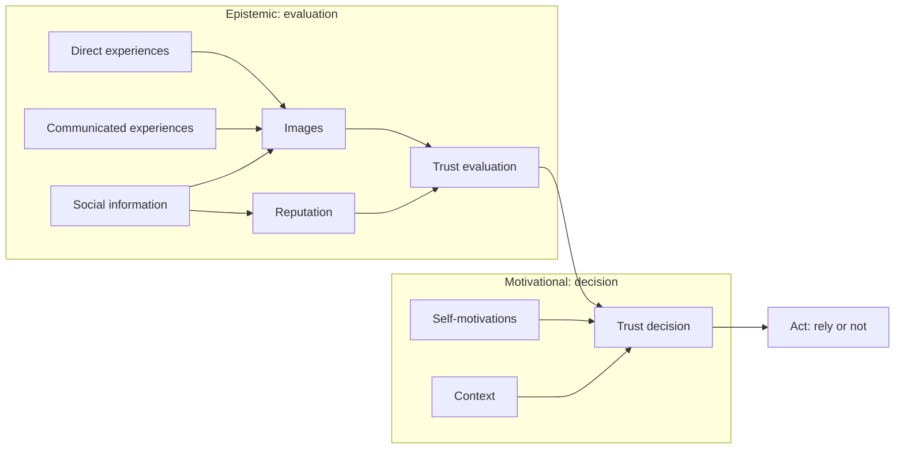

# 05 Trust and Reputation

Sources:

- Weiss (ed.), *Multiagent Systems*, 2nd ed., 2013, Chapter 9 "Trust and Reputation in Multiagent Systems" by Jordi Sabater-Mir and Laurent Vercouter. Primary source for this topic.

[04](04-multiagent-organisations.md) covered control through organisations and institutions: rules stated outside the agents and enforced by the system. This topic covers the other kind of control in an open MAS, where agents watch and judge each other. [03 section 3](03-agent-landscape-2026.md#3-open-self-interested-mas-arrives) recorded what happened in 2026 when agents with different owners met without it.

Each section below states the classical concept, then its relevance to agentic AI.

## 1. Why Trust and Reputation

Autonomy is what makes agents useful, and it also makes them a risk. An agent in an open system cannot assume that others follow the same code of conduct or share its interests.

Computer security addresses part of this. Cryptography, public-key infrastructure, and trusted platforms guarantee properties such as authentication and message integrity. They cannot tell an agent whether a message is true or whether a service was delivered as promised. They also need a few trusted third parties to issue keys and credentials, which conflicts with decentralisation and openness.

Rasmusson and Jansson proposed **soft security** for this gap: social control mechanisms that do not prevent every bad event, but adapt the system so the same bad event is less likely to happen again. Trust and reputation are the soft security that human societies have long used.

They serve two purposes:

1. **Locally**, an agent uses them to decide whom to interact with.
2. **Globally**, they act as social control. Agents supervise each other, and the threat of being distrusted and excluded deters bad behaviour.

**Agentic AI relevance.** Agent platforms in 2026 rely mostly on hard security: sandboxes, signed identities, and malware scanning of skills. These answer "who wrote this?" and "does it contain known malware?" They do not answer "are this skill's instructions honest?" or "is this tool output true?". Prompt injection succeeds in that gap: a message can be authentic and still lie.

## 2. Representing Trust and Reputation

There is no single representation. Simpler ones are easier to compute with. More expressive ones support richer reasoning but cost more.

| Representation | Example | Strength | Weakness |
|---|---|---|---|
| Boolean | trustworthy / not | Simplest | Trust is a matter of degree. Not usable for reputation. |
| Number | 0.4 in [−1, 1] or [0, 1] | Easy to compute and compare. By far the most used. | Meaning is local. One agent's 0.6 is very good, another's is merely acceptable, so values cannot be exchanged. |
| Qualitative label | {bad, neutral, good} | Shared meaning, readable by humans | Loses fine comparisons. Agents must share the label set. |
| Probability distribution or fuzzy set | 75% very bad, 25% bad | Can express polarised behaviour (always very good or very bad, never in between) and unpredictability | Needs more computation and storage. |
| Belief | `OccTrust(i, j, α, φ)` | Fits BDI reasoning directly | Must define the belief's content and link it to the data behind it. |

Two points from this section apply throughout.

1. **Trust is relative to an action and a goal.** Castelfranchi and Falcone's definition: agent *i* trusts agent *j* to do action *α* in order to achieve goal *φ*. I may trust a student to write a good paper but not to cook a good meal.
2. **A value needs a reliability measure.** A trust or reputation value is only as good as its basis. Reliability depends on the number of opinions, their variance, how recent they are, and how credible their sources are.

**Agentic AI relevance.**

- Registry signals such as stars, download counts, and rankings are single numbers without a reliability measure or a stated context. A skill with many downloads may be trusted to format documents and still be untrustworthy with shell access. Trust per action and goal maps to scoped permissions: trusting a tool for one capability, not in general.
- An agent's memory, for example `MEMORY.md` or a consolidated memory store, is where trust beliefs about tools, sources, and other agents would live. In current agents such entries are rare and informal.

## 3. Trust

### 3.1 Trust as evaluation and as decision

Gambetta's definition is the most widely used: "trust is the subjective probability by which an individual, A, expects that another individual, B, performs a given action on which its welfare depends." That is trust as an **evaluation**, a prediction.

Castelfranchi and Falcone add trust as an **act**: the decision to rely on someone. Most computational models compute evaluations and neglect the decision.

*The dual nature of trust, after Weiss Figure 9.4. An image is the agent's own evaluative belief about a target. Reputation is what the group says about it. The decision also weighs what is at stake and the current context.*

### 3.2 Sources of images

1. **Direct experiences** of interacting with the target. Usually the most reliable source, provided the agent perceives its own interactions correctly.
2. **Communicated experiences** reported by other agents. They add evidence but may be false, or judged by different satisfaction criteria.
3. **Social information**: the target's position, relationships, or role.

Communicated experiences need care. Selfish agents have no reason to share honest opinions, and a group of malicious agents can recommend each other. An agent therefore also rates its informers, by comparing their reports against its own direct experience, and weights their reports accordingly.

The **correlated evidence problem** arises when several agents report the same interaction. The receiver cannot tell, so one event looks like many. One remedy is to find clusters of closely connected agents and ask only one member of each.

### 3.3 From evaluation to decision

Images are computed by aggregation: a simple or weighted average (weighted by recency and source credibility), counts mapped to labels, or the distance between the observed outcomes and an ideal distribution. A model with beliefs instead derives trust logically. **Dispositional trust** states the conditions under which a target is trusted: the target intends to act as expected and is able to. **Occurrent trust** is trust here and now. It follows when the agent currently has the goal and believes the conditions hold.

The simplest decision compares a trust value with a threshold. Marsh and Briggs use two thresholds, giving three outcomes: trust, distrust, or uncertain. The threshold should rise with the stakes. The decision also depends on context. Sabater-Mir and Vercouter's example: a good mechanic with a long queue is the wrong choice when the car is needed urgently.

Models differ so much that they are hard to compare or connect. The ART testbed (2005-2008) compared them in competitions. The best models did well in its scenario, but why they did well could not be explained or carried to real applications.

**Agentic AI relevance.**

- Most LLM agents never make an explicit trust decision. A tool result, web page, file, or subagent report enters the context and is treated as true by default. The evaluation-then-decision process is missing, which is why prompt injection works.
- Two thresholds with an "uncertain" outcome describe a useful agent behaviour: act on trusted input, refuse distrusted input, and ask the human when uncertain. Raising the threshold with the stakes is the same idea as requiring approval for destructive actions.
- The correlated evidence problem appears when an agent researching a question finds many web pages that copy one source. Agreement among them is not independent confirmation.

## 4. Reputation

### 4.1 Definition

Sabater-Mir and Vercouter define reputation as "what a social entity says about a target regarding his or her behavior". Each part of the definition matters.

- **A social entity** is a group, not an individual. The speaker passes on the group's judgement and takes less personal responsibility, so is less afraid of retaliation and more willing to spread it.
- **Says**, not believes. Reputation exists only when evaluations are communicated. The speaker may not believe what it passes on.
- **Regarding behaviour.** Reputation is always about a specific behaviour, even when that is left unstated.

Reputation is distinct from a shared image. Several agents can hold the same opinion of a target, but it becomes reputation only when it is communicated and attributed to the group.

### 4.2 Sources of reputation

| Source | What it is | Note |
|---|---|---|
| Communicated images | Aggregating what members of the group say about their own evaluations | Most common. Few models check whether the speakers represent the group. Many give a value from the first report. |
| Communicated reputation | Third parties stating what the reputation is | The speaker only passes the value on and commits less to it. |
| Inherited reputation | Reputation taken from the target's role, relationships, or structure | A new institute director is assumed to be a good researcher. A paper inherits its journal's reputation. A default until better evidence arrives. |

The ReGreT model combines four sources (witness, neighbourhood, system, and default reputation) as a weighted sum. Weights come from each source's reliability and a fixed preference order. A fixed order is a weakness: if witnesses start lying, the agent should shift weight to other sources.

### 4.3 Centralised versus decentralised

| | Centralised | Decentralised |
|---|---|---|
| How it works | A central service collects evaluations and publishes a reputation value. | Each agent gathers evaluations and computes reputation itself. |
| Strengths | Uses everyone's information, so a few bad reports matter less. Newcomers benefit immediately. | No central party to trust. No bottleneck, so it scales. Each agent chooses its own method. |
| Weaknesses | Everyone must trust the service to be impartial. Ignores individual preferences. Bottleneck and single point of failure. Fear of retaliation makes ratings too positive. | Slow to gather enough information, hard for newcomers. Needs more capable agents. |
| Examples | eBay, review sites. Humans read the comments alongside the score. | ReGreT, TRAVOS, FIRE |

Reputation has two uses. It is a **source of trust**, usually when direct experience is missing. It also maintains **social order**: agents that follow the norms get more opportunities to interact, and those that break them are excluded.

**Agentic AI relevance.**

- Skill registries, MCP server registries, and agent registries are centralised reputation systems, with all the weaknesses in the table. Users must trust the registry's ranking, and the registry is a single target for manipulation. ClawHub's top-ranked malicious skill had a gamed ranking.
- Inherited reputation is how agents and users mostly trust tools today: a skill or MCP server from a known vendor or verified publisher inherits that publisher's reputation. The classical advice is to treat it as a default and replace it with experience.
- An agent has no decentralised reputation of its own. It does not remember which tools, sources, or agents failed it in past sessions unless the user writes that down.

## 5. Attacks on Reputation

| Attack | How it works | Countermeasure |
|---|---|---|
| Unfair ratings | Deliberately false feedback: badmouthing a good agent or praising a bad one. | Weight informers by their past accuracy. |
| Ballot-stuffing | Submitting more feedback than real interactions. | Filter suspected sources. Use feedback per interaction, not accumulated totals. |
| Dynamic personality | Build a high reputation, then exploit it. In *value imbalance exploitation*, many cheap honest services earn reputation and a few valuable ones defraud. | Limit how far back history counts, shortening the window when reputation drops. Weight feedback by the value of the service. |
| Whitewashing | Change identity to escape bad feedback, often helped by colluders' unfair ratings. | None given in the chapter. Costly identities are the usual remedy. |
| Collusion | A group cooperates to boost other attacks. Not an attack by itself. | Look for small groups that consistently recommend each other against everyone else's view. Hard without a global view. |
| Sybil | Create many fake identities to outvote honest agents, for example to boost one's own reputation. | None given in the chapter. Costly identities are the usual remedy. |
| Reputation lag | Exploit the delay before reputation reflects new behaviour: behave well, defraud while the score is high, recover, repeat. | Faster reaction to behaviour change. Detect cyclic patterns. |

Defences produce false positives. Combined with collusion, unfair ratings can make honest ratings look unfair. The chapter advises waiting for several independent signals before acting, balanced against the cost of waiting.

**Agentic AI relevance.**

- Dynamic personality and reputation lag describe a software supply chain attack: publish a useful skill or package, build downloads and trust, then ship a malicious update before the reputation reacts. Pinning versions and reviewing updates are the countermeasure of not letting past reputation cover new behaviour.
- Whitewashing and Sybil attacks are cheap where publishing needs only a free account. Republishing a removed skill under a new name is whitewashing.
- Agents are themselves raters. An agent that installs, recommends, or rates skills on its owner's behalf can be steered by prompt injection into unfair ratings or ballot-stuffing at machine speed.

## 6. Connections to Other Agreement Technologies

**Argumentation.** Arguments can justify a reputation value: "I rate this seller badly because a reliable informer said so." Abstract arguments let an agent explain its judgement without disclosing private data. In reverse, trust in a speaker decides whether to accept its argument. The chapter notes that a trustworthy sender's information may be accepted even when it contradicts what the agent knows.

**Negotiation.** Trust negotiation, from computer security, exchanges credentials to establish trust in proportion to the risk of the transaction, ideally disclosing the minimum. Trust models also rate partners as negotiators.

**Norms.** Tuomela distinguishes rules (hard constraints, enforced by institutions), social norms (shared group preferences), and personal norms (individual expectations). Institutions need intrusive control and trusted third parties. Where that is not possible, trust and reputation enforce norms socially. The gap between a contract and its outcome becomes an experience that feeds trust.

**Organisations.** Reputation can be attached to a group, and an agent can have different reputations in different groups. Trust can be attached to roles, so an agent can be judged before any interaction by the role it plays. This requires roles to be explicit, as in [04 section 3](04-multiagent-organisations.md#3-structure-roles-dependencies-and-scenes).

**Ontologies.** Agents with different trust models cannot use each other's values without a shared ontology. Even then, subjectivity remains: an outcome that is good for one agent can be bad for another. Agents may need to align their models, or argue about values, before using each other's evaluations.

**Agentic AI relevance.**

- The argumentation point names the danger in LLM agents directly. Trusting a source enough to accept information that contradicts what the agent knows is how a trusted-looking tool output or file overrides an agent's instructions.
- Trust negotiation with minimal disclosure applies to agent-to-agent protocols. An agent asked for credentials or user data should disclose only what the transaction's risk warrants.
- Role-based trust needs explicit roles. Agent cards and registries describe capabilities, which is a step toward roles that trust can attach to.

## 7. Open Problems

The chapter's conclusions list three directions that apply directly to LLM agents.

1. **Cognitive models alongside numbers.** Statistical models predict well. Socio-cognitive models explain why a value is what it is, which humans need in order to understand and rely on an agent's judgement. The authors see the two as complementary.
2. **Integrated, proactive trust.** A trust module that only answers queries is not enough. It should justify its values, take part in decisions, and act to improve what the agent knows about others.
3. **Interoperability.** Agents with different models must exchange trust information meaningfully.

[R10](../research/README.md) on the research backlog studies trust in skill supply chains.

## Key Takeaways

1. Hard security proves who sent something and that it was not altered. It cannot prove the content is true or the service honest. Trust and reputation cover that gap through soft security: adapting rather than preventing.
2. Trust is relative to an action and a goal, and a trust value needs a reliability measure. A single registry score has neither.
3. Trust has two parts, an evaluation and a decision. LLM agents usually skip the decision and accept whatever enters their context, which is why prompt injection works.
4. Reputation is what a group says, not what anyone verified. Inherited reputation, from a vendor or publisher, is a default to be replaced by experience.
5. Centralised reputation, as in skill and agent registries, helps newcomers but is a single point of trust and manipulation.
6. The classical attacks are the attacks on agent ecosystems: gamed rankings, Sybil accounts, whitewashed republishing, and malicious updates that exploit reputation lag.
7. Agents need memory of whom and what they have trusted, and how that turned out. Today that lives only in what the user writes down.
