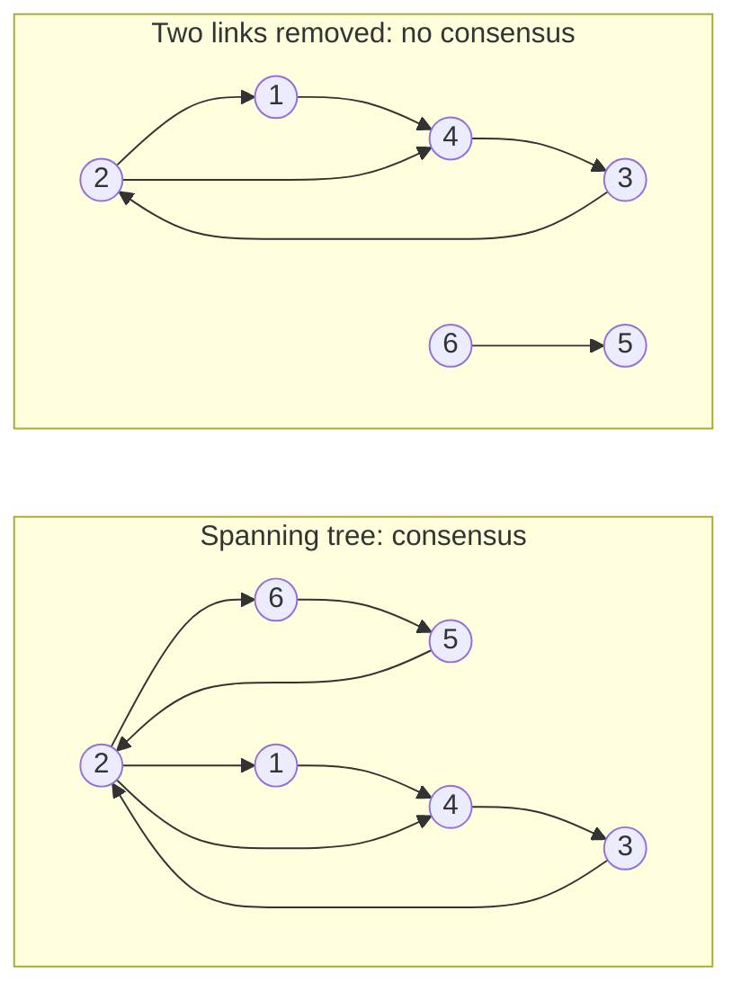
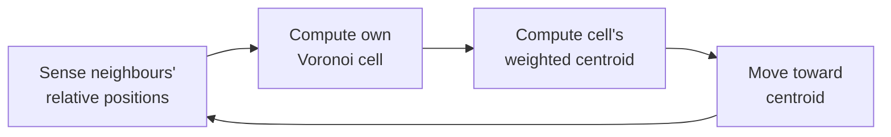
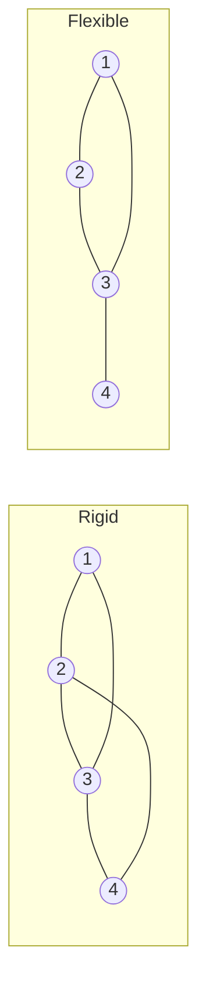

# 06 Control of Cooperative MAS

Sources:

- Nagahara, Azuma, and Ahn, *Control of Multi-agent Systems*, 2024, Chapters 3 (Consensus Control), 4 (Coverage Control), and 5 (Formation Control). Primary source for this topic.

[01 section 10](01-setting-the-scene.md#10-a-control-theory-view-nagahara-azuma-and-ahn) introduced the control-theory view: a MAS is dynamics (how each agent's state changes), a network (which agents interact), and control (each agent's local rule). It noted that this view designs the communication topology and proves that agents converge. This topic covers the three basic problems the book uses to show how.

All three are team MAS in the sense of [01 section 7.2](01-setting-the-scene.md#72-two-definitions-compared): every agent serves one global goal. All three follow one recipe:

1. State the global goal as a function to minimise: disagreement, uncovered area, or constraint error.
2. Give each agent a rule that uses only information from its neighbours, usually their positions or values relative to its own.
3. Prove that when every agent follows its local rule, the group reaches the global goal, and state what the network must look like for that to hold.

Each section below states the classical concept, then its relevance to agentic AI. Section 4 states what carries over and what does not.

## 1. Consensus: Agreeing on a Value

### 1.1 The problem

Each agent *i* holds a state *x_i*, such as a sensor reading, an estimate, or a position. *Consensus* means all states converge to the same value. The target value defines the type.

| Type | Consensus value | Typical use |
|---|---|---|
| Average | Mean of the initial values | Fusing readings from distributed sensors |
| Geometric mean | Geometric mean of the initial values | Statistical processing of positive readings |
| Maximum, minimum | Largest or smallest initial value | Agreeing on an extreme, such as the worst case |
| Leader-follower | The leader's initial value | A leader distributing a command to all agents |

### 1.2 The controller

The basic consensus controller is one line: each agent moves its value toward its neighbours' values, by the sum of the differences.

*u_i = Σ over neighbours j of (x_j − x_i)*

An agent only needs relative information: how far each neighbour is from it. It does not need the global state or a central coordinator.

### 1.3 When it works

Whether the group reaches consensus depends on the network, not on the agents.

1. **Directed network.** The group reaches consensus if and only if the network has a spanning tree: some agent's information can reach every other agent along directed links.
2. **Undirected network.** The group reaches consensus if and only if the network is connected, and the result is always the average.
3. **Where it converges.** For a directed network, the consensus value is a weighted average of the initial values. The weights come from the network structure, so some agents have more influence than others. If every agent has equal in-degree and out-degree (a *balanced* network), the weights are equal and the result is the average.

*After Nagahara et al. Figure 3.1. An arrow from j to i means i uses j's value. On the left, information from every agent reaches every other, and the six agents agree. On the right, removing the links 5→2 and 2→6 cuts the group in two. Agent 6 never hears from the others and the others never hear from 6, so no common value is reached.*

### 1.4 How fast

For an undirected network, convergence speed is set by the *algebraic connectivity*, the second smallest eigenvalue of the graph Laplacian. Disagreement shrinks at least as fast as e^(−λ₂t). Adding links raises λ₂. In the book's example, a six-agent network has λ₂ = 1. Adding two links raises it to 1.382, and removing one lowers it to 0.486. A denser network converges faster but costs more communication.

Two further results:

- **Discrete time.** For agents that update in steps, the same results hold if the step size is below 1 divided by the largest number of neighbours any agent has. Larger steps can overshoot.
- **Gradient view.** On an undirected network, the controller minimises total disagreement, half the sum of squared differences across links. The sum of all values never changes, which is why the result is the average.

The book points to extensions for time-varying networks, quantised communication, and malicious agents.

**Agentic AI relevance.**

- Multi-agent debate, where LLM agents read each other's answers and revise their own over several rounds, is a consensus process on text. The theorems apply to linear updates on numbers, not to LLM revisions, but they pose the right questions. Does every agent's view reach every other? Whose view gets the most weight? Does the group converge, and to what?
- Influence follows network structure. In a directed network some agents count for more, and a network where everyone listens to one agent produces leader-follower consensus: the group adopts that agent's view. An orchestrator broadcasting a plan is a leader. A debate where one agent's answer is shown to all others drifts toward that agent.
- More links mean faster agreement and more tokens. Algebraic connectivity measures the trade-off.
- Disconnected groups never agree, and each settles on its own answer. Splitting agents into teams that do not share results produces this.
- Maximum and minimum consensus fit agent questions such as "did any agent find a blocking problem?" or "what is the most conservative estimate?"
- [R2](../research/README.md) tests consensus-style update rules on LLM debate.

## 2. Coverage: Dividing a Space

### 2.1 The problem

*Coverage* means placing agents over a region at a desired density. The book's example is mobile sensors detecting anomalies. A sensor detects less accurately the farther away an anomaly is, and an anomaly costs more in some places than others.

The goal is a function to minimise. For each location, take the nearest agent's performance cost, which grows with distance, and multiply by the location's importance. Sum over the whole region. Two functions define the problem: the *performance function* (how service degrades with distance) and the *weighting function* (how much each location matters).

### 2.2 Voronoi cells

A *Voronoi diagram* divides the region so that each agent gets the cell of locations nearer to it than to any other agent. The cells cover the whole region and do not overlap. Each cell's *centroid* is its centre of mass, weighted by importance.

### 2.3 The controller

With a quadratic performance function, the controller is simple: each agent moves toward the weighted centroid of its own Voronoi cell.

*The coverage loop each agent runs. Each agent needs only its neighbours' relative positions, the region's boundary, and the importance weights inside its own cell.*

Neighbours in coverage are the agents currently visible, so the network changes as agents move. This differs from consensus, where the network was fixed.

The group's motion is a gradient descent on the coverage cost, and it converges to a *stationary point*: a configuration where each agent sits at the centroid of its own cell. This is a local optimum, not necessarily the best possible placement.

The book's application is a *multi-agent display*. Setting the importance weights from an image's darkness, 3000 simulated agents arrange themselves to reproduce a greyscale picture, as in halftone printing.

**Agentic AI relevance.**

- Dividing work among subagents is a coverage problem: a codebase, a search space, or a list of documents to review. Voronoi cells give a rule that produces no gaps and no overlap by construction. Each agent owns the work nearest to it under some distance, such as directory structure or topic similarity.
- The weighting function corresponds to where the work matters most: changed files, high-risk modules, or the parts of a question users care about. Agents concentrate where weight is high.
- Moving toward the centroid is a rebalancing rule. An agent whose region is too large or too important shifts so that load evens out, using only its neighbours' positions.
- Convergence is to a local optimum. A poor initial division may settle into a stable but poor one.
- [R3](../research/README.md) tests coverage-style division of a codebase among subagents.

## 3. Formation: Holding a Shape

### 3.1 The problem

*Formation control* drives agents into a configuration defined by constraints between pairs of agents: a distance, a bearing (direction), or an angle. It has three goals:

1. Every constraint reaches its desired value.
2. The resulting shape is unique, up to moving or rotating the whole formation.
3. Agents use only local measurements, with no central coordinator and no global position.

### 3.2 Rigidity

Meeting every constraint does not guarantee the intended shape. If the constraints are too few, the agents can satisfy them all while the shape bends. Whether a set of constraints fixes the shape is a property of the constraint graph, called *rigidity*.

*Distance constraints shown as links. On the left, every agent is held by enough links that no part of the shape can move without breaking a constraint. On the right, agent 4 has one link and can swing around agent 3 while every constraint still holds.*

Rigidity theory gives tests:

- **Laman's theorem.** In two dimensions, a graph with 2n − 3 distance constraints is rigid if and only if no subgroup of n′ agents has more than 2n′ − 3 constraints among them. This is a purely topological test: count links, without positions.
- **Rank test.** Infinitesimal rigidity can be checked by the rank of a *rigidity matrix* built from a specific configuration.
- **Global rigidity** is stronger. A locally rigid shape can still have a mirror image that satisfies the same constraints. The book's four-agent example has two such shapes.

### 3.3 The controllers

Each controller is a gradient descent on the sum of squared constraint errors. The three types differ in what agents must sense and share.

| Type | Agents control | Agents sense | Shared reference needed |
|---|---|---|---|
| Distance-based | Distances to neighbours | Relative positions in their own frames | None. Agents need not agree on which way is north. |
| Bearing-based | Directions to neighbours | Bearing vectors | A common reference direction. The formation's centroid and scale stay fixed. |
| Angle-based | Distances and angles between incident links (weak rigidity) | Relative positions | Not stated in the chapter |

Convergence is local. For distance-based control, a formation that starts close to the desired shape reaches it. One that starts far away may settle at an undesired equilibrium where the gradient is zero but the shape is wrong. Global convergence is proven only for a few simple graphs.

The book also distinguishes, across all three chapters, *absolute-state* controllers, where agents exchange their actual states by communication, from *relative-state* controllers, where agents measure only differences, for example with onboard sensors.

**Agentic AI relevance.**

- Pairwise agreements between agents, such as an interface contract between two components built by different agents, are formation constraints. Rigidity asks whether the set of pairwise agreements is enough to fix the whole design. If it is not, every agent can meet every agreement while the overall system is still ambiguous.
- Rigidity is a property of the agreement graph and can be checked by counting before any agent runs. The equivalent check for LLM systems would ask whether the agreements between agents pin down the result.
- The shared-reference question applies directly. Some coordination works when each agent has only its own context and compares itself with neighbours. Other coordination needs a shared frame, such as a common spec or shared state. A design should state which it relies on.
- Local convergence to an undesired equilibrium describes agents that settle into a stable but wrong state. Each agent sees no local reason to change, and no single agent can see that the whole is wrong.

## 4. What Carries Over

The guarantees in these chapters are proofs about linear or gradient dynamics on numeric states. LLM agents exchange text and update through a model, so none of the theorems applies to them directly. What carries over is a set of design questions with precise classical answers. Each can be tested for LLM systems.

| Question | Classical answer | Test for LLM systems |
|---|---|---|
| Will the agents agree? | Only if the network has a spanning tree. | [R2](../research/README.md) |
| What will they agree on? | A weighted average, weighted by network position. | [R2](../research/README.md) |
| How fast? | Set by algebraic connectivity. More links mean faster agreement and more messages. | [R1](../research/README.md), [R4](../research/README.md) |
| How to divide the work? | Voronoi cells weighted by importance. No gaps, no overlap. | [R3](../research/README.md) |
| Do local agreements fix the global result? | Only if the constraint graph is rigid. | Not yet on the backlog |
| Will local rules find the global optimum? | Usually only a local one. Starting point matters. | Not yet on the backlog |

## Key Takeaways

1. Control theory solves cooperative MAS problems with one recipe: state the global goal as a function, give each agent a local gradient rule using neighbours' information, and prove convergence.
2. Whether agents reach consensus depends on the network: a spanning tree for directed networks, connectivity for undirected ones. Agents that cannot hear each other, directly or indirectly, never agree.
3. Network position sets influence. A balanced network averages. A network centred on one agent adopts that agent's view.
4. More links mean faster convergence and more communication. Algebraic connectivity measures the trade-off.
5. Coverage divides a space with no gaps and no overlap using Voronoi cells weighted by importance. Agents rebalance using only their neighbours' positions.
6. Meeting every pairwise constraint does not fix the global shape unless the constraint graph is rigid, and rigidity can be checked in advance by counting.
7. Local rules usually converge to a local optimum. A group can settle into a stable but wrong state.
8. The theorems do not transfer to LLM agents, but the questions do, and research items R1 to R4 test them.
