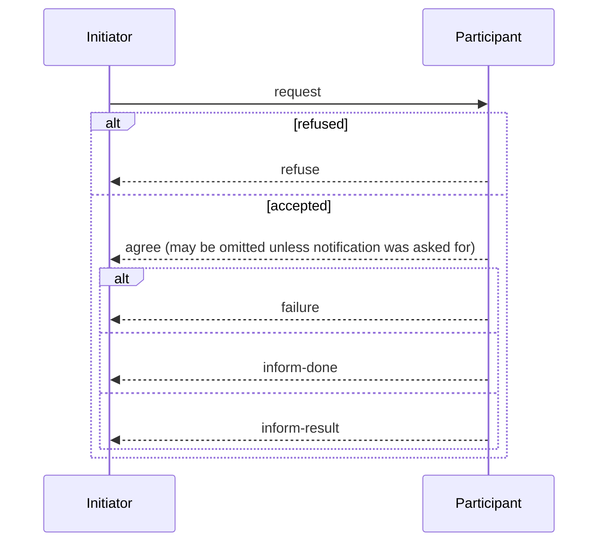
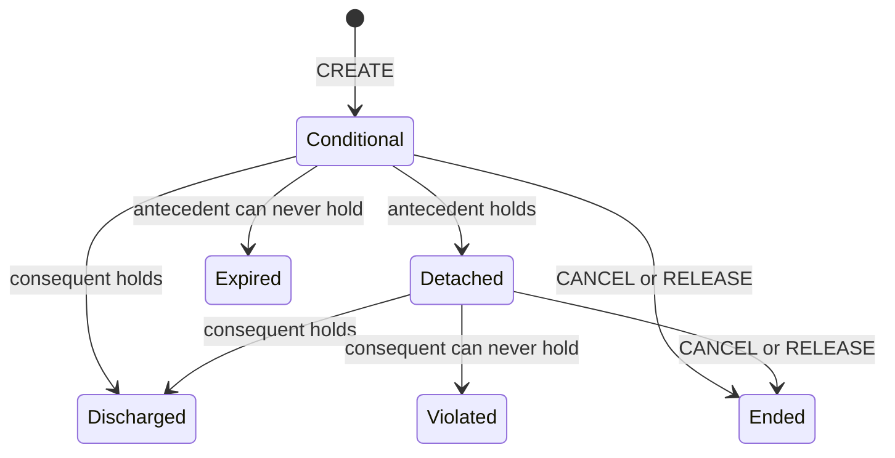
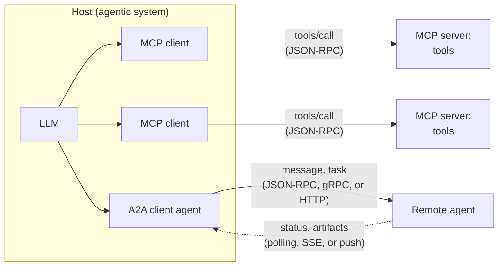

# 07 Agent Communication

Sources:

- Wooldridge, *An Introduction to MultiAgent Systems*, 2nd ed., 2009, Chapter 6 "Understanding Each Other" and Chapter 7 "Communicating".
- Weiss (ed.), *Multiagent Systems*, 2nd ed., 2013, Chapter 3 "Agent Communication" by Amit K. Chopra and Munindar P. Singh.
- Sayfan, *Design Multi-Agent AI Systems Using MCP and A2A*, 2026, Chapter 7 (MCP) and Chapter 8 (multi-agent design and A2A).
- The MCP specification (version 2026-07-28) and the A2A specification (version 1.0.0), checked on 1 November 2026, where they differ from or add to Sayfan.
- For section 7: O'Brien, *Building Complex Multi-Agent Systems Using Patterns*, 2026, Chapters 7, 9, and 10. Dibia, *Designing Multi-Agent Systems*, 2025, Chapters 4 and 14. Rothman, *Context Engineering for Multi-Agent Systems*, 2025, Chapters 2, 5, 7, and 8.

[01 section 9.8](01-setting-the-scene.md#98-protocols) named MCP and A2A, and [04](04-multiagent-organisations.md) and [05](05-trust-and-reputation.md) both stopped at the point where agents need a shared language. This topic covers how agents talk: the classical theory of communication as action, the languages built on it, the debate over what a message means, and how MCP and A2A compare.

Each section below states the classical concept, then its relevance to agentic AI.

## 1. Communication as Action

Wooldridge starts from the difference between objects and agents in [01 section 8.4](01-setting-the-scene.md#84-agents-versus-objects). When object `o2` calls `o1.m1(arg)`, `o2` decides that `m1` runs. `o1` has no say. An agent cannot be made to act or have its internal state written by another agent. All another agent can do is perform a *communicative action* that tries to influence it.

Saying "It is raining in London" to someone is an attempt to change their beliefs. The listener controls their own beliefs and may decide the speaker is unreliable. The speaker performs the action for a purpose, presumably intending the listener to believe it.

This is a different problem from the one concurrency theory studies. Concurrent systems research focuses on synchronisation, such as two processes overwriting each other's update to a shared variable. Agent communication focuses on influence between parties that each decide for themselves.

**Agentic AI relevance.** An MCP tool call is a method call. The host decides that the tool runs, and the server can only succeed or return an error. An A2A request goes to an agent that can reject it: the A2A 1.0 specification includes a `REJECTED` task state. The two protocols sit on opposite sides of the object/agent line. Sayfan's AI-6 framework wraps MCP tools, sub-agents, and A2A skills all as tools, so from the calling LLM's view every agent looks like an object.

## 2. Speech Act Theory

### 2.1 Austin and Searle

Speech act theory treats utterances as actions that change the world, like declaring war or pronouncing a couple married. Austin (1962) identified *performative verbs*, such as request, inform, and promise, and three aspects of each speech act:

| Aspect | What it is | Example |
|---|---|---|
| Locutionary act | Making the utterance | Saying "please make some tea" |
| Illocutionary act | The action performed in saying it | Requesting tea |
| Perlocution | The effect it has | Getting the listener to make tea |

Austin's *felicity conditions* for a performative to succeed are an accepted procedure with the right people and circumstances, correct and complete execution, and sincerity. Searle (1969) refined these into normal input/output conditions (the hearer can hear), preparatory conditions (the hearer can do the action and would not do it anyway), and sincerity conditions (the speaker really wants it done).

Searle classified speech acts into five types:

| Type | What it does | Paradigm case |
|---|---|---|
| Representative | Commits the speaker to the truth of a proposition | Informing |
| Directive | Tries to get the hearer to do something | Requesting |
| Commissive | Commits the speaker to a course of action | Promising |
| Expressive | Expresses a psychological state | Thanking |
| Declaration | Changes an institutional state of affairs | Declaring war |

Declarations are the *counts-as* actions of [04 section 4.3](04-multiagent-organisations.md#43-events-states-and-counts-as): they work only when the speaker is empowered.

### 2.2 Speech acts as plans

Cohen and Perrault (1979) made speech acts usable by AI planners by modelling them as STRIPS operators with preconditions and effects, stated in terms of beliefs and wants. A *Request* succeeds if the speaker believes the hearer can do the action and the speaker wants it done. Its effect is only that the hearer believes the speaker wants the action. Getting the hearer to actually act, the perlocution, needs a separate *mediating act*: the hearer must come to want it too. Cohen and Levesque (1990) then grounded speech acts in a general theory of rational action and intention.

**Agentic AI relevance.**

- LLM agents communicate in natural language, so the illocutionary act is implicit. Whether a message is a request, an inform, or a promise must be inferred by the receiving model. A2A skills take a natural-language message as input, so the protocol carries no field saying what kind of act a message is.
- The gap between illocution and perlocution is the gap between asking an agent and the agent doing it. A delegated task is a request. Whether the subagent acts, and acts as asked, is a separate question that no message can settle.
- Commissives are missing from tool protocols. An MCP tool cannot promise to do something later. A2A tasks can run for a long time, but the protocol records progress, not a promise.

## 3. Shared Meaning: Ontologies

Before agents can communicate about a domain, they must agree on its terms. A buyer of bolts needs the seller to understand "size", "inch", and "centimetre" the same way. Wooldridge quotes Hendler's definition: an ontology is "a formal definition of a body of knowledge", typically a taxonomy of classes and subclasses with the relationships between them.

The building blocks are classes, instances, properties, subclass relations (which are transitive and let properties be inherited), and *axioms*, such as "no sculpture is a work of fiction". An ontology plus a set of instances is a knowledge base.

Ontologies range from informal to formal:

1. **Controlled vocabulary.** A few predefined keywords. No hierarchy.
2. **Glossary.** Terms with natural-language definitions. Computationally no more powerful than a controlled vocabulary.
3. **Thesaurus.** Adds synonyms, so a search for weather forecasts also finds meteorological forecasts.
4. **Informal taxonomy.** A loose hierarchy, like product categories on a shopping site.
5. **Formal taxonomy.** Explicit subclass relations.
6. **Properties and value restrictions.** For example, "every person has exactly one birth mother".
7. **Arbitrary logical constraints.** Most precise, but reasoning can become intractable or undecidable.

Ontologies also differ by scope: an *upper* ontology defines the most general concepts, a *domain* ontology builds on it for a field such as medicine, and an *application* ontology serves one application. Reuse matters because an ontology is only useful if others share it.

Wooldridge surveys the languages: XML for ad hoc vocabularies, OWL (Lite, DL, and Full, trading expressiveness against tractability), KIF (first-order logic in a LISP-like syntax), and RDF (subject-predicate-object triples whose predicates are themselves web resources). He also describes reasoning tasks such as consistency checking and instance classification, and a seven-step method for building an ontology. One of its lessons applies widely: an ontology built for a purpose can conflict with a scientific taxonomy, as a grocery store that files tomatoes under fruit will confuse its customers.

**Agentic AI relevance.**

- LLMs reduce the need for formal ontologies. A model knows that Merseyside and Liverpool overlap, or that "meteorological forecast" means weather forecast, without a thesaurus. Wooldridge's semantic web example works without annotation.
- Mismatches become silent. Two agents can use "size", "done", or "approved" in different senses and never notice, because natural language always parses. A formal ontology would at least fail visibly.
- MCP tool definitions use JSON Schema for arguments. That is a controlled vocabulary with types: precise about structure, silent about meaning. Units, enumerations, and descriptions carry the meaning, and the descriptions are read by a model.
- Shared terms are a prerequisite for 04 and 05. Roles, norms, and trust values cannot be exchanged between agents that do not agree on what the terms mean.

## 4. Agent Communication Languages

### 4.1 KQML

The DARPA Knowledge Sharing Effort in the early 1990s produced two languages. KIF (section 3) was for message content. KQML was the "outer" language: an envelope that states the *performative*, the intended illocutionary force, and leaves the content to another language.

A KQML message is a performative with parameters. Wooldridge's example asks a stock server for IBM's price, with exactly one answer wanted:

```text
(ask-one
  :content  (PRICE IBM ?price)
  :receiver stock-server
  :language LPROLOG
  :ontology NYSE-TICKS)
```

The main parameters are `:content`, `:sender`, `:receiver`, `:language`, `:ontology`, and `:reply-with` and `:in-reply-to` for linking replies to questions. Agents treat each other as if each had a *virtual knowledge base*, whatever their real internals. The 1993 version had 41 performatives. They included queries (`ask-one`, `ask-all`), assertions (`tell`, `untell`), streams (`stream-about`, ending with `eos`), subscriptions (`subscribe`), and facilitation: `advertise` to announce what an agent handles, `recommend-one` to find an agent that can answer, and `broker-one` and `recruit-one` to route a request to one.

Wooldridge lists five criticisms:

1. The performative set was fluid, so implementations could not interoperate.
2. Transport was never precisely defined.
3. The semantics was never rigorously defined, only described in English.
4. Commissives were missing, so agents could not make commitments to each other.
5. The performative set was too large and ad hoc.

### 4.2 FIPA ACL

The Foundation for Intelligent Physical Agents, formed in 1995, produced a cleaner language with the same message structure and about 20 performatives. Grouped by purpose:

| Purpose | Performatives |
|---|---|
| Passing information | `inform`, `inform-if`, `inform-ref`, `confirm`, `disconfirm` |
| Requesting information | `query-if`, `query-ref`, `subscribe` |
| Negotiation | `cfp` (call for proposals), `propose`, `accept-proposal`, `reject-proposal` |
| Performing actions | `request`, `request-when`, `request-whenever`, `agree`, `refuse`, `cancel`, `propagate`, `proxy` |
| Error handling | `failure`, `not-understood` |

`inform` and `request` are the primitives, and the others are defined from them. FIPA gave each a formal semantics in a logic of beliefs, desires, and uncertainty called SL. Each message has a *feasibility precondition*, which the sender must satisfy, and a *rational effect*, which is what the sender hopes to achieve. For `inform`, the sender must believe the content and not believe the receiver already knows it. The rational effect is that the receiver believes it. Because receivers are autonomous, conformance requires only the feasibility precondition. The rational effect is not guaranteed.

FIPA also specified interaction protocols. The request protocol is the simplest:



*The FIPA request protocol, after Weiss Figure 3.2. The participant may refuse. If it agrees, it later reports failure, completion, or a result.*

### 4.3 Conformance and platforms

Checking that a message is well formed is easy. Checking that an agent respects the semantics is hard. Verifying that an agent believed what it informed requires access to its mental state, and it is unclear how to inspect the beliefs of a program written in Java. Wooldridge calls this the *semantic conformance testing* problem.

JADE, released by Telecom Italia in 1998, became the most widely used FIPA platform. Its main container keeps a table of agents, an agent management system for naming and lifecycle, and a *directory facilitator*: a yellow-pages service where agents register what they provide. Wooldridge's JADE example is a buyer sending `cfp` to several sellers and keeping the lowest `propose`.

**Agentic AI relevance.**

- MCP and A2A fixed KQML's practical failures. Both define a precise message schema (JSON-RPC 2.0) and precise transports. Neither has KQML's fluid performative set.
- Neither fixed the semantics. MCP methods such as `tools/call` have a defined shape but no statement of what the call commits either party to. A2A messages carry natural language, so the performative has moved back inside the content. Chopra and Singh describe the same failure in KQML practice: designers used only `tell` and encoded the real meaning ad hoc in the content.
- The FIPA request protocol has a `refuse` branch and an `agree` step. An MCP tool call has neither. A2A has states for rejection and for asking the caller for more input, which brings it closer to FIPA.
- KQML's facilitation performatives and FIPA's directory facilitator are what agent cards, agent registries, and MCP server registries now provide.
- The conformance problem is worse for LLM agents. A FIPA agent's beliefs were at least in principle a data structure. An LLM agent's beliefs are not inspectable at all.

## 5. What a Message Means: Three Approaches

Chopra and Singh argue that a protocol's job is to make loosely coupled, autonomous agents interoperate: any agent that conforms to its role should work with any other, however each is built. They judge protocol specifications by three criteria:

1. **Software engineering.** High-level, understandable, modifiable, composable, and supporting loose coupling.
2. **Flexibility.** Constrain agents no more than correctness in the application requires.
3. **Compliance checking.** Precise, with a standard of correctness based on information the agents can observe.

### 5.1 Traditional software engineering: message flow

State machines, sequence diagrams, and choreography languages such as WS-CDL specify which messages may occur in which order. Chopra and Singh distinguish a *choreography*, the message flow seen from a neutral perspective, from an *orchestration*, a workflow where one party drives all the others. They see choreography as closer to MAS thinking because a central party tends to make the others fit its mould.

Compliance is easy to check: does the sequence of messages match the specification? But the specification ignores what messages mean. If a protocol says ship then pay, a customer who pays first is non-compliant, though the merchant would be happy. Adding paths for every sensible variation makes the state machine bigger without making it flexible, and the choice of which paths to allow stays arbitrary.

### 5.2 Traditional AI: mentalist semantics

KQML and FIPA ACL define meaning in terms of the agents' beliefs and intentions. Chopra and Singh reject this as a basis for communication, though not for building agents. Beliefs and intentions are internal, so no observer can check them. A customer told a shipment will arrive Wednesday cannot tell a sincere mistake from a lie. The approach works only when one team designs all the agents, which defeats the purpose of an open system. They call FIPA's formal semantics "a veneer of rigor" that is never used in practice, while valuing FIPA's agent management and interaction protocols.

### 5.3 Commitments: social semantics

Chopra and Singh's alternative gives messages meaning through the *social commitments* they create between the parties. A commitment C(x, y, r, u) means debtor x is committed to creditor y that if antecedent r holds, x will bring about consequent u. All commitments are conditional. An unconditional commitment has antecedent "true".

| Operation | Performed by | Effect |
|---|---|---|
| CREATE(x, y, r, u) | Debtor x | The commitment holds |
| CANCEL(x, y, r, u) | Debtor x | The commitment no longer holds |
| RELEASE(x, y, r, u) | Creditor y | The commitment no longer holds |
| DELEGATE(x, y, z, r, u) | Debtor x | z becomes the debtor to y |
| ASSIGN(x, y, z, r, u) | Creditor y | z becomes the creditor of x |
| DECLARE(x, y, r) | x | Informs y that r holds. Not a commitment operation, but it can trigger detach and discharge. |



*A commitment's lifecycle, assembled from Chopra and Singh's definitions and their Exercise 5. The chapter has no such diagram, and the state names Conditional and Ended are added here. A commitment is discharged when its consequent holds, expires when its antecedent can never hold, and is violated when its antecedent holds but its consequent can never hold.*

A purchase protocol then defines each message by its effect on commitments:

| Message | Meaning |
|---|---|
| Offer(merchant, customer, price, item) | CREATE(merchant, customer, price, item): the merchant will deliver the item if paid |
| Accept(customer, merchant, price, item) | CREATE(customer, merchant, item, price): the customer will pay if the item is delivered |
| Reject(customer, merchant, price, item) | RELEASE(merchant, customer, price, item) |
| Deliver(merchant, customer, item) | DECLARE(merchant, customer, item) |
| Pay(customer, merchant, price) | DECLARE(customer, merchant, price) |

Any order of messages is compliant as long as nobody violates a commitment. Paying first, paying before an offer is accepted, and even accepting before an offer arrives all work. Compliance is checked against observable messages, not internal states.

| | Message flow | Mentalist | Commitments |
|---|---|---|---|
| Abstraction | Control flow | Beliefs and intentions | Business relationships |
| Compliance | Checked lexically | Unverifiable | Checked semantically |
| Flexibility | Low | Low | High |

*After Weiss Table 3.2.*

Chopra and Singh give patterns for writing commitments. **Compensation** adds a commitment to compensate the creditor if the original is violated, such as a discount on the next purchase if a paid item is not delivered. **Counter offer** replies to a commitment with one that asks for more and gives less. They name one antipattern: **commit another as debtor**. One agent cannot create a commitment for someone else, because a commitment is a public undertaking by its debtor. A merchant cannot promise a customer that a third-party seller will deliver. The third party must make that commitment itself, possibly through a standing agreement to accept delegations.

Their open problems are: specifying meaning without operational detail, letting agents verify each other's compliance from the messages they observe, refining and composing protocols, and checking whether a vendor's published role conforms to the role a protocol requires.

**Agentic AI relevance.**

- MCP and A2A specify schemas and message flows. They are in the first column of the table: compliance is checked lexically, and meaning is left to the implementations. A2A's task states record progress, such as working, completed, or failed, but not who owes what to whom.
- Mentalist semantics fits LLM agents even worse than classical ones. An LLM's beliefs and intentions cannot be observed, and its self-reports are not reliable evidence of them. Commitments can be checked from the messages alone.
- Commitments would give agent delegation a precise meaning. Accepting a task is a commitment to deliver a result if given what it needs. An orchestrator telling a user that a subagent will do something is the commit-another-as-debtor antipattern unless the subagent has itself committed.
- Most multi-agent LLM systems are orchestrations, with one agent driving the others, not choreographies. Chopra and Singh's criticism that the central party makes the others fit its mould applies.
- The role-conformance problem is the agent card problem. An agent card declares skills, but nothing checks that the agent behind it conforms to any role.

## 6. MCP and A2A

### 6.1 MCP

Sayfan describes MCP, introduced by Anthropic, as a standard way for agentic AI systems to use tools, data sources, and external services. A *host* (the agentic system) contains one *client* per *server*. Servers expose *tools* (functions the model can call), *resources* (context and data), and *prompts* (templated messages). Messages are JSON-RPC 2.0 over standard input/output for local servers or Streamable HTTP for remote ones. Sayfan uses only tools, and in his view resources and prompts were "a mistake that just complicates the protocol". He warns that a locally run server has all the permissions of the user who started it.

Sayfan's examples show a handshake of `initialize`, `notifications/initialized`, `tools/list`, and `tools/call`. The 2026-07-28 specification makes MCP stateless: every request carries its protocol version and the client's capabilities in its metadata, and servers must not rely on earlier requests on the same connection. It adds message patterns for multi-round-trip requests, where a server needs more input from the client to finish, and for subscriptions. Clients can offer servers *elicitation* (asking the user for information), *sampling*, and lists of root directories. An optional *Tasks* extension supports long-running operations. The specification says tool descriptions should be treated as untrusted unless they come from a trusted server.

### 6.2 A2A

Sayfan presents A2A as going beyond what MCP was designed for: agents communicating with agents rather than with tools. It has three actors: the user, a client agent acting for the user, and a remote agent. Its core objects are:

| Object | What it is |
|---|---|
| Agent card | JSON metadata describing an agent's identity, capabilities, skills, endpoint, and authentication. Sayfan's example is served at `/.well-known/agent-card.json`. |
| Task | A stateful unit of work with an identifier, for long-running and multi-turn interactions |
| Message | One turn of communication between client and remote agent |
| Part | A content container for text, a file, or structured data |
| Artifact | An output produced by a task, such as a document or image |

Interactions are request and response with polling, streaming over server-sent events, or push notifications. Skills take natural-language input and return natural-language output, possibly with artifacts.

Sayfan's example uses A2A protocol version 0.3.0. Version 1.0.0 defines task states `SUBMITTED`, `WORKING`, `INPUT_REQUIRED`, `AUTH_REQUIRED`, `COMPLETED`, `FAILED`, `CANCELED`, and `REJECTED`. Of these, the last four are terminal and the two `REQUIRED` states are interruptions waiting on the client. It defines bindings for JSON-RPC, gRPC, and HTTP+JSON.



*MCP connects an agent to tools. A2A connects an agent to another agent, which runs its own loop and reports back through task states and artifacts.*

Sayfan does not mention speech acts, KQML, FIPA, contract net, or commitments. His Chapter 8 orchestration patterns, collaborative workflows, and conflict resolution concern agents working together and are outside this topic.

### 6.3 Classical and modern compared

| Feature | KQML | FIPA ACL | MCP | A2A |
|---|---|---|---|---|
| Talks to | Agents | Agents | Tools and data | Agents |
| Act type in envelope | Performative | Performative | Method name (`tools/call`, `resources/read`) | None. Inferred from natural-language content. |
| Content | KIF or other, declared in `:language` | SL or other | JSON matching the tool's JSON Schema | Text, files, and data parts |
| Shared terms | `:ontology` parameter | `:ontology` parameter | Tool names, schemas, and descriptions | Skill descriptions, examples, and tags |
| Semantics | English descriptions | Mentalist (SL) | None beyond schemas | None beyond schemas and task states |
| Receiver can refuse | Partly (`sorry` for no better answer, `error` for a malformed message) | Yes (`refuse`, `not-understood`) | Only by returning an error | Yes (`REJECTED`) |
| Linking replies | `:reply-with`, `:in-reply-to` | Conversation identifiers | Request IDs. Explicit identifiers for state that spans requests. | Task IDs |
| Streams and subscriptions | `stream-about`, `subscribe`, `eos` | `subscribe` | Subscribe and notify | Server-sent events, push notifications |
| Discovery | `advertise`, `recommend`, `broker` | Directory facilitator | Registries, `tools/list` | Agent cards, registries |
| Transport | Undefined | Defined by platform | Standard I/O, Streamable HTTP | JSON-RPC, gRPC, HTTP+JSON |

**Agentic AI relevance.**

- The structure of agent communication has come back. Envelopes, discovery, reply linking, subscriptions, and refusal all have counterparts in MCP and A2A. What has not come back is a theory of meaning: neither the mentalist one nor the commitment one.
- A2A's move from performatives to natural language trades precision for flexibility. Any request can be phrased, and the receiving model works out what kind of act it is. The cost is the one Chopra and Singh warn about: meaning hidden in content couples the agents through shared, unstated assumptions.
- MCP changed its connection model between Sayfan's examples and the current specification. KQML's fluid performative set damaged interoperability, so fast-moving protocol versions are a risk to watch.
- [R7](../research/README.md) explores an agent reached over A2A that can decline or counter a request. Sections 2 and 5 give it vocabulary: refuse, agree, propose, and counter offer.

## 7. When the Sender Is a Language Model

Sections 4 and 5 assumed a sender whose messages follow from what it believes or what it has committed to. This section draws on the three LLM-era books listed under Sources for what changes when the sender is an LLM.

### 7.1 Assertions without beliefs

FIPA's `inform` requires the sender to believe the content (section 4.2). O'Brien's Chapter 10 states that an LLM predicts the next token and does not "consult beliefs". He lists calibrated confidence among the things LLMs cannot reliably provide, and calls hallucination a consequence of how models are trained, "not a bug to be patched". On that account, an LLM agent cannot satisfy the feasibility precondition, and mentalist semantics fail for it twice: its states cannot be inspected (section 5.2), and it may have no belief behind what it asserts.

O'Brien's practical rule follows: "Don't use data produced by GenAI with your other IT systems." He states it as absolute. His own Chapter 9 lets model output choose tool calls that write to other systems, and his Chapter 10 names extracting structured data from text as a real strength. The workable reading is a boundary: validate model output, and record that it came from a model, before another system relies on it.

Commitment semantics (section 5.3) survive. A commitment is defined by the messages exchanged, not by the sender's mind. An LLM agent that informs can be held to what it said, whether or not it believed it.

### 7.2 Typed content

Dibia forces every control decision into a schema: which agent speaks next, the plan, and whether a step succeeded. The classical counterpart is the content language (KIF, FIPA SL). A schema makes content parseable, not true. Dibia's claim in Chapter 14 that structured outputs "eliminated parsing errors and hallucinations" holds for the first and not the second.

Rothman shows the cost of not agreeing on content. His agents return results under different keys (`blueprint_json`, `facts`, `summary`, `answer_with_sources`). The Writer agent grows a branch for each new producer. His "MCP" messages are a Python dictionary with four keys (protocol version, sender, content, metadata). They are not the Model Context Protocol of section 6.1, and they have no performative, language, or ontology field. That is less structure than KQML had.

### 7.3 Saying "I do not know"

In Rothman's Chapter 7 and 8 runs, the Researcher agent finds nothing relevant and says so. The statement is passed to the Writer as ordinary facts, and the pipeline continues. In Chapter 7 the Writer turns it into a narrative about the missing information. In Chapter 8, asked for a trial opening statement the knowledge base cannot support, the Writer produces one with invented details. Rothman notes that warnings could become exceptions in production, but presents the Chapter 8 run as confirming the engine's honesty.

FIPA puts this outcome in the envelope: `failure` after an agreed task, or `refuse` before it (section 4.2). A2A has the `FAILED` and `REJECTED` task states (section 6.2). When an abstention is part of the act type, the next agent and the orchestrator can act on it. When it is part of the content, it is one more piece of text the next model may ignore. This is the fabricated success of [08 section 8](08-working-together.md#8-coordination-failures) seen from the receiving side.

### 7.4 Where a claim came from

Rothman tags each retrieved chunk with its file name and appends every retrieved file name to the answer as a source. Answers then cite files that did not support them, including one where the model wrote "Sources: None". Provenance is per file, not per page or per claim. Citing honestly needs each claim aligned to the passage that supports it. The classical counterparts are justification in truth-maintenance systems and the source of a trust image ([05 section 3.2](05-trust-and-reputation.md#32-sources-of-images)).

**Agentic AI relevance.**

- Treat an LLM agent's assertions as claims to be checked, not as beliefs it holds. Its stated confidence cannot set a trust value ([05](05-trust-and-reputation.md)) or a bid ([08 section 3](08-working-together.md#3-task-sharing-the-contract-net)).
- Put outcomes such as refusal, failure, and "nothing found" in a typed field the orchestrator reads, not in free text.
- Agree content schemas between agents as the classical languages agreed content languages and ontologies. A schema check catches malformed content. It does not catch false content.
- Commitments, defined by observable messages, are the one classical semantics that applies to LLM agents as they are.

## Key Takeaways

1. Agents influence each other through communicative actions. They cannot invoke each other like methods. MCP tool calls are method invocations, and A2A requests go to agents that can reject them.
2. Speech act theory separates what is said, the act performed in saying it, and its effect. Asking an agent to do something does not make it happen.
3. Agents need shared terms. LLMs reduce the need for formal ontologies but make mismatches silent.
4. KQML and FIPA ACL built communication from performatives. KQML failed on interoperability: fluid performatives, undefined transport, no semantics. MCP and A2A solve the interoperability problems but have no semantics either.
5. Mentalist semantics, defining meaning by beliefs and intentions, cannot be checked by an observer. For LLM agents this is worse, because their internal states are not inspectable.
6. Commitment semantics define meaning by who owes what to whom. They allow flexible message orders and can be checked from observed messages. No current agent protocol uses them.
7. An agent cannot commit another agent. An orchestrator promising work on a subagent's behalf is a known antipattern.
8. A2A moved the type of a message from the envelope into natural-language content. That gains flexibility and hides meaning, the coupling problem KQML practice showed.
9. An LLM sender may have no belief behind what it asserts. Treat its messages as claims to check, put refusal and failure in typed fields, and validate its output before other systems rely on it. Commitment semantics still apply.
