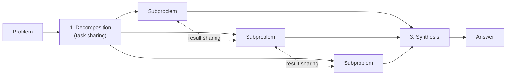
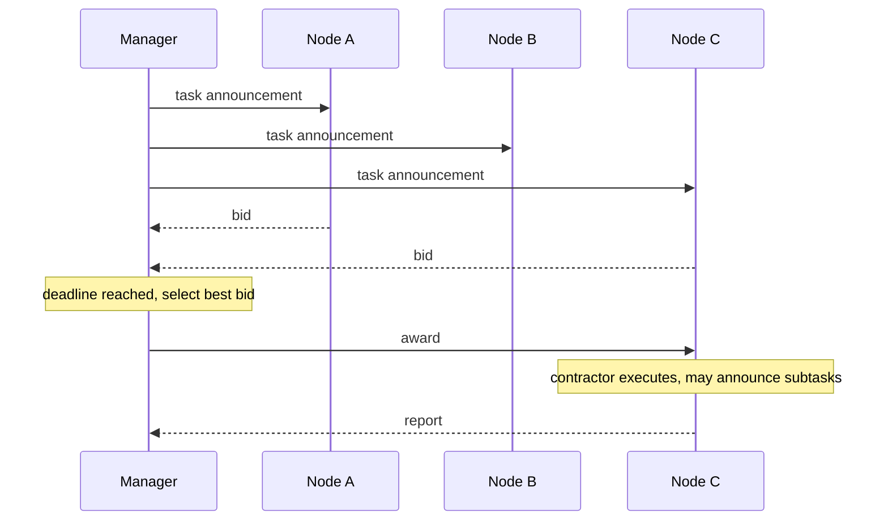
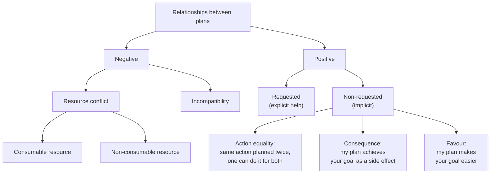

# 08 Working Together

Sources:

- Wooldridge, *An Introduction to MultiAgent Systems*, 2nd ed., 2009, Chapter 8 "Working Together". Primary source for the classical concepts.
- Sayfan, *Design Multi-Agent AI Systems Using MCP and A2A*, 2026, Chapter 8 (orchestration patterns, decomposition, conflict resolution) and Chapter 10 (failure modes and diagnosing coordination failures).
- For section 9: Dibia, *Designing Multi-Agent Systems*, 2025, Chapter 2 section 2.5, Chapter 3, Chapter 4 sections 4.12 and 4.13, Chapter 7 section 7.2, and Chapter 15. O'Brien, *Building Complex Multi-Agent Systems Using Patterns*, 2026, Chapters 8 and 9. Rothman, *Context Engineering for Multi-Agent Systems*, 2025, Chapter 2.

[07](07-agent-communication.md) covered how agents talk. This topic covers how a team of agents shares out a problem, shares results, and keeps out of each other's way. It is the cooperative side of the macro problem from [01 section 3](01-setting-the-scene.md#3-the-two-central-problems-micromacro). Self-interested agents are left for a later topic.

Each section below states the classical concept, then its relevance to agentic AI. Section 8 maps Sayfan's orchestration patterns and failure modes onto the classical concepts.

## 1. Cooperative Distributed Problem Solving

Wooldridge names two differences between a MAS and a conventional distributed system. Agents may be built by different people with different goals. Agents decide at run time, so they must coordinate dynamically, where a distributed system has coordination fixed at design time.

*Cooperative distributed problem solving* (CDPS), begun by Lesser and colleagues, studies how a loosely coupled network of problem solvers, each capable on its own, can solve problems none could solve alone, because no single one has enough expertise, resources, or information.

Most CDPS work makes the **benevolence assumption**: the agents share a common goal, so there is no conflict, and an agent should help whenever needed, even at its own cost. Wooldridge notes the assumption is reasonable when one person or organisation owns all the agents, and that it greatly simplifies design, because only the system's overall performance matters.

CDPS is not **parallel problem solving**. In parallel problem solving the components are interchangeable processors, and one node decomposes the problem, farms out pieces, and assembles the answer. In CDPS the nodes have distinct expertise.

Two measures judge a cooperative system:

1. **Coherence.** How well the system behaves as a unit: solution quality, efficient use of resources, clarity of operation, and how gracefully performance degrades under uncertainty or failure.
2. **Coordination.** How well agents avoid extraneous activity, such as synchronising and aligning their work. In a perfectly coordinated system, agents never undo each other's subgoals and need not communicate explicitly because they can predict each other. Destructive interference between agents is the sign of poor coordination.

**Agentic AI relevance.**

- Multi-agent LLM systems owned by one user or company are benevolent by design. That is why the classical CDPS techniques apply to them more directly than the self-interested ones.
- Many subagent systems sit between CDPS and parallel problem solving. The subagents often run the same model, and their "expertise" comes only from different prompts, tools, and context. Whether they behave as specialists or as interchangeable processors is a design question worth stating.
- Coherence and coordination are usable evaluation measures. Coherence asks whether the team's output is good. Coordination asks how much of the team's effort, and tokens, went into duplicated or conflicting work. [R5](../research/README.md), comparing single-agent and multi-agent token cost, bears on the second.

## 2. Decomposition, Solution, Synthesis

Smith and Davis describe CDPS in three stages, and two activities that run through them:

*The three stages of CDPS, after Wooldridge Figures 8.1 and 8.2. Subproblems are solved in stage 2. Task sharing allocates subproblems to agents. Result sharing passes useful information between agents while they work.*

Wooldridge raises three issues with decomposition.

1. **Grain size.** Decomposing down to atomic operations, as in the ACTOR model where every subproblem spawns an actor, makes the overhead of managing interactions outweigh the benefit.
2. **Who decomposes.** One agent decomposing alone must understand the whole task's structure. If others know parts of it better, decomposition should itself be cooperative.
3. **Decomposition depends on the agents.** A decomposition the available agents cannot solve is useless.

Sayfan offers three decomposition strategies: by domain expertise (requirements, development, testing), by workflow stage (research, planning, writing, editing, publishing), and by capability (collect, process, visualise). He asks five questions to choose: where the natural boundaries are, how tools cluster, what context each part needs, what can run in parallel, and where errors should be isolated.

**Agentic AI relevance.**

- Grain size is a token cost. Each subagent needs its own instructions and context, so splitting work too finely spends more on coordination than it saves.
- In most LLM systems one orchestrator decomposes alone, from its own understanding of the task. Wooldridge's second issue applies: the agent best placed to decompose a part of the task may be the specialist for that part.
- Sayfan's question about context is a reason specific to LLMs ([01 section 9.7](01-setting-the-scene.md#97-a-new-reason-to-use-multiple-agents)): a decomposition should keep each agent's needed context within its window.

## 3. Task Sharing: the Contract Net

The Contract Net (Smith, 1977-1980) allocates tasks the way companies put contracts out to tender. It is the most implemented and studied framework for distributed problem solving.

*The Contract Net, after Wooldridge Figure 8.3. Node B judged itself ineligible and did not bid. Unsuccessful bidders discard the task.*

1. **Announcement.** A node with a task becomes its *manager* and announces it. With no knowledge of others' abilities it broadcasts to all. With some knowledge it sends to likely candidates. If it knows exactly who is suitable, it sends point to point.
2. **Bidding.** Nodes check the announcement's eligibility specification against their own abilities. Eligible nodes bid, stating their relevant capabilities.
3. **Award.** After a deadline, the manager awards the task to the best bidder, which becomes the *contractor*.
4. **Report.** The contractor carries out the task, which may mean announcing subtasks of its own, and reports the result.

Two shortcuts exist. A **directed contract** skips announcement and bidding when the manager knows who should do the task, and the chosen node can acknowledge or refuse. A plain **request and inform** exchange is used for simple requests for information.

Sandholm proposed a rule for deciding whether to bid. A contractor bids if the *marginal cost* of the new task, the cost of all its tasks with the new one minus the cost without it, is affordable given what it has and what the task pays.

**Agentic AI relevance.**

- An LLM orchestrator choosing a subagent from its description is a directed contract without the option to refuse. Sayfan's AI-6 leaves the choice to the model, which picks a sub-agent from its description as it would any tool.
- A Contract Net for LLM agents would let subagents bid with what they know about themselves: relevant tools, current load, estimated cost, or confidence. The manager would choose on evidence, not descriptions alone. FIPA's `cfp` and `propose` ([07 section 4.2](07-agent-communication.md#42-fipa-acl)) were designed for this. [R6](../research/README.md) and [R7](../research/README.md) explore bidding and refusal.
- The award gives each task exactly one owner. That prevents the duplicated work Sayfan lists as a common failure (section 8).
- Marginal cost is a natural basis for an LLM agent's bid: the extra tokens and time a task would add given what it is already doing.

## 4. Result Sharing and Inconsistency

### 4.1 Result sharing

In result sharing, agents exchange partial results as a solution develops, either proactively, because the receiver will be interested, or reactively, on request. Durfee lists four benefits:

| Benefit | How sharing helps |
|---|---|
| Confidence | Independent solutions can be cross-checked to find errors. |
| Completeness | Local views combine into a better global view. |
| Precision | Shared results make the overall solution more precise. |
| Timeliness | Sharing a solution is faster than every agent deriving it. |

The FELINE system combined task sharing and result sharing among rule-based experts. Each agent kept an *environment model* listing, for itself and each acquaintance, its **skills** (hypotheses it can establish) and **interests** (hypotheses whose truth it needs). When an agent needed a fact another agent listed as a skill, it sent a request. When it derived a fact another agent listed as an interest, it sent an unsolicited inform.

### 4.2 Handling inconsistency

With limited views and fallible sources, agents' beliefs will be inconsistent. Durfee and colleagues list three responses:

1. **Prevent or ignore it.** The Contract Net does this: only the manager's view matters.
2. **Resolve it by bargaining.** Rarely practical, because of the communication and computation overhead.
3. **Degrade gracefully.** The preferred option.

Lesser and Corkill call systems that degrade gracefully *functionally accurate/cooperative* (FA/C). Their problem solving proceeds opportunistically and incrementally. Agents exchange high-level intermediate results, not raw data. Inconsistency is resolved as partial results are compared, during problem solving rather than at the start or end. Several routes lead to a solution, so one failure does not stop the system.

**Agentic AI relevance.**

- Sayfan's parallel pattern with a judge, where several agents answer the same input and a judge compares them, uses result sharing for confidence.
- Agent cards list skills but not interests. Without interests, an agent cannot know who would want a result it has, so proactive informing does not happen. Sharing in current systems is almost entirely reactive or routed through the orchestrator.
- Sayfan observes that agents rarely share their own context. What they share is usually written for the receiver. That is FA/C's advice to exchange high-level intermediate results rather than raw data.
- FA/C describes how LLM agent teams should treat each other's output: as partial, tentative, and possibly wrong, to be checked against other results as work proceeds.

## 5. Coordination

Coordination is managing the interdependencies between agents' activities. Wooldridge's examples: two people reaching a door only one can pass through, a grant proposal that needs another person's signature first, and printing a copy of a paper for a colleague who will want it. Von Martial classified the relationships between agents' plans:

*Von Martial's typology of coordination relationships, after Wooldridge Figure 8.4.*

In a MAS, agents must recognise and manage these relationships at run time. Conventional software anticipates them at design time. Wooldridge describes four approaches.

### 5.1 Partial global planning

Partial global planning was developed by Durfee for the Distributed Vehicle Monitoring Testbed, where sensor agents tracked vehicles. Agents cannot plan the whole problem, so planning is *partial*. They exchange local plans to form a non-local view, so it is *global*. It repeats three steps:

1. Each agent decides its own goals and makes short-term plans.
2. Agents exchange information to find where plans and goals interact.
3. Agents change their local plans to coordinate better.

A *meta-level structure* says which agents should exchange information with which, and when. The shared *partial global plan* records the objective, *activity maps* of what agents are doing and will produce, and a *solution construction graph* of how agents should interact and what to exchange when.

Decker's generalised version (GPGP) uses five techniques:

1. **Update non-local viewpoints.** Share no, all, or some local information.
2. **Communicate results.** Send only what obligations require, everything, or only what others are interested in.
3. **Handle simple redundancy.** When several agents are doing the same task, pick one at random to do it and broadcast the result.
4. **Handle hard relationships.** Von Martial's negative relationships threaten success, so reschedule to remove them.
5. **Handle soft relationships.** Positive relationships improve performance, so reschedule if possible but do not insist.

### 5.2 Joint intentions

Coordination is not the same as cooperation. Searle's example: people in a park all run to the one tree when it rains. That is coordinated but not cooperative, since each just wants to stay dry. Dancers converging on the same tree as part of a choreography perform the same actions cooperatively, because each acts toward a shared aim.

Being in a team implies responsibility to the other members. If two people are lifting a heavy object together and one concludes it cannot be done, simply letting go is not cooperation. The member should at least tell the other.

Jennings separates a **commitment**, a promise to bring something about, from a **convention**, which says when the commitment may be dropped and how to behave toward others when it is. A team has a *joint commitment* to the overall aim, whose state is spread across members, and a *social convention* governing it. Levesque, Cohen, and Nunes formalised this as a *joint persistent goal*. Each member keeps the goal until it is mutually believed that the goal is achieved, that it is impossible, or that the reason for it no longer holds. A member that comes to believe any of these must try to make it mutually believed: it must tell the others.

Jennings implemented commitments and conventions as rules in ARCHON, an industrial control system. Its rules detect when a joint goal is satisfied, when its motivation has gone, or when the shared plan has been violated or invalidated, and then abandon, suspend, or replace local activities and inform the cooperation module. Tambe's Steam framework encoded teamwork in about 300 domain-independent rules and was used in military simulations and RoboCup.

Wooldridge and Jennings's teamwork model has four stages:

1. **Recognition.** An agent with a goal sees that cooperation could achieve it, because it cannot do it alone or prefers not to.
2. **Team formation.** It recruits a team that agrees on the end, not yet the means.
3. **Plan formation.** The team agrees on a plan, possibly by negotiation.
4. **Team action.** The team executes the plan under a convention such as the joint persistent goal.

### 5.3 Mutual modelling

Agents can coordinate by predicting each other. At the door, I can keep walking if my model of you says you will let me through first. Gasser's MACE testbed in the mid-1980s gave each agent *acquaintance models* of others: class, name, role, skills, goals, and plans.

### 5.4 Norms and social laws

A *norm* is an established, expected pattern of behaviour, such as queueing for a bus. A *social law* is a norm with some authority behind it. Conventions simplify decisions by dictating what to do in common situations. There are two ways to get them:

| Approach | How | Strengths and weaknesses |
|---|---|---|
| Offline design | Designers fix social laws and build them into agents. | Simpler and more controllable. Fails when the system's characteristics are not known at design time, when goals keep changing, or when the system is too complex to predict. Shoham and Tennenholtz proved that finding a *useful* social law, one that still lets agents reach every state they need, is NP-complete. |
| Emergence | Agents converge on a convention from local experience. | Adapts to open, changing systems. Convergence takes time, and switching conventions has a cost. |

Shoham and Tennenholtz's *tee shirt game* studies emergence. Agents each wear red or blue, are paired at random each round, see only their partner's shirt, and may switch. The goal is for everyone to end up wearing the same colour. Of the update rules tested, *highest cumulative reward*, where agents adopt the strategy that has paid best so far, was shown to reach agreement within a bounded number of rounds with probability as close to 1 as required, to stay stable once reached, and to leave no agent worse off than its initial choice.

Their offline example is traffic laws for robots on a grid. A law that makes every robot follow one snake-shaped route through the whole grid prevents all collisions but is slow. A law that lays roads over the grid also prevents collisions and is much faster.

**Agentic AI relevance.**

- Partial global planning describes what parallel coding agents need: share plans before acting, find overlaps (two agents editing the same file is a negative relationship over a resource) and synergies, and adjust. Most current systems skip the exchange and discover conflicts at merge time.
- GPGP's redundancy rule is a direct remedy for duplicated work: detect agents doing the same task, keep one, and broadcast its result.
- The joint persistent goal says what a subagent should do when it finds its task impossible or pointless: stop and tell the team. LLM subagents often do the opposite. Sayfan's failure list includes agents that report success when a tool failed and tasks that look done with steps missing (section 8). A convention stated in the subagent's instructions, giving the conditions for dropping a task and the duty to report, is the classical fix.
- Agent cards and subagent descriptions are thin acquaintance models: skills, but rarely goals, plans, or current state. Mutual modelling is mostly absent.
- File ownership rules such as "only this agent edits this directory", or a rule that delegation only flows from parent to child, are offline social laws. They prevent conflicts by making them impossible, at the cost of flexibility, like the snake-shaped traffic law. Sayfan notes that strict parent-to-child delegation rules out circular delegation.
- The tee shirt game is consensus without communication, a relative of [06 section 1](06-control-of-cooperative-mas.md#1-consensus-agreeing-on-a-value).

## 6. Multiagent Planning

Durfee distinguishes three arrangements:

| Arrangement | Who plans | Who executes |
|---|---|---|
| Centralised planning for distributed plans | One master agent plans the division and ordering of work | The other agents each execute their part |
| Distributed planning | Specialist agents together form one central plan | Others execute it |
| Distributed planning for distributed plans | Agents form their own plans and coordinate as they go, possibly by negotiation | The same agents. There may never be a global plan. |

Centralised planning is simplest, because the master sees everything and can dictate coordination. The third is hardest.

Georgeff's *plan merging* takes plans made separately by single agents and produces a conflict-free multiagent plan in three steps:

1. **Interaction analysis.** Find where plans interact, using satisfiability (some order works), commutativity (can run in parallel), and precedence (one sets up the other).
2. **Safety analysis.** Remove harmless interactions and identify the harmful ones.
3. **Interaction resolution.** Treat unsafe interactions as critical sections and enforce mutual exclusion.

Stuart's alternative translated plans into temporal logic and used a theorem prover to find a synchronised execution, which is PSPACE-complete in general.

**Agentic AI relevance.**

- Most multi-agent LLM systems use centralised planning for distributed plans. The orchestrator makes the plan or to-do list and subagents execute pieces. This is simple and keeps the orchestrator in control, the trade-off [01 section 10](01-setting-the-scene.md#10-a-control-theory-view-nagahara-azuma-and-ahn) describes for central topologies.
- Parallel agents working in separate copies of a codebase and merging afterwards is plan merging done late. A merge conflict is a harmful interaction found after execution instead of during interaction analysis. Plan merging suggests checking for interactions before the agents start.

## 7. Modern Practice: Sayfan's Patterns

Sayfan's six orchestration patterns map onto the classical concepts:

| Sayfan pattern | Description | Classical counterpart |
|---|---|---|
| Sequential | Agents work in a fixed order, each passing output to the next | Centralised plan with fixed precedence. A pipeline of CDPS stages. |
| Parallel | Agents run at once, then results are aggregated or judged | Result sharing for confidence. Redundancy by design. |
| Hierarchical | A coordinator decomposes, delegates, and synthesises. Specialists may delegate further. | Task sharing by directed contract. Centralised planning for distributed plans. |
| Event-driven | Agents subscribe to events and react | Proactive result sharing by interests, as in FELINE. Subscriptions, as in 07. |
| Collaborative | Agents propose, negotiate, and form groups dynamically | Contract Net, partial global planning, and negotiation |
| Hybrid | Combinations, such as a sequential spine with parallel validation | Combined task and result sharing, as in FELINE |

His mitigations per pattern are retries and timeouts (sequential), a judge (parallel), redundancy for critical agents (hierarchical), logging and tracing (event-driven), and a cap on inter-agent exchanges (collaborative). He reports the hierarchical pattern with specialists by domain as particularly effective for enterprise use.

For conflicts between agents, Sayfan's strategies also have classical counterparts:

| Sayfan strategy | Classical counterpart |
|---|---|
| Explicit role boundaries: each domain maps to exactly one agent | Offline social law. Roles from [04 section 3](04-multiagent-organisations.md#3-structure-roles-dependencies-and-scenes). |
| Priority-based: security over compliance over business logic over automation | Offline social law with a fixed precedence |
| Token-based coordination: one holder of an exclusive token at a time | Mutual exclusion over critical sections, as in plan merging |
| Consensus by vote with a threshold | Group decision making. See [06 section 1](06-control-of-cooperative-mas.md#1-consensus-agreeing-on-a-value). Voting among self-interested agents is not yet covered. |
| Dynamic role assignment by performance and load | Contract Net with load as part of the bid |

He concludes that clear architecture should make conflict resolution "a safety net rather than a primary mechanism". That is the preference for offline design over run-time resolution, with the trade-offs in section 5.4.

## 8. Coordination Failures

Sayfan's Chapter 10 lists six coordination failure patterns in multi-agent LLM systems, illustrated with his Kubernetes operations system. Each corresponds to a classical concept that addresses it:

| Failure (Sayfan) | Example | Classical concept | Section |
|---|---|---|---|
| Partial task completion: each agent succeeds locally while the global goal fails | The fixer repairs the problem but the coordinator never tells the notifier, so humans may fix it again | Joint persistent goal: members keep the goal until it is mutually believed achieved, and report | 5.2 |
| Duplicated work | Two health-check cycles delete the same pods and post conflicting reports | Contract Net award gives one owner. GPGP redundancy handling. Action equality. | 3, 5.1 |
| Conflicting actions: agents work at cross-purposes and the system oscillates | One agent scales up while another scales down | Von Martial's negative relationships. GPGP hard relationships. Partial global planning. | 5, 5.1 |
| Deadlocks and hangs | Agents wait on each other or on locked resources | Plan merging's critical sections. Offline social laws such as lock ordering. | 6, 5.4 |
| Context lost at handoffs | The coordinator delegates without the list of failing pods, so diagnosis runs twice | Result sharing. FA/C's exchange of high-level intermediate results. | 4 |
| Message ordering | A cancel is processed before the create it cancels | Precedence in interaction analysis | 6 |

His other agent failures include fabricated tool results, where an agent reports a restart that never happened, and circular delegation, where two agents hand a task back and forth.

Sayfan's remedies come from distributed systems rather than the MAS literature: distributed tracing with a correlation ID across all agents, structured handoffs with mandatory context fields, idempotency, timeouts, circuit breakers, locks and lock ordering, deadlock detection with wait-for graphs, and validating the dependency graph for cycles before running. He does not cite the classical MAS work. His notes on testing are thin, limited to coordination integration tests with slow agents, malformed data, reordered messages, and simultaneous updates, plus replaying and shadowing tool calls.

**Agentic AI relevance.**

- The failures practitioners now report are the problems CDPS research set out to solve in the 1980s and 1990s. The classical solutions work at a different level from the distributed-systems remedies. Tracing and locks detect and contain failures. Contracts, joint commitments, and partial global plans give agents the information and obligations that prevent them.
- Fabricated success is a broken convention. A team member that cannot reach its goal must say so. LLM agents are not built with that duty, so it must be stated and checked.
- Distributed tracing gives the observability that coherence and coordination measures need. A trace across all agents shows duplicated work, conflicts, and lost handoffs directly.

## 9. Stopping and Human Control

This section draws on the LLM-era books listed under Sources. It covers two decisions the classical sources leave to the agent's design: when to stop, and when to hand control to a human.

### 9.1 Why stopping is new

A BDI agent stops pursuing an intention when its commitment strategy says so ([02 section 3.2](02-agent-architectures.md#32-commitment-versus-reconsideration)). A team stops when its joint persistent goal is mutually believed achieved or impossible (section 5.2). Both are designed rules.

An LLM agent's loop ends when the model returns a reply with no tool call. Dibia says the model has no reliable sense of being done. Multi-agent conversations either run on, paying for every call, or stop early with the task incomplete. O'Brien makes the same point from the other side: BDI deliberation ends by construction, and an LLM loop does not, so it needs a cap.

### 9.2 Stop conditions

Dibia treats termination as a component to design. His conditions:

| Family | Conditions |
|---|---|
| Budget | Maximum messages, maximum tokens, timeout, maximum iterations as a final safety net |
| Semantic | A keyword in the output ("TERMINATE", "APPROVED"), a task-status tool the agent must call with complete or incomplete and a reason, or a separate judge model that reads the evidence and sends the agent back if it stops too early |
| External | A human or another system signals the end, or the agent hands off |

Conditions combine with "any of" and "all of". His robustness order, weakest first, is criteria stated only in the prompt, then a deterministic check against a to-do list, then a judge model. His named mistake is stopping on a keyword the prompt never tells the agent to emit.

Others in current practice:

- O'Brien caps a ReAct loop at ten steps. A loop that reaches the cap raises an alert and its message is quarantined as a runaway.
- Rothman caps revisions after a failed validation at two.
- Sayfan caps the number of exchanges in a collaborative pattern (section 7).

### 9.3 Stopping interacts with context

Dibia's one measurement of a judge that sends the agent back shows a side effect. With a small context budget, adding the judge raised calls from 32 to 50 and repeated file reads from 15 to 55 percent, and the judged quality fell from 5.5 to 4.0. The judge correctly found the work incomplete. The agent had already lost its recent work to context compaction, so it started again. [14 section 4.3](14-context-engineering.md#43-thrashing) has the full table. A stop rule cannot be tuned apart from the context budget.

### 9.4 Errors inside the loop

O'Brien routes errors by kind. A tool that rejects bad input returns an error result that the model sees as an observation and can reason about. An infrastructure failure goes to retry queues and never reaches the model. The book does not address one difference. A classical "poison" message fails every time it is replayed, but a malformed model output may succeed if the same input is sampled again. For model output, the line between a transient and a permanent failure is a probability.

### 9.5 Human control

Dibia sets out how an agent hands control to a human:

- *Approval tiers by cost of action.* Low-cost actions run automatically. Medium-cost actions run and notify. High-cost actions wait for approval. Thresholds are set by the user.
- *Rule-based or model-judged escalation.* Fixed rules (transactions over a set amount, legal or medical topics, three failed attempts) or the agent's own judgement of risk.
- *Exit and resume.* When a tool needs approval, the agent stops, returns the request, and saves its full state. Approval starts a new run from that state, on any server.
- *Interruption.* Pause, resume, or cancel at any point, and add requirements without stopping.
- *Calibration.* An approval rate above 95 percent suggests the agent is asking too often.

Dibia gives no user study for these. The classical name for this field is *adjustable autonomy*, where control passes between agent and human by strategy. None of the three books cites it.

**Agentic AI relevance.**

- A team of LLM agents needs the convention from section 5.2: when a member may stop, and the duty to report why. Stop conditions and task-status tools are a partial, per-agent version.
- Prefer deterministic stop checks, such as a to-do list or a test result, over a model's own claim to be done. Use a judge only with enough context budget for the agent to continue.
- Whether a loop converges, oscillates, or runs away should be measured, not only capped. [R13](../research/README.md) on the research backlog tests stopping rules against such a measure.

## Key Takeaways

1. Multi-agent LLM systems owned by one party are cooperative distributed problem solvers working under the benevolence assumption. The classical CDPS techniques apply directly.
2. Judge a team on coherence (quality of the joint result) and coordination (how little effort is wasted on duplicated or conflicting work).
3. Decomposition has a grain size, needs knowledge of the task's structure, and must fit the agents available. For LLMs, context needs are a further reason to split work.
4. The Contract Net allocates tasks by announcement, bid, and award, giving each task one owner. LLM orchestrators use directed contracts without letting agents bid or refuse.
5. Result sharing improves confidence, completeness, precision, and timeliness. Without declared interests, agents cannot share proactively.
6. Partial global planning has agents exchange plans to find conflicts and overlaps before acting. Parallel LLM agents mostly find them at merge time.
7. Teamwork needs conventions: when a member may drop its part, and the duty to tell the others when it does. Their absence explains partial completion and fabricated success.
8. Social laws designed offline prevent conflicts by making them impossible, at a cost in flexibility. Finding a useful one is NP-complete in general.
9. The coordination failures reported in current practice map onto classical concepts. Current remedies come from distributed systems and contain failures. The classical concepts aim to prevent them.
10. An LLM agent has no reliable sense of being done, so stopping must be designed: budgets, deterministic checks, judges, and caps. Stop rules interact with the context budget. Handing control to a human by cost of action is adjustable autonomy, which current practice does not cite.
