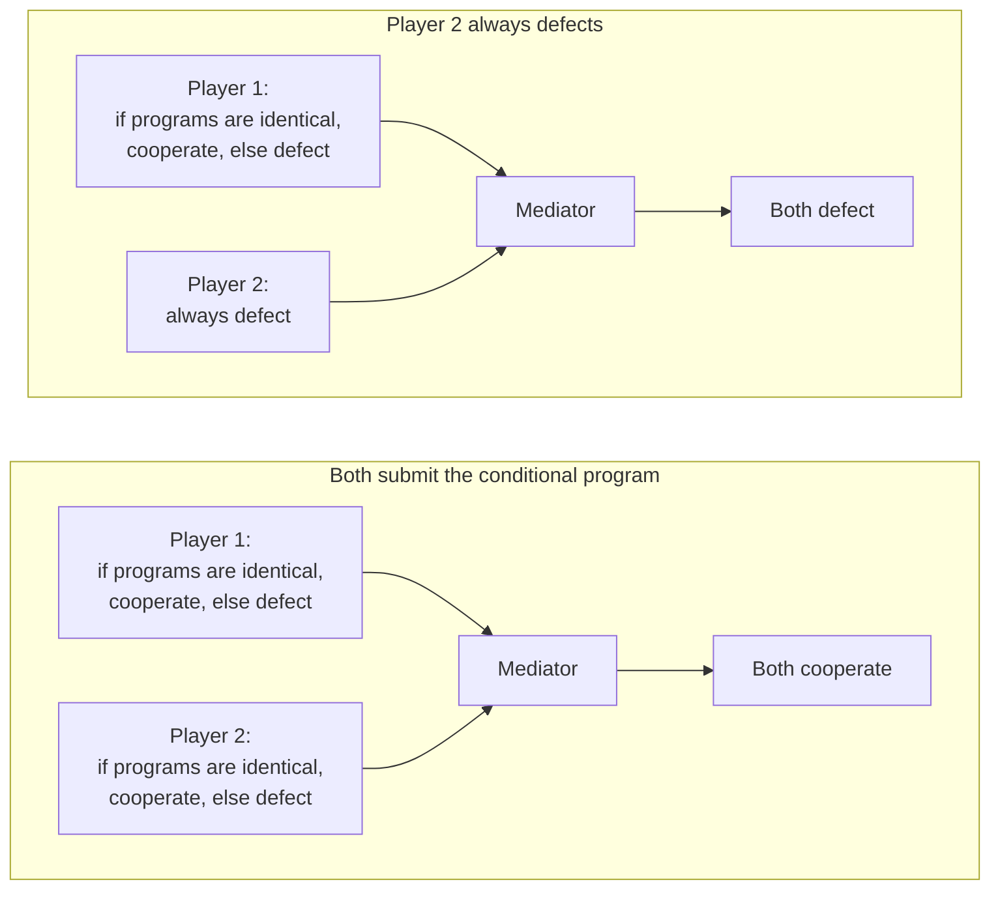
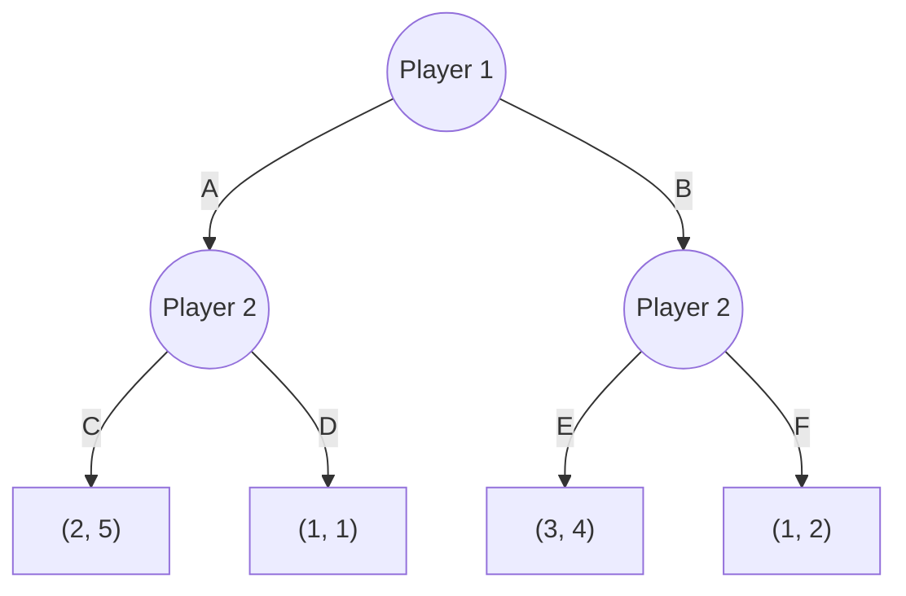

# 09 Strategic Interaction

Sources:

- Wooldridge, *An Introduction to MultiAgent Systems*, 2nd ed., 2009, Chapter 11 "Multiagent Interactions". Primary source.
- Weiss (ed.), *Multiagent Systems*, 2nd ed., 2013, Chapter 17 "Game-Theoretic Foundations of Multiagent Systems" by Edith Elkind and Evangelos Markakis. Used for sequential games, incomplete information, and complexity.

This is the first of four topics on self-interested agents. [08](08-working-together.md) assumed benevolence: agents share a goal because one party owns them all. When agents act for different owners, as in the open networks of [03 section 3](03-agent-landscape-2026.md#3-open-self-interested-mas-arrives), each pursues its owner's preferences. Game theory is the standard tool for predicting what such agents will do and for designing interactions where self-interest leads somewhere good. Elkind and Markakis put the designer's task as making agents want to choose a desirable plan of action.

Each section below states the classical concept, then its relevance to agentic AI. The later topics cover group decisions (10), coalitions and auctions (11), and bargaining and argumentation (12).

## 1. Preferences and Utility

A self-interested agent has preferences over outcomes, assumed to be its owner's. A *utility function* gives each outcome a number, higher being better. Utility represents preference and is not money. A million dollars matters little to someone with five hundred million and a great deal to someone with nothing.

Two measures judge an outcome without choosing one:

1. **Pareto efficiency.** An outcome is Pareto efficient if no other outcome makes someone better off without making someone else worse off. Giving one person the whole cake is Pareto efficient, though hardly fair.
2. **Social welfare.** The sum of all agents' utilities. It ignores how utility is distributed, so Wooldridge considers it appropriate mainly when all agents have the same owner.

**Agentic AI relevance.** The owner boundary decides which measure applies. An orchestrator and its subagents serve one owner, so maximising total value is the right objective, and [08](08-working-together.md) applies. Agents for different owners each maximise their owner's utility, and the system designer can at best aim for outcomes that are Pareto efficient or that the owners would accept.

## 2. Games in Strategic Form

In the simplest model, two agents each choose an action at the same time, without seeing the other's choice, and the combination determines the outcome. A *payoff matrix* lists each agent's utility for every combination. In the tables below, the row agent's payoff comes first.

### 2.1 Solution concepts

| Concept | Definition | Assumes about the other agent | Exists? |
|---|---|---|---|
| Dominant strategy | Best whatever the other agent does | Nothing | Often not |
| Iterated elimination of strictly dominated strategies | Repeatedly remove actions that another action always beats | Rationality, applied step by step | Always leaves something |
| Nash equilibrium | Each agent's action is a best response to the other's, so neither gains by changing alone | It plays the same equilibrium | A pure one may not exist. There may be several. |
| Mixed Nash equilibrium | As above, with agents choosing actions at random by fixed probabilities | The same, plus expected utility | Always, in finite games (Nash, 1951) |

Wooldridge's motivating example of a Nash equilibrium is driving on the left in the UK: if everyone else drives on the left, you can do no better than to drive on the left too.

Nash equilibrium has two problems. It may not exist in pure strategies, and there may be several with no way to choose. In *matching pennies*, each agent shows heads or tails, and the row agent wins if they match. There is no pure equilibrium. The mixed equilibrium is for each to choose heads or tails with probability one half. In the *Battle of the Sexes* from Weiss, Alice and Bob prefer to go out together, but Alice prefers one venue and Bob the other. Both "both go to Alice's choice" and "both go to Bob's choice" are equilibria, and nothing in the game picks one.

Elkind and Markakis's *bridge* example shows a public good. 10,000 inhabitants each decide whether to give $10 toward a $50,000 bridge that each values at $20. An inhabitant prefers to contribute only if exactly 4,999 others do. The equilibria are exactly 5,000 contributors or none, so "nobody contributes" is stable.

### 2.2 Zero-sum games

In a *zero-sum* game, one agent's gain is the other's loss. Von Neumann's minimax theorem (1928) shows that two-player zero-sum games have a value: each agent can guarantee it by a mixed strategy, every equilibrium gives the same payoffs, and equilibrium strategies can be swapped freely, so choosing between equilibria is not a problem. These games can be solved in polynomial time by linear programming. Wooldridge notes that real zero-sum situations are rare, even wars share some interests, yet people often treat situations as zero-sum, with bad results.

**Agentic AI relevance.**

- A counterparty agent reached over A2A that serves another owner should be modelled as maximising its owner's utility, not as a teammate. Protocol rules then need checking for incentives as well as correctness: what does each side gain by deviating?
- Dominant strategies are the safest basis for protocols between agents whose reasoning is unknown, because they assume nothing about the other side. Nash equilibria assume the other agent reasons the same way, which LLM agents from different vendors may not.
- When there are several equilibria, as in the Battle of the Sexes, LLM agents can often agree by talking first. The classical simultaneous-move model forbids communication, so an agent protocol that allows a message before acting changes the game.
- The bridge example is the free-rider problem in a shared resource such as a public skill registry, a shared evaluation suite, or a commons of reviews. "Nobody contributes" is a stable outcome.

## 3. Social Dilemmas

With two agents and two actions, cooperate (C) or defect (D), the symmetric games can be classified by how each agent ranks the four outcomes. There are 24 orderings. Four games stand out:

| Game | Agent's ranking, best to worst | Pure equilibria | Dominant strategy |
|---|---|---|---|
| Prisoner's dilemma | I defect and you cooperate > both cooperate > both defect > I cooperate and you defect | Both defect | Defect |
| Stag hunt | Both cooperate > I defect and you cooperate > both defect > I cooperate and you defect | Both cooperate, or both defect | None |
| Chicken | I defect and you cooperate > both cooperate > I cooperate and you defect > both defect | One cooperates, the other defects | None |
| Matching pennies | Zero-sum | None. Only mixed. | None |

Wooldridge's prisoner's dilemma payoffs:

| | Other cooperates | Other defects |
|---|---|---|
| **Cooperate** | 3, 3 | 0, 5 |
| **Defect** | 5, 0 | 2, 2 |

Defecting is dominant for both, so both defect and each gets 2. Both cooperating would give each 3 and the highest social welfare. Mutual defection is the only outcome that is not Pareto efficient. Rational play wastes utility, hence the dilemma. Wooldridge's real-world instances are disarmament, where the worst outcome is disarming alone, and the *tragedy of the commons*: grazing land, fishing, and network bandwidth, the shared Internet connection example of [04 section 1.1](04-multiagent-organisations.md#11-the-commons-problem).

He reviews three attempts to rescue cooperation in a single game and rejects each. Apparent honesty usually has a hidden incentive behind it, such as social disapproval. Treating the other player as a twin means there are no longer two decisions. And people cooperate when the cost of being exploited is small, not when stakes are high.

In the **stag hunt**, everyone gains most by cooperating, but a lone cooperator does worst. Which equilibrium agents reach depends on trust. In **chicken**, two drivers head for a cliff, and the disaster is both expecting the other to swerve.

**Agentic AI relevance.**

- Agents competing for a shared rate limit, compute budget, or registry ranking face a commons. Each gains by taking more, and all lose if all do.
- The stag hunt fits joint ventures between agents for different owners, such as two agents committing resources to a shared task. Cooperation pays only if each trusts the other to follow through, which links to [05](05-trust-and-reputation.md).

## 4. Repeated Play

### 4.1 The shadow of the future

If the prisoner's dilemma is played repeatedly and each agent sees the other's past moves, cooperation can become rational. Defection can be punished in later rounds, and the cost of being exploited once is spread over many rounds. Infinite play is not required: a high enough probability of meeting again is enough.

If the number of rounds is fixed and known to both, *backward induction* brings defection back. In the last round there is no future to protect, so both defect. The second-to-last round then is effectively the last, and so on back to the first.

### 4.2 Axelrod's tournament

In 1980 Axelrod invited programs to play the repeated prisoner's dilemma against each other, 200 rounds per game. The winner was **tit-for-tat**, five lines of code: cooperate first, then copy the opponent's previous move. Tit-for-tat loses to always-defect head to head. It won overall because it did well among other cooperative strategies. Axelrod drew four rules from the results:

1. **Do not be envious.** You need not beat the other player to do well.
2. **Do not be the first to defect.** Opening with cooperation was the best single predictor of success.
3. **Reciprocate both cooperation and defection.** Punish in proportion and forgive, so cooperation can resume.
4. **Do not be too clever.** Complex strategies did worse. They did not account for being modelled in return, did not forgive, and were too hard for others to read.

Wooldridge adds a caution about *noise*. If agents sometimes misread each other's moves, two tit-for-tat players fall into cycles of retaliation and lose a great deal.

**Agentic AI relevance.**

- Repeated interaction needs persistent identity. Anonymous one-off calls to a marketplace agent are a one-shot game where defection pays. Stable identities, histories, and reputation ([05](05-trust-and-reputation.md)) create the shadow of the future.
- A relationship with a known end date, such as a deprecation or a contract term, invites end-game defection by backward induction.
- LLM agents misread each other's messages more often than classical agents misread moves. Automatic retaliation between agents, such as blocking or downgrading after one bad interaction, risks the spirals Wooldridge describes. Measured response and forgiveness matter.

## 5. Program Equilibria

Tennenholtz (2004) made "I will cooperate if you will" precise. Each player submits a program instead of an action, and a *mediator* runs both. A program can compare its own text with the other's.

*Program equilibria, after Wooldridge Figure 11.3. The conditional program cooperates only with a copy of itself, so it is never exploited, and submitting the same program is each player's best response.*

The comparison is textual because deciding whether two programs behave the same is undecidable in general. Wooldridge calls this safe but theoretically inelegant, and notes that the mediator may be a bottleneck.

**Agentic AI relevance.** Program equilibria correspond to verifiable agent policies: "I cooperate with agents running attested, published policies", with a trusted runtime or registry as the mediator. For LLM agents the textual trick is weaker, because an identical prompt and model need not produce identical behaviour.

## 6. Sequential Games

Many interactions take turns: board games, negotiation protocols, and open-cry auctions. Elkind and Markakis model these as *extensive-form* games, trees whose nodes belong to players or to chance. A strategy is a complete plan, saying what the player would do at every node it owns, including nodes that are never reached.

Nash equilibrium is too weak here because it can rest on threats that would never be carried out.

*After Weiss Figure 17.1. Payoffs are (Player 1, Player 2). Player 2 threatening F after B would push Player 1 to choose A, but if B happens, Player 2 prefers E. Backward induction gives B then E, with payoffs (3, 4).*

This game has three Nash equilibria, including one where Player 2 plans F after B and Player 1, believing it, chooses A. The threat is not credible. A *subgame-perfect equilibrium* (Selten) requires a best response in every subgame, not just along the path played. *Backward induction* finds all subgame-perfect equilibria by solving the last decisions first, provided an optimal action exists at every node. Every subgame-perfect equilibrium is a Nash equilibrium, but not the reverse.

**Agentic AI relevance.** A multi-turn negotiation between agents over A2A is an extensive-form game. Subgame perfection asks whether an agent's stated fallbacks, such as "I will walk away" or "I will escalate", are threats it would actually carry out at that point. An LLM agent instructed to bluff may not follow through, and a counterparty reasoning by backward induction will discount it.

## 7. Incomplete Information

Agents often do not know each other's preferences. A *Bayesian game* models this with *types*. Nature draws each agent's type from a distribution everyone knows, and each agent sees only its own type. A strategy says what each type of agent does. In a *Bayes-Nash equilibrium*, no type of any agent can improve its expected payoff by deviating.

Auctions are the main example, with each bidder's type being its private valuation. In a first-price sealed-bid auction with two bidders whose values are independently and uniformly distributed between 0 and 10, bidding half one's value is an equilibrium. Bidders shade below their true value.

**Agentic AI relevance.** An agent dealing with a stranger in a marketplace rarely knows the other side's valuation, capabilities, or owner's goals. Agent cards and registry metadata act as public signals about the other agent's type. Because they are self-reported, whether agents report their type truthfully is a mechanism design question, covered in [11](11-coalitions-and-auctions.md).

## 8. Computation and Representation

| Problem | Complexity |
|---|---|
| Check whether a strategy is dominant or a profile is a pure equilibrium | Easy, for a fixed number of players |
| Find a mixed Nash equilibrium | PPAD-complete, even for two players |
| Find an equilibrium with a property such as maximum welfare | NP-complete |
| Solve a two-player zero-sum game | Polynomial, by linear programming |

PPAD-completeness means no efficient general algorithm is known, though a solution always exists. Payoff matrices also grow exponentially with the number of players, so practical work needs compact representations.

Wooldridge asks how agents come to share the rules of a game. Rules can be hard-wired at design time, which fails for encounters the designer did not foresee, or written in a machine-readable form that agents interpret at run time. The Game Description Language from the General Game Playing competition (2005) is a first step: programs receive the rules of a game they have never seen and must play it without human help.

Sichman's *dependence relations* describe a related structure. Agent A depends on B if it needs B for one of its goals. Dependence can be unilateral, mutual (both need each other for the same goal), or reciprocal (each needs the other, possibly for different goals). It can be believed by one side only, or by both.

**Agentic AI relevance.**

- Computing equilibria is hard, so LLM agents should not be assumed to play them. Protocols that work with dominant strategies, or that do not depend on equilibrium play, are more robust.
- Agent cards, MCP tool schemas, and protocol specifications are machine-readable rules interpreted at run time. They describe capabilities and message formats, but not payoffs, legal moves, or termination, which a game description needs.
- A registry annotated with dependence relations would show which agents rely on which, and where reliance is one-sided or unknown to one party.

## Key Takeaways

1. Agents with different owners are self-interested. Game theory predicts their behaviour and guides the design of their interactions. Social welfare is the right objective only under one owner.
2. A dominant strategy assumes nothing about the other agent. A Nash equilibrium assumes the other plays the same equilibrium. Pure equilibria may not exist or may not be unique. Mixed ones always exist in finite games but are hard to compute.
3. The prisoner's dilemma shows that individually rational play can waste utility. The tragedy of the commons is its many-agent form: shared rate limits, budgets, and rankings.
4. Repetition makes cooperation rational when the end is not known in advance. Persistent identity and reputation create that repetition. Noise breaks strict reciprocity, so forgiveness matters.
5. Program equilibria let agents cooperate safely by conditioning on each other's verified policy. For LLM agents, identical text does not guarantee identical behaviour.
6. In turn-taking interactions, only threats a party would actually carry out count. Backward induction tests an agent's stated fallbacks.
7. Agents rarely know each other's preferences. Bayesian games model this, and self-reported agent cards raise the question of truthful reporting.
8. Machine-readable interaction rules exist for capabilities and formats, but not yet for the payoffs and legal moves that strategic reasoning needs.
