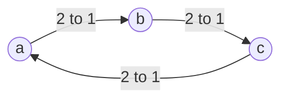

# 10 Group Decisions

Sources:

- Wooldridge, *An Introduction to MultiAgent Systems*, 2nd ed., 2009, Chapter 12 "Making Group Decisions". Primary source.
- Weiss (ed.), *Multiagent Systems*, 2nd ed., 2013, Chapter 6 "Computational Social Choice" by Felix Brandt, Vincent Conitzer, and Ulle Endriss. Used for further voting rules, ways around the impossibility results, decisions over several linked issues, and fair division.

[09](09-strategic-interaction.md) treated encounters between agents as games. This topic covers procedures designed for groups to decide: *social choice*, informally voting theory. Agents have preferences over outcomes, the group must reach one decision, and each agent may vote strategically. Brandt, Conitzer, and Endriss list applications that already use these ideas: merging search engine rankings, PageRank viewed as an election in which pages vote for pages, recommender systems, and merging ontologies.

Each section below states the classical concept, then its relevance to agentic AI.

## 1. Aggregating Preferences

Each voter ranks the outcomes. The question is how to combine the rankings into one group decision. A *social welfare function* produces a group ranking. A *social choice function* picks a winner. Both are *voting procedures*.

With two outcomes, majority vote works. With three or more, Condorcet's paradox appears. Three voters rank three outcomes:

| Voter | Ranking |
|---|---|
| 1 | a > b > c |
| 2 | b > c > a |
| 3 | c > a > b |

*The majority graph for Condorcet's paradox, after Weiss Figure 6.1. An arrow means "beats by majority". Whatever is chosen, two of the three voters prefer some other outcome.*

The majority's preferences are cyclic, so "what the majority wants" is not defined. An outcome that beats every other in a head-to-head vote is a *Condorcet winner*. It need not exist.

**Agentic AI relevance.** Many multi-agent LLM systems decide by vote: several agents answer, and the majority answer is taken. With two options that is sound. With more options, or when agents rank rather than pick, the result depends on the rule, and the group's preferences may have no consistent answer.

## 2. Voting Rules

| Rule | How the winner is chosen |
|---|---|
| Plurality | Most first places |
| Borda | With k candidates, a first place earns k-1 points, second k-2, down to 0 for last. Highest total wins. |
| Sequential majority | A series of head-to-head votes in a fixed order (the *agenda*). The winner of each meets the next candidate. |
| Copeland | Most head-to-head wins |
| Single transferable vote (STV) | Repeatedly eliminate the candidate with fewest first places and transfer those votes |
| Kemeny, Slater | The ranking that disagrees least with the head-to-head results. NP-hard to compute. |

A rule that always picks the Condorcet winner when one exists is a *Condorcet extension*. Copeland, Kemeny, and Slater are. Plurality, Borda, and STV are not. Fishburn showed that no points-by-position rule is a Condorcet extension.

Brandt, Conitzer, and Endriss's drinks example shows how much the rule matters. Nine agents choose a drink:

| Voters | 4 | 3 | 2 |
|---|---|---|---|
| First | milk | beer | wine |
| Second | wine | wine | beer |
| Third | beer | milk | milk |

Plurality picks milk. STV eliminates wine first, its two votes move to beer, and beer wins. Head to head, wine beats both others, so wine is the Condorcet winner and Copeland picks it. Their exercise with 100 voters and five candidates gives five different winners under plurality, Borda, Copeland, STV, and plurality with a runoff.

Wooldridge's UK example shows plurality's weakness. With 44% ranking Labour, Liberal Democrat, Conservative, 12% ranking Liberal Democrat, Labour, Conservative, and 44% ranking Conservative, Liberal Democrat, Labour, plurality elects the Conservatives, whom 56% rank last. The Liberal Democrats beat each other party head to head.

**Agentic AI relevance.**

- Ensembles of LLM judges, ranking agents, or voting subagents are rank aggregation. A system that "takes the majority" should state its rule and its tie-breaking, because reasonable rules disagree on the same ballots.
- Combining rankings from several retrieval or search agents is the metasearch problem, where Kemeny-style aggregation is the classical answer.

## 3. Impossibility

What should a good rule satisfy? Wooldridge lists:

| Property | Meaning |
|---|---|
| Pareto | If every voter prefers a to b, so does the group. |
| Condorcet winner | If a Condorcet winner exists, it wins. |
| Independence of irrelevant alternatives (IIA) | The group's ranking of a against b depends only on how voters rank a against b. |
| Non-dictatorship | No single voter's ranking always becomes the group's. |

| Rule | Pareto | Condorcet winner | IIA | Non-dictatorship |
|---|---|---|---|---|
| Plurality | Yes | No | No | Yes |
| Borda | Yes | No | No | Yes |
| Sequential majority | No | Yes | No | Yes |
| Dictatorship | Yes | | Yes | No |

*After Wooldridge, section 12.3. Blank where the chapter does not say.*

**Arrow's theorem** (1951) shows the table cannot be completed. With three or more outcomes, every social welfare function that satisfies Pareto and IIA is a dictatorship. Wooldridge compares its pessimism to the one-shot prisoner's dilemma. The usual way out is to relax IIA, the most contested condition. Brandt, Conitzer, and Endriss show that producing a set of acceptable winners instead of a ranking does not escape the theorem either.

Wooldridge draws a practical point: when a decision procedure is implemented as software, we should ask which of these properties it satisfies, not only whether the code is correct.

**Agentic AI relevance.** An agent protocol that aggregates votes, ratings, or rankings has to give up one of these properties, and should choose which deliberately. Borda, for example, breaks IIA: adding a decoy option can reorder the others, which matters if agents or users can add options to a ballot.

## 4. Manipulation

### 4.1 Strategic voting and agenda control

A voter's true preferences are private. Seen from a voter, a voting rule is a game in which its strategies are all the rankings it could report. Under plurality, a voter whose favourite cannot win does better by voting for a viable second choice. In the drinks example, the three beer drinkers can make wine win by reporting it first, which they prefer to milk.

Sequential majority gives power to whoever sets the agenda. Wooldridge's example has 99 voters in three blocs of 33 with the cyclic preferences from section 1. Every head-to-head vote is 66 to 33, and the agenda decides the winner:

| Agenda | Votes | Winner |
|---|---|---|
| ω3, ω2, ω1 | ω2 beats ω3, then ω1 beats ω2 | ω1 |
| ω1, ω2, ω3 | ω1 beats ω2, then ω3 beats ω1 | ω3 |
| ω1, ω3, ω2 | ω3 beats ω1, then ω2 beats ω3 | ω2 |

With cyclic preferences the chair can make any candidate win. A simple heuristic works: put the candidates most likely to beat the favourite first, and the favourite last. Wooldridge concludes that democratic procedures "may not be quite as democratic as they appear".

### 4.2 Gibbard-Satterthwaite

A rule is *manipulable* if some voter can sometimes gain by misreporting. The **Gibbard-Satterthwaite theorem** shows that with three or more outcomes, every rule that always picks a single winner, can produce every outcome, and cannot be manipulated is a dictatorship. Wooldridge notes it is equivalent to Arrow's theorem.

Wooldridge's box "Is it bad to tell lies?" quotes Moulin: in this setting free speech includes the right to lie, and agents are sincere only when it pays. He gives two reasons to prefer rules where honesty is optimal. Computing the best strategic vote may be expensive, and strategic voting favours agents with more computing power. Under a rule where truth-telling is optimal, an agent need only know its own preferences. The *revelation principle* says, roughly, that any mechanism with desirable equilibria can be replaced by one with the same outcomes in which telling the truth is rational. [11](11-coalitions-and-auctions.md) uses it.

### 4.3 Ways around it

Bartholdi and colleagues (1989) proposed making manipulation computationally hard. Several rules, including second-order Copeland and STV, are NP-hard to manipulate. Brandt, Conitzer, and Endriss list the limits: hardness is worst case only, many instances are easy, and Isaksson, Kindler, and Mossel showed that for a broad class of rules a randomly chosen voter and misreport succeeds often enough that random search finds manipulations easily. The other routes they cover:

| Route | Result |
|---|---|
| Restrict preferences to be *single-peaked*: options lie on a line, such as tax rates, and each voter's liking falls away from its favourite | A Condorcet winner always exists: the median voter's favourite. The median rule cannot be manipulated. |
| Randomise | Only random dictatorship is fully non-manipulable, or rules with heavy randomisation |
| Return a set of winners | Manipulable under the usual comparisons, but some rules are safe under weaker ones |
| Add money with quasilinear utility | Vickrey-style mechanisms that cannot be manipulated exist. See [11](11-coalitions-and-auctions.md). |

Other strategic behaviours studied include control of the election by the chair, bribery of voters, and *false-name manipulation*, where one voter casts votes under many identities. Results for false-name-proof voting are "rather negative". The proposed remedies are making identities costly or using social network signals.

**Agentic AI relevance.**

- Agents representing different owners have private preferences and every reason to misreport them. Gibbard-Satterthwaite applies to any non-dictatorial aggregation they feed into.
- Computational hardness is a weak defence against LLM agents. They can search for profitable misreports cheaply, and the hardness results are worst case only. Designs should rely on restricting the domain, payments, or randomisation, not on obscurity.
- Whoever orders the comparisons has power. An orchestrator that runs pairwise comparisons, or a registry that ranks skills by pairwise tests, can steer the result when preferences cycle. The order should be fixed, published, and auditable.
- False-name manipulation is the Sybil attack of [05 section 5](05-trust-and-reputation.md#5-attacks-on-reputation). A registry or marketplace that lets one owner create many agents cannot rely on voting-based rankings without costly or verified identities.
- Checking for a Condorcet winner is cheap. An orchestrator can run it before committing to the result of a multi-agent vote.

## 5. Decisions over Linked Issues

Many decisions involve several issues at once, and the number of combinations grows exponentially. Voting on each issue separately can choose a combination bad for everyone. Brandt, Conitzer, and Endriss's dinner example has three agents choosing a starter, main course, and wine. Their favourites are salad-trout-white, salad-veal-red, and oyster-veal-white. Voting issue by issue gives salad-veal-white, nobody's favourite. Voting on the food first and the wine last, since the wine choice depends on the food, gives salad-veal-red.

*CP-nets* represent such preferences compactly: a graph of which issues depend on which, and for each issue a preference that may depend on its parents. If every agent's dependencies agree with the voting order, agents can submit their CP-nets and leave. When an agent's preferences on two issues depend on each other cyclically, no voting order suits it. The issue order gives the agenda setter great control. The authors call practical algorithms for voting over linked issues one of the field's most pressing open problems.

**Agentic AI relevance.** Agents agreeing on a plan with several linked parameters, such as architecture, language, and deployment target, face this problem. Deciding parameters one at a time in dependency order works when preferences are compatible with that order. Whoever sets the order has power over the result.

## 6. Fair Division

When the decision is how to divide goods among agents, each agent cares only about its own bundle, and preferences can be numeric valuations. Brandt, Conitzer, and Endriss compare the criteria:

| Criterion | Measures | Fairness | Efficiency |
|---|---|---|---|
| Utilitarian | Sum of utilities | Weak | Strong |
| Egalitarian | Utility of the worst-off agent | Strong | Weak |
| Nash | Product of utilities | Middle | Middle |
| Leximin | Improve the worst-off, then the next worst-off, and so on | Strong | Better than egalitarian |
| Envy-freeness | No agent prefers another's bundle to its own | Strong | Needs adding. Giving nobody anything is envy-free. |
| Pareto optimality | No change helps someone without hurting someone | None | Minimal |

Utility vectors (1, 6, 5) and (4, 4, 4) have the same sum, but the Nash product prefers the second, 64 against 30. With one item that two agents both want, no complete allocation is envy-free. Most of these optimisation problems are NP-hard for realistic ways of stating valuations.

Allocation can also be reached by local trades. Sandholm showed that if agents may pay each other and keep making any deal that benefits every party involved, the sequence of deals ends at an allocation that maximises total utility. The guarantee needs deals of any size. Limiting the number of agents or items per deal breaks it, except for additive valuations, where single-item deals suffice. Finding the next beneficial deal is NP-hard in the worst case.

**Agentic AI relevance.**

- Dividing compute, budget, or tasks among agents for different owners is fair division. The criterion is a design choice: utilitarian suits one owner, while egalitarian or envy-free allocation suits agents representing different parties.
- Sandholm's result supports letting agents trade tasks or resources with credits, as long as the protocol allows multi-item deals when valuations are not additive.
- Brandt, Conitzer, and Endriss observe that centralised allocation assumes complete information, rarely available in a MAS. Agents must report valuations truthfully, which leads to mechanism design in [11](11-coalitions-and-auctions.md).

## Key Takeaways

1. With three or more options, majority preferences can be cyclic, so a group may have no consistent choice.
2. Reasonable voting rules disagree on the same ballots. A system that aggregates agent votes or rankings must state its rule.
3. Arrow's theorem: no ranking rule satisfies Pareto, independence of irrelevant alternatives, and non-dictatorship together. Every aggregation gives something up.
4. Gibbard-Satterthwaite: every non-dictatorial rule over three or more options can be manipulated. Agents for different owners will misreport when it pays.
5. Computational hardness is a weak shield against manipulation, and weaker still against LLM agents that search cheaply. Restricted domains, randomisation, and payments are sturdier.
6. Whoever sets the agenda or the order of issues can steer the outcome. Ordering logic should be fixed and auditable.
7. One owner creating many agents defeats voting-based rankings. Identity cost is a prerequisite.
8. Fair division offers several criteria, from total utility to envy-freeness. Which applies depends on whether the agents serve one owner or many.
