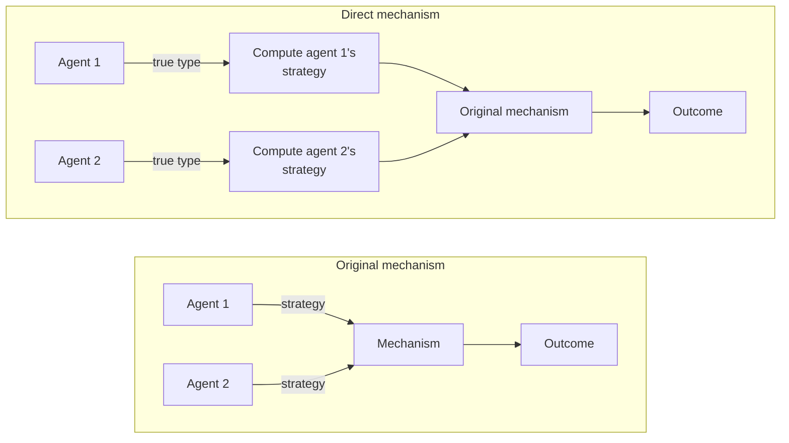
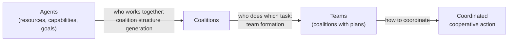

# 11 Coalitions and Auctions

Sources:

- Wooldridge, *An Introduction to MultiAgent Systems*, 2nd ed., 2009, Chapter 13 "Forming Coalitions" and Chapter 14 "Allocating Scarce Resources".
- Weiss (ed.), *Multiagent Systems*, 2nd ed., 2013, Chapter 7 "Mechanism Design and Auctions" by Kevin Leyton-Brown and Yoav Shoham, and Chapter 8 "Computational Coalition Formation" by Edith Elkind, Talal Rahwan, and Nicholas R. Jennings.

[09](09-strategic-interaction.md) predicted what self-interested agents do in a given game. [10](10-group-decisions.md) showed that voters can gain by misreporting. This topic covers two ways self-interested agents divide value: forming coalitions and sharing what they earn, and allocating scarce goods through auctions. Underneath both is *mechanism design*: choosing the rules so that agents pursuing their own interests produce a good result.

Each section below states the classical concept, then its relevance to agentic AI.

## 1. Mechanism Design

Game theory takes the game as given and predicts play. Mechanism design chooses the game, so Leyton-Brown and Shoham call it inverse game theory. They describe it as protocol design for distributed systems whose parts are not cooperative, or "incentive engineering".

A mechanism *implements* a goal if the outcomes rational agents reach under it are the ones the designer wants. The strongest form is implementation in *dominant strategies*: each agent's best action does not depend on what the others do.

The **revelation principle** simplifies the search. If any mechanism implements a goal, a *direct* mechanism in which each agent simply reports its private information, and reporting truthfully is optimal, implements it too.

*The revelation principle, after Weiss Figure 7.2. The new mechanism "lies for the agents": it takes their true types and plays their equilibrium strategies for them, so they have no reason to misreport.*

The authors add cautions. The mechanism must compute the agents' strategies, which can be hard. Agents must reveal everything about their preferences, which raises privacy and communication costs. The direct mechanism can have equilibria the original did not.

Gibbard-Satterthwaite ([10 section 4.2](10-group-decisions.md#42-gibbard-satterthwaite)) rules out useful dominant-strategy mechanisms for general preferences. The way out is to restrict preferences to *quasilinear* ones: each agent's utility is its value for the outcome minus what it pays. Money then becomes a tool for aligning incentives.

**Agentic AI relevance.**

- Designing protocols for agents with different owners is mechanism design. The question for any marketplace, registry, or task exchange is not only "does the protocol work?" but "what does each agent gain by misreporting, and does the protocol make honesty the best policy?"
- Dominant-strategy mechanisms suit LLM agents. The agent need only know its owner's preferences and report them, without modelling opponents. Its strategic reasoning is unreliable, so not depending on it is an advantage.
- The revelation principle's privacy cost matters for delegation. A direct mechanism asks an agent for its owner's full valuation, such as a budget ceiling, which owners may not want disclosed. Indirect mechanisms, such as an ascending auction, reveal less.

## 2. Coalitions

### 2.1 The setting

Wooldridge notes that cooperation fails in the prisoner's dilemma because agents cannot make binding agreements and utility goes to individuals. Contracts and firms remove both conditions, which is the setting of *cooperative game theory*. A *coalition* is any group of agents. Each coalition can achieve a *value*, which its members then divide. Wooldridge adopts a lifecycle from Sandholm and colleagues:

*The cooperation lifecycle, after Wooldridge Figure 13.1. This topic covers forming coalitions and dividing their value. [08](08-working-together.md) covered teams and coordination.*

### 2.2 Stability: the core

A division of a coalition's value is *stable* if no subgroup could do better on its own. The *core* is the set of divisions of the whole group's value to which no coalition objects.

Wooldridge's example: two agents each worth 5 alone and 20 together. Any division giving each at least 5 is in the core, such as (15, 5) or (10, 10). A division of (16, 4) is not, because agent 2 would leave. The core says (15, 5) is stable but not that it is fair.

The core can be empty. With three agents where any pair or all three earn 1, some agent gets at least 1/3, so the other two get at most 2/3 together and would leave to earn 1 as a pair.

Results on when the core is non-empty:

| Game class | Core |
|---|---|
| Simple games (each coalition wins or loses) | Non-empty if and only if some agent is in every winning coalition (a *veto player*). Only veto players are paid. |
| Convex games (an agent adds more to bigger coalitions) | Always non-empty. Paying each agent its contribution in any fixed joining order is stable. |

When the core is empty, related concepts always give an answer. The *least core* relaxes the stability constraints by the smallest amount that makes them satisfiable. The *nucleolus* minimises the largest dissatisfaction, then the next largest, and is unique.

### 2.3 Fairness: the Shapley value

The *Shapley value* pays each agent its average contribution to the coalition, over all the orders in which agents might join. Shapley (1953) showed it is the only division that satisfies four axioms: the whole value is shared out, agents that contribute nothing get nothing, interchangeable agents get the same, and the shares in a combined game are the sums of the shares in its parts.

In Wooldridge's example where agent 1 is worth 5 alone, agent 2 is worth 10 alone, and they are worth 20 together, the Shapley value is 7.5 for agent 1 and 12.5 for agent 2.

Elkind, Rahwan, and Jennings's parliament example shows that voting weight is not power. Parties hold 40, 22, 30, and 9 of 101 seats, and a majority needs 51. Any two of the three large parties win, and the smallest never makes a difference. The three large parties each have Shapley value 1/3 despite holding 40, 22, and 30 seats, and the smallest has 0. Raise the quota to 60, and the smallest party becomes pivotal for some coalitions and gains power.

### 2.4 Representation and computation

Listing a coalition's value for every subset needs 2^n entries. Compact representations trade expressiveness for tractability:

| Representation | Idea | Shapley value | Core questions |
|---|---|---|---|
| Weighted voting | A coalition wins if its weights reach a quota | Hard (#P-complete) with large weights | Easy for the whole group (check for a veto player) |
| Induced subgraph | Value is the sum of edge weights among members | Easy: half the weight of an agent's edges | Hard with negative weights |
| Marginal contribution nets | Rules such as "if a and b are present, add 5" | Easy for simple rules | NP-hard |
| Skill games | Value depends on the skills members bring or the tasks they can cover | Not stated in the chapter | Not stated in the chapter |

### 2.5 Coalition structure generation

When one designer owns all the agents, the question is not how to divide value but how to partition agents into coalitions to maximise the total. The number of partitions grows faster than exponentially, and the problem is NP-hard. Sandholm and colleagues showed that searching just the partitions into one or two coalitions, which together include every possible coalition, guarantees a result within a factor n of the optimum, and no smaller search guarantees anything. Dynamic programming finds the optimum in O(3^n) time. Anytime algorithms return good partitions early and improve them while time allows, which suits agents that may not have time to finish.

**Agentic AI relevance.**

- Splitting payment or credit among agents from different owners who completed a task together is a coalitional game. The Shapley value is the principled split. It needs exponentially many evaluations in general, but compact representations make it tractable.
- Skill registries map onto skill games: a team's value depends on the union of its members' advertised skills. Elkind, Rahwan, and Jennings note work on agents hiding skills or spreading them across several identities, the misreporting and Sybil problems of open registries.
- An agent with a skill nobody else has is a veto player and can claim the whole surplus. Without one, a multi-owner team may be unstable, and smaller teams may be the only stable arrangement.
- An orchestrator choosing teams of subagents for one owner is solving coalition structure generation. Anytime algorithms fit time-boxed planning.
- The theory assumes coalition values are known. For LLM agents the value of a team is uncertain and expensive to estimate, which the chapter's authors leave to other work.

## 3. Auctions

An auction allocates a scarce good to whoever values it most. Some formats also make bidders reveal their true valuations. Auctions vary along four dimensions:

| Dimension | Options |
|---|---|
| Values | Private (only the bidder's own value matters), common (the good is worth the same to all, but nobody knows exactly how much), or correlated |
| Price paid | First price (the winner pays its own bid) or second price (the winner pays the highest losing bid) |
| Visibility | Open (bids are public) or sealed |
| Progression | One shot, ascending, or descending |

The four standard single-item auctions:

| Auction | Format | Bidder's best strategy |
|---|---|---|
| English | Open, ascending. The winner pays its final bid. | Raise in small steps until the price reaches your value. |
| Dutch | Open, descending. The first bidder to accept pays the current price. | Strategically the same as first-price sealed-bid |
| First-price sealed-bid | One sealed bid. The highest pays its bid. | Bid below your value. With n bidders and values uniformly distributed, bid (n-1)/n of your value. |
| Vickrey (second-price sealed-bid) | One sealed bid. The highest pays the second-highest bid. | Bid your true value. This is a dominant strategy. |

In a Vickrey auction, bidding above your value risks winning at a price above it, and bidding below lowers your chance of winning without lowering the price. Truth-telling is best whatever others do.

*Revenue equivalence*: with risk-neutral bidders and independent private values, all four formats give the seller the same expected revenue. Wooldridge cautions that this depends on simple assumptions and genuinely private values.

Wooldridge's further points:

- **Winner's curse.** With common values, the winner is the bidder who most overestimated the good.
- **Collusion.** None of the four formats is immune to bidders colluding.
- **Lying auctioneers.** In a Vickrey auction, the auctioneer can overstate the second-highest bid. Signed bids or a trusted third party prevent it.
- **Spite.** Vickrey auctions allow bidding above your value to make a rival pay more, at the risk of winning at a loss.

**Agentic AI relevance.**

- Contract Net task allocation ([08 section 3](08-working-together.md#3-task-sharing-the-contract-net)) is a reverse auction. Awarding the task to the lowest bidder at the second-lowest price makes bidding true cost a dominant strategy, provided costs are private and agents act rationally.
- Proxy bidding, where an agent bids for its owner up to a stated maximum, is delegation in its simplest form. Leyton-Brown and Shoham show it reduces to a second-price auction, so a delegated agent needs only its owner's limit.
- Auctioneer honesty requires verifiable bids. Signed messages between agents, or a trusted registry acting as auctioneer, are the agent equivalents.
- Collusion and shill bidding are cheap when identities are free. One owner can run many agents in a marketplace.

## 4. Combinatorial Auctions and VCG

### 4.1 Bundles

When goods are worth more together (complements) or less together (substitutes), bidders need to bid on bundles. Selling each good separately exposes a bidder to winning only part of a bundle it needs. Combinatorial auctions settle bundle bids all or nothing. The UK's 2000 3G spectrum auction, a simultaneous ascending auction for five licences, raised £22.5 billion over 150 rounds.

Bidding languages express bundle values compactly. An XOR bid pays for at most one of its parts. An OR bid pays for any combination of non-overlapping parts:

| Bid | Value of {a, b} | Value of {c, d} | Value of {a, b, c, d} |
|---|---|---|---|
| ({a, b}, 3) XOR ({c, d}, 5) | 3 | 5 | 5 |
| ({a, b}, 3) OR ({c, d}, 5) | 3 | 5 | 8 |

Choosing the winning bids to maximise total value, the *winner determination problem*, is NP-hard and cannot be approximated well in general. In practice, integer programming "works surprisingly well", and greedy heuristics are used.

### 4.2 VCG

The Vickrey-Clarke-Groves (VCG) mechanism generalises the Vickrey auction:

1. Each agent reports its valuation.
2. Choose the outcome that maximises total reported value.
3. Each agent pays the harm its presence does to the others: the others' total value if it were absent, minus their total value in the chosen outcome.

Truth-telling is a dominant strategy, and the outcome maximises total value. With one good, VCG is the Vickrey auction.

Leyton-Brown and Shoham's example buys a route across a network where each link's owner privately knows its cost. The cheapest route costs 5 and uses three links. Each of those links is paid what the route would cost without it, minus the costs of the other links used. VCG pays the three link owners 4, 2, and 3. Two of them have the same cost, but one is paid more because the network has a worse alternative without it. VCG pays out 9 for a route costing 5 and collects nothing.

Their list of VCG's drawbacks, which they note are not unique to VCG:

1. Agents must disclose all their private information.
2. It is open to collusion.
3. Prices can be far above the value of the best alternative.
4. Excluding bidders can raise revenue.
5. Revenue cannot be given back to the agents without distorting incentives.
6. Choosing the outcome can be computationally intractable.

They add shill bids and false-name bidding, where one bidder uses several identities, and note VCG is rarely used in practice.

Three impossibility results bound what any mechanism can do:

| Result | Cannot have all of |
|---|---|
| Gibbard-Satterthwaite | Dominant-strategy truthfulness, three or more outcomes all possible, and no dictator (general preferences) |
| Green-Laffont and Hurwicz | Dominant-strategy truthfulness, maximum total value, and payments that never run a deficit |
| Myerson-Satterthwaite | Truthfulness in expectation, maximum total value, no deficit, and voluntary participation |

### 4.3 Sponsored search

Search advertising runs an auction on every search. In the *generalised first-price* auction, Leyton-Brown and Shoham's example shows bids climbing in small steps until one bidder drops out, then restarting, a cycle observed in practice. The *generalised second-price* auction, now dominant, charges each slot the next bid down. It is not truthful: in their example, a bidder valuing a click at $10 gains by bidding $3 for a lower slot when the lower slot's click rate is high enough.

**Agentic AI relevance.**

- An agent that needs several complementary skills, tools, or data sources values them as a bundle. Buying them separately creates exposure to buying only some. OR and XOR bids give a format for bundle requests.
- Routing a task through a chain of third-party agents is the shortest-path example. VCG makes cost reporting truthful but can cost the buyer far more than the work.
- False-name bidding defeats VCG, and creating agent identities costs almost nothing. Identity binding, such as verified agent identities or reputation, is a prerequisite for these mechanisms in agent marketplaces.
- The guarantees assume perfectly rational agents in equilibrium. LLM agents may follow instructions literally, collude implicitly, or cycle like the first-price search example. Leyton-Brown and Shoham list behaviour under bounded rationality as an open question.

## 5. Agents in Markets

Wooldridge describes early systems where agents traded for people:

| System | Mechanism | Human role |
|---|---|---|
| Kasbah (1996) | Marketplace matching buying and selling agents. Sellers set a target price, a minimum, a deadline, and how fast to lower the price. | The user confirms each sale. |
| eBay | English auction with a deadline and proxy bidding | The user sets a maximum. |
| Spanish Fishmarket | Models a real fish auction protocol | |
| Google AdWords | A second-price variant run on each search, ranking by bid and ad quality | Advertisers set budgets. |
| Trading Agent Competition | Agents buy flights, hotels, and entertainment for simulated clients across several kinds of auction | None at run time |

**Agentic AI relevance.** Kasbah and the Trading Agent Competition mark the two ends of a choice every owner of a spending agent faces: confirm each transaction, or set limits and let the agent act. The MoltMatch incident in [03 section 3](03-agent-landscape-2026.md#3-open-self-interested-mas-arrives) shows what happens when an agent acts without either.

## Key Takeaways

1. Mechanism design chooses rules so that self-interested agents produce good outcomes. Protocols between agents for different owners need it.
2. The revelation principle says truthful direct mechanisms suffice, at the cost of agents disclosing everything. Dominant-strategy mechanisms suit LLM agents because they need no model of opponents.
3. The core asks whether a coalition is stable. It can be empty. An agent with a unique required skill can claim the whole surplus.
4. The Shapley value is the unique fair division under four axioms. Voting weight is not power.
5. Partitioning one owner's agents into teams is a search problem with anytime algorithms and quality bounds.
6. In a Vickrey auction, bidding true value is dominant. Contract Net awards priced this way make honest cost bids the best policy.
7. Bundles of complementary goods need combinatorial auctions. Winner determination is NP-hard but often solvable in practice.
8. VCG makes truth-telling dominant and maximises total value, but can overpay, invites collusion and false-name bids, and is rarely used. No mechanism has every desirable property.
9. Cheap identities undermine every mechanism here. Agent marketplaces need identity and reputation before auctions or coalition payments can be trusted.
