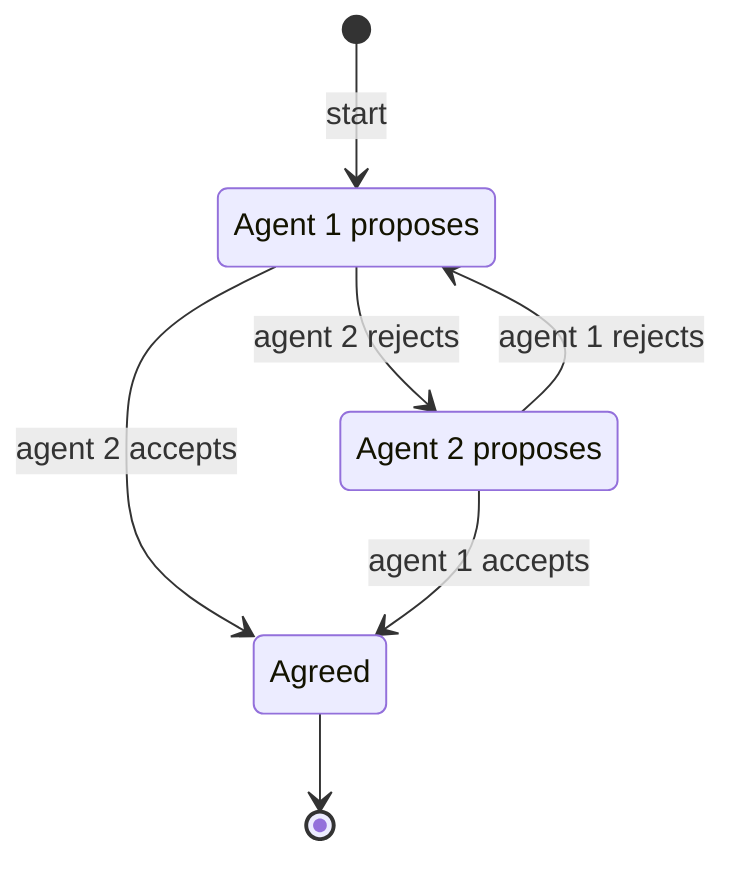
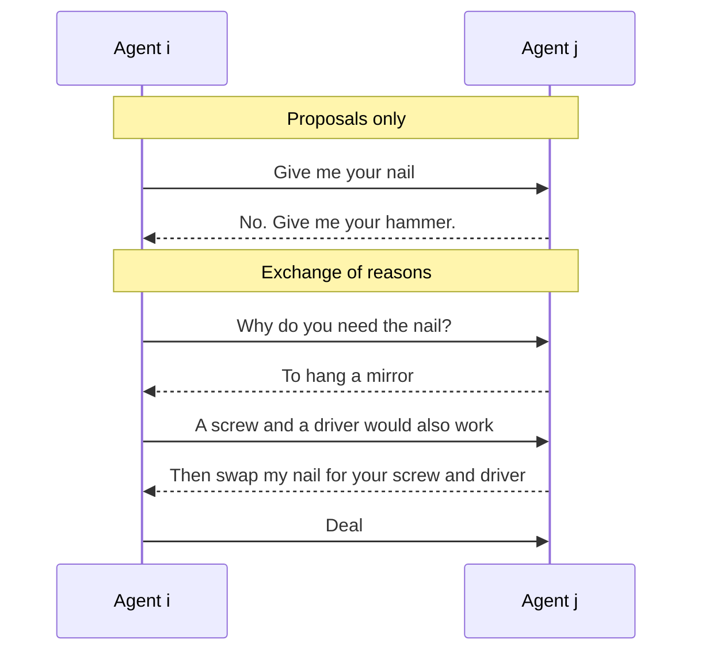
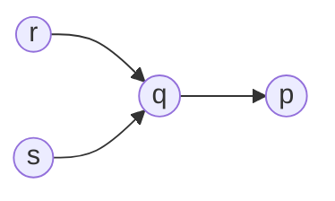

# 12 Bargaining and Argumentation

Sources:

- Wooldridge, *An Introduction to MultiAgent Systems*, 2nd ed., 2009, Chapter 15 "Bargaining" and Chapter 16 "Arguing".
- Weiss (ed.), *Multiagent Systems*, 2nd ed., 2013, Chapter 4 "Negotiation and Bargaining" by Shaheen Fatima and Iyad Rahwan, and Chapter 5 "Argumentation among Agents" by Iyad Rahwan.

This is the last of the four topics on self-interested agents. [09](09-strategic-interaction.md) to [11](11-coalitions-and-auctions.md) covered games, votes, coalitions, and auctions. This topic covers agents reaching agreement by exchanging offers (bargaining) and by exchanging reasons (argumentation). Fatima and Rahwan, quoting Jennings and colleagues, describe negotiation as a distributed search through a space of possible agreements.

Each section below states the classical concept, then its relevance to agentic AI.

## 1. The Negotiation Setting

Wooldridge breaks any negotiation into four parts:

| Part | What it is |
|---|---|
| Negotiation set | The possible proposals |
| Protocol | Which proposals are legal, given what has happened so far |
| Strategies | How each agent chooses its proposals. Usually private. |
| Agreement rule | When a deal is reached, and which deal it is |

Every negotiation also has a *conflict deal*: what each party gets if no agreement is reached. Fatima and Rahwan add that a strategy covers what information to reveal, truthfully or not, as well as which offers to make.

Negotiations differ in the number of issues and parties. With one issue, such as price, a concession is obvious. With several issues, it is unclear what counts as a concession, and the number of possible deals grows exponentially. One-to-one negotiation is the most analysed. Many-to-one is usually handled by auctions ([11](11-coalitions-and-auctions.md)). Many-to-many is hardest. Rosenschein and Zlotkin distinguish *task-oriented* domains, where agents redistribute tasks to cut their own costs, *state-oriented* domains, where agents choose a joint state to reach, and *worth-oriented* domains, where agents try to achieve as many goals as possible.

**Agentic AI relevance.** Agent-to-agent protocols such as A2A define how messages are exchanged and how tasks progress ([07 section 6](07-agent-communication.md#6-mcp-and-a2a)). For agents negotiating on behalf of different owners, the four parts are a checklist. The negotiation set, the agreement rule, and the conflict deal are usually left undefined, so two agents can exchange messages indefinitely without knowing whether they have agreed.

## 2. Axiomatic Bargaining

Nash (1950) asked what a fair agreement would be, without modelling the process. A *bargaining problem* is the set of utility pairs the parties could agree on, plus the *disagreement point* they get without agreement. Nash required the solution to satisfy five axioms: each party gets at least its disagreement payoff, the solution ignores which party is which, it is Pareto efficient, it is unaffected by rescaling either party's utility, and removing options that were not chosen does not change it. The unique solution maximises the product of the parties' gains over their disagreement payoffs.

Fatima and Rahwan contrast the two approaches:

| | Axiomatic (Nash) | Non-cooperative (Rubinstein) |
|---|---|---|
| Process | None | Offers alternate over time |
| Enforcement | A third party enforces the agreement | Agreements must be self-enforcing |
| Strength | Simple, with a unique answer | Models tactics, procedure, and information |
| Criticism | Ignores offers and the possibility of breakdown, so it suits arbitration | Relies on backward induction over events that never happen |

**Agentic AI relevance.** The Nash solution suits a mediator, such as a platform or registry, that settles a deal between agents for different owners. It requires each party's utility and fallback, which the parties have reason to misstate.

## 3. Alternating Offers

### 3.1 Rubinstein's protocol

Two agents divide a resource, conventionally a pie. Agent 1 proposes a division. Agent 2 accepts or rejects. If it rejects, agent 2 proposes and agent 1 responds, and so on.

*The alternating offers protocol, after Wooldridge Figure 15.1. Rejecting forever yields the conflict deal.*

The outcome depends on time:

| Setting | Outcome |
|---|---|
| One round | The proposer takes everything, and accepting is the responder's best reply. |
| Fixed number of rounds, no cost of delay | Whoever proposes last takes everything. |
| Unlimited rounds, no cost of delay | Any division is an equilibrium outcome, so equilibrium predicts nothing. |
| Unlimited rounds, delay is costly | A unique subgame-perfect equilibrium with immediate agreement (Rubinstein, 1982). |

With delay costly, each agent i has a *discount factor* δ_i between 0 and 1: a share received one round later is worth δ_i times as much. Agent 1 gets (1 − δ2) / (1 − δ1δ2) and agent 2 the rest. With both factors at 0.9, agent 1 gets about 0.53. The more patient agent does better, because its threat to hold out is more credible. Fatima and Rahwan add that bargaining power depends on relative, not absolute, costs of delay.

### 3.2 Deadlines and protocol choice

Real agents face deadlines. With a deadline and a common discount factor, backward induction still gives agreement in the first round. Fatima and Rahwan show that the protocol decides who gets the surplus. Under alternating offers, the surplus is shared and both the deadline and discounting matter. Under simultaneous offers in continuous time, agreement comes only at the earlier deadline, and the agent with the later deadline takes the entire surplus.

### 3.3 Publishing a strategy

Wooldridge notes that software agents, unlike people, can publish their code. Committing publicly to a hard strategy, such as "this is my final offer, and here is the program that will reject anything less", can pay off for the publisher.

**Agentic AI relevance.**

- Whoever designs the negotiation protocol between agents sets their bargaining power: alternating or simultaneous offers, deadlines, and who moves first.
- An agent negotiating for an owner should know its owner's deadline and cost of delay. These determine its bargaining power, and revealing them weakens it.
- Agent cards and registry entries could publish negotiation policies. A published hard policy is a credible commitment and can be used to exploit counterparties that negotiate flexibly.

## 4. Several Issues

When agents negotiate several issues, the procedure matters:

| Procedure | How issues are handled |
|---|---|
| Package deal | All issues in every offer. Agents trade off between issues. |
| Separate | Independent negotiations, such as separate delegates for each issue |
| Sequential, each implemented at once | One issue at a time, in agenda order, each settled as agreed |
| Sequential, implemented together | One issue at a time, but nothing takes effect until all are settled |

With complete information and linear utilities, the package-deal equilibrium reaches agreement in the first round and is Pareto efficient. Each offer is a knapsack problem: concede on the issues that cost you least and matter most to the other side. With indivisible issues that problem becomes NP-complete. Schelling first observed that the agenda matters: the order of issues changes the outcome. Agendas can be fixed in advance or negotiated.

**Agentic AI relevance.** Agents agreeing on a contract with price, deadline, scope, and quality terms face multi-issue negotiation. Package deals let both sides gain by trading across issues, which issue-by-issue negotiation misses. The agenda, as in [10 section 5](10-group-decisions.md#5-decisions-over-linked-issues), is a source of power.

## 5. Heuristic Negotiation

When computing equilibria is too hard, agents use heuristics. Faratin and colleagues (1998) defined *negotiation decision functions*, offers that depend on simple factors rather than strategic reasoning:

| Tactic family | Driven by |
|---|---|
| Time-dependent | Time left before the deadline. *Boulware* agents hold their offer and concede near the deadline. *Conceder* agents concede early. |
| Resource-dependent | Resources left |
| Behaviour-dependent | The opponent's concessions, imitated to avoid exploitation |

Agents can also model their opponent, for example inferring that an opponent that concedes more on price than on quality values quality more. A *mediator* can find Pareto-efficient deals when utilities interact, but only if the parties trust it and report honestly.

Negotiating with people is different. People react to framing, dislike unequal outcomes, and will punish unfairness at their own cost. Kraus and Lehmann built a Diplomacy-playing agent that could not be told apart from human players. The research platform Colored Trails, where players trade coloured chips to reach goals on a grid, has been used to study reciprocity and cultural differences.

**Agentic AI relevance.**

- LLM negotiators cannot compute equilibria over rich deal spaces, and free-form haggling is hard to audit. A concession curve with a reserve price and deadline, set by code outside the model, can be checked and enforced. The model can explain the offers while a deterministic function chooses them.
- A personal agent negotiating with a person, or for a person against a business agent, needs a model of human behaviour, not only of rational opponents.

## 6. Task-Oriented Domains

Rosenschein and Zlotkin studied agents that can save cost by redistributing tasks. Wooldridge's example is two neighbours driving children to school: if both have children going to the same school, one trip can serve both. A *deal* reassigns the tasks. The *negotiation set* is the deals that leave both agents no worse off than doing their own tasks and that cannot be improved for one without hurting the other.

In the **monotonic concession protocol**, agents make proposals simultaneously from the negotiation set. They agree when either rates the other's proposal at least as highly as its own. Otherwise each must concede in the next round or the result is the conflict deal. The protocol is verifiable and always terminates, but may not reach agreement and can take exponentially many rounds.

The **Zeuthen strategy** decides who concedes. An agent's *willingness to risk conflict* is what it would lose by accepting the other's offer, as a fraction of what it would lose by causing conflict. The agent less willing to risk conflict concedes, just enough to reverse the balance. Any agreement reached is Pareto efficient and individually rational, and the strategy is in equilibrium with itself, so Rosenschein and Zlotkin argue it can be published: "It does away with any need for secrecy."

Agents can lie about their tasks:

| Deception | Method | Countermeasure |
|---|---|---|
| Phantom task | Claim a task you do not have | Make tasks verifiable |
| Decoy task | Create an artificial task on demand | Detection "essentially impossible" |
| Hidden task | Conceal a real task to shift work to the other agent | None given |

**Agentic AI relevance.** Agents in a task market or skill registry can misreport their workload, capabilities, or costs in exactly these ways. Verifiability, such as attested capabilities or audited task claims, is the only remedy the classical work offers.

## 7. Argumentation-Based Negotiation

In the approaches so far, the only replies to an offer are a counter-offer or withdrawal. *Argumentation-based negotiation* also exchanges reasons, alternative plans, threats, rewards, and claims about rights and obligations. Fatima and Rahwan's example comes from Parsons and colleagues:

*After Weiss Figure 4.3. Agent i wants to hang a painting and has a hammer, a screw, and a driver. Agent j wants to hang a mirror and has a nail. Offers alone stall, because each needs what the other has. Asking why reveals an alternative plan, and both get what they need.*

Fatima and Rahwan call the lack of a model of strategy a major drawback of argumentation-based negotiation: agents may withhold or misrepresent their reasons. Wooldridge describes Sycara's Persuader, which mediated labour disputes by finding arguments that threatened goals the other side ranked higher. Its argument types ranged from appeals to universal principles, the weakest, to threats, the strongest.

**Agentic AI relevance.** LLM agents exchange reasons naturally, so argumentation-based negotiation fits them better than it fitted classical agents. The cautions carry over: agents may withhold reasons that weaken their position, and "why" questions need protocol rules so that dialogues stay relevant and end.

## 8. Argumentation

### 8.1 Abstract argumentation

Argumentation decides what to believe when the available information is inconsistent. Dung (1995), whom Wooldridge credits with making argumentation scientific, models it as a graph. Nodes are arguments, and an edge from a to b means a attacks b. The internal structure of arguments is ignored.

*After Wooldridge Figure 16.1a. r and s are unattacked, so they are accepted. Both attack q, so q is rejected. q was p's only attacker, so p is accepted.*

A set of arguments is *conflict-free* if none attacks another, and *admissible* if it is conflict-free and defends each of its members against every attacker. Several *semantics* then pick out acceptable sets:

| Semantics | Definition | Exists? |
|---|---|---|
| Grounded | Accept unattacked arguments, reject what they attack, repeat until nothing changes | Always. Unique. |
| Preferred | A maximal admissible set | Always. May be several. |
| Stable | Attacks every argument outside itself | Not always |

An argument is *sceptically* accepted if it is in every preferred set, and *credulously* accepted if it is in at least one. Checking admissibility is polynomial. Checking that a set is preferred is co-NP-complete. In the graph above, the grounded and the only preferred set are both {p, r, s}.

Two extensions make attacks depend on more than structure. In *preference-based* argumentation (Amgoud and Cayrol), an argument cannot attack a stronger one: forensic evidence is not defeated by hearsay. In *value-based* argumentation (Bench-Capon), each argument promotes a value, each audience ranks values, and whether an attack succeeds depends on the audience. Wooldridge's example concerns whether to punish someone who harmed a burglar. An audience that ranks life above property accepts the right-to-life argument over the property-defence argument. Most audiences rank defending one's own life above an attacker's life, so the self-defence argument wins.

### 8.2 Structured arguments

Arguments built from premises and rules can be attacked in three ways:

| Attack | Target |
|---|---|
| Rebut | The conclusion |
| Undercut | Whether a rule applies in this case |
| Undermine | A premise |

Walton's *argument schemes* pair a pattern of reasoning with *critical questions* that test it. His scheme for practical reasoning: in these circumstances, doing this action leads to a state that achieves the goal and promotes a value, so do the action. Its critical questions ask whether the circumstances are true, whether the action has the stated consequences, whether it will achieve the goal, whether the goal promotes the value, and whether there are other ways.

### 8.3 Dialogues

Walton and Krabbe classified dialogues by their starting situation and goal:

| Type | Starting situation | Goal |
|---|---|---|
| Persuasion | Conflicting opinions | Resolve the issue |
| Negotiation | Conflicting interests | Make a deal |
| Inquiry | Shared ignorance | Establish knowledge |
| Deliberation | A need to act | Reach a decision |
| Information seeking | One party's ignorance | Pass on knowledge |
| Eristic | Antagonism | Strike at the other party |

Dialogue protocols fix the legal moves. In Prakken's persuasion protocol, a party can *claim* something, the other can ask *why*, the first answers with an argument (*since*), and either can *concede* or *retract*. Argument games between a proponent and an opponent connect dialogues to the semantics: the proponent has a winning strategy in one such game exactly when its argument is in the grounded set.

### 8.4 Strategic argumentation

Rahwan applies mechanism design ([11 section 1](11-coalitions-and-auctions.md#1-mechanism-design)) to argumentation. Each agent privately holds some arguments, reveals some of them, and the outcome is the grounded set of all revealed arguments. Agents prefer outcomes that accept more of their own arguments. Assuming an external verifier stops agents inventing arguments, the only manipulation left is hiding them, and hiding can pay. In Rahwan's example, agent x holds α1, α4, and α5. The attacks are α1 on α2, α2 on α3, and α3 on α4 and α5:

| x reveals | Accepted arguments | x's arguments accepted |
|---|---|---|
| α1, α4, α5 | α1, α3 | 1 |
| α4, α5 | α2, α4, α5 | 2 |

By hiding α1, x lets α2 defeat α3, which frees α4 and α5. Revealing everything is guaranteed to be best for an agent if none of its arguments indirectly attacks another of its own through a chain of an odd number of attacks, as α1 does to α4 and α5 here. Rahwan calls the field "still in its infancy" on strategy.

The *Argument Interchange Format* (AIF) is a community ontology for exchanging arguments between systems. Information nodes hold claims. Scheme nodes record inference, conflict, or preference. Information nodes never link directly, so every relationship is explicit.

**Agentic AI relevance.**

- When several LLM agents or critics disagree, building an explicit attack graph and taking the grounded set gives a unique, sceptical, auditable result. That is different from a majority vote ([10](10-group-decisions.md)) or an LLM judge. Value-based audiences correspond to owners with different priorities.
- Walton's critical questions are a checklist for reviewing an agent's justification of an action. The AIF's explicit structure is a format for justification messages between agents and for audit logs.
- Labelling agent-to-agent conversations by Walton and Krabbe's types would let each type have suitable rules. Persuasion should not be judged as negotiation, and eristic exchanges should be detected and stopped.
- Selective disclosure is the strategic problem. A vendor agent in a marketplace presenting only favourable evidence is hiding arguments. Rahwan's external verifier corresponds to provenance or attestation of claims, which [05](05-trust-and-reputation.md) and [07](07-agent-communication.md) also call for.

## Key Takeaways

1. A negotiation needs a negotiation set, a protocol, strategies, an agreement rule, and a conflict deal. Agent-to-agent protocols usually leave the agreement rule and conflict deal undefined.
2. With alternating offers and costly delay, agreement is immediate and the more patient agent gets more. Deadlines and protocol choice decide who gets the surplus.
3. Software agents can publish their negotiation strategy. A published hard strategy is a credible commitment, and a strategy in equilibrium with itself can be published safely.
4. With several issues, package deals let both sides gain by trading across issues. The agenda is a source of power.
5. Simple concession curves with deadlines and reserve prices, set by code outside the model, are an auditable policy for LLM negotiators.
6. Agents can lie about tasks and capabilities. Verifiability is the main defence.
7. Exchanging reasons can unlock deals that offers alone cannot, but agents may withhold reasons that hurt them.
8. Abstract argumentation gives a unique, sceptical way to resolve disagreement among agents, an alternative to voting or an LLM judge.
9. Hiding arguments can pay. Provenance and attestation of claims are needed for argumentation between self-interested agents.
