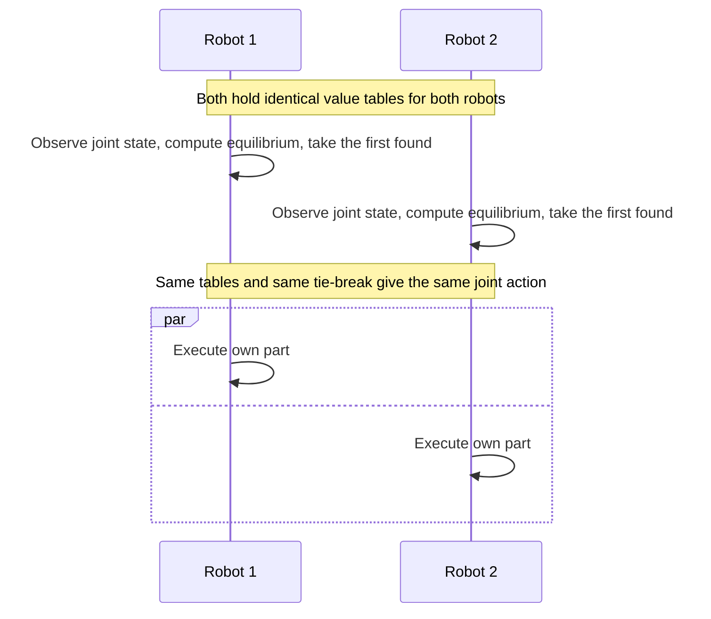
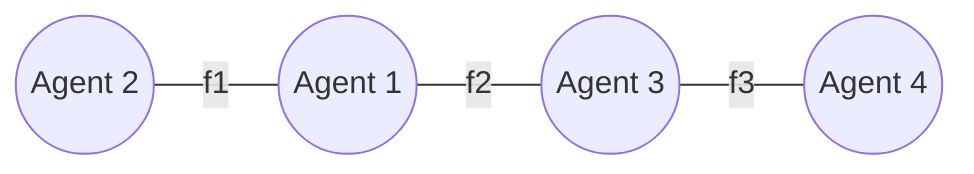

# 13 Multiagent Learning and Coordination

Sources:

- Sadhu and Konar, *Multi-Agent Coordination: A Reinforcement Learning Approach*, IEEE Press, 2020. Chapter 1 surveys multiagent reinforcement learning. Chapters 2 to 4 present the authors' methods for cooperative multi-robot planning, and Chapter 5 an evolutionary method for robots carrying a stick together.
- Vlassis, *A Concise Introduction to Multiagent Systems and Distributed Artificial Intelligence*, 2007, Chapter 4 "Coordination" and Chapter 7 "Learning".
- Weiss (ed.), *Multiagent Systems*, 2nd ed., 2013, Chapter 10 "Multiagent Learning" by Karl Tuyls and Kagan Tumer.

[09](09-strategic-interaction.md) to [12](12-bargaining-and-argumentation.md) assumed agents know the game they are playing. This topic covers agents that learn what to do from rewards, alongside other agents that are also learning. It ties together threads from earlier topics: equilibrium selection from [09](09-strategic-interaction.md), coordination from [08](08-working-together.md), and the network view of [06](06-control-of-cooperative-mas.md).

Deployed LLM agents mostly do not learn online from rewards. Two parts of this topic carry over anyway. The coordination mechanisms, such as conventions, roles, and coordination graphs, work without learning. The learning problems, such as non-stationarity and credit assignment, appear whenever agents adapt their prompts, memories, or policies while others do too, and whenever a team's result has to be credited to its members. Section 8 states what carries over.

Each section below states the classical concept, then its relevance to agentic AI.

## 1. From One Learner to Many

### 1.1 Single-agent reinforcement learning

A *Markov decision process* (MDP) has states, actions, transition probabilities, and rewards. The *Markov property* holds when the current state summarises everything relevant from the past. An optimal policy then depends only on the state. *Q-learning* learns the value Q(s, a) of taking action a in state s, without a model of the transitions, by repeatedly moving its estimate toward the observed reward plus the discounted value of the next state. It converges to the optimal values if every state-action pair is tried infinitely often and the learning rate decays suitably (Watkins and Dayan, 1992). Agents balance *exploration* against *exploitation*, for example by acting randomly with a small probability.

### 1.2 Markov games

A *Markov game*, or stochastic game, extends the MDP to several agents. In each state, agents choose actions simultaneously, each receives its own reward, and the joint action decides the next state. Each state is a strategic game of the kind in [09](09-strategic-interaction.md). Unlike an MDP, an equilibrium policy may need randomisation.

Tuyls and Tumer list five ways to set up a multiagent MDP, differing in what each agent sees, how actions are chosen, and which reward it optimises:

| # | Agent sees | Actions | Reward optimised |
|---|---|---|---|
| 1 | Full state | One central policy over joint actions | Team |
| 2 | Full state | Each agent chooses its own | Team |
| 3 | Full state | Each agent chooses its own | Its own |
| 4 | Its local state | Each agent chooses its own | Team |
| 5 | Its local state | Each agent chooses its own | Its own |

**Agentic AI relevance.** The five setups correspond to design choices in multi-agent LLM systems: one orchestrator choosing for everyone (1), agents with shared context judged on the team result (2), agents with only their own context judged on their own subtask (5), and the cases between.

## 2. Why Multiagent Learning Is Hard

The sources agree on four core problems.

1. **Non-stationarity.** To each learner, the other learners are part of the environment, and they keep changing. The conditions under which single-agent learning converges no longer hold. Tuyls and Tumer state there is no general formal theory of when multiagent learning succeeds.
2. **Curses of dimensionality.** States, joint actions, and joint outcomes each grow exponentially with the number of agents. A table indexed by joint state and joint action for m agents needs |S| × |A|^m entries.
3. **Credit assignment.** *Temporal* credit assignment asks which action in a sequence earned a delayed reward. *Structural* credit assignment asks how much of the team's result is due to each agent. Temporal methods such as Q-learning do not solve the structural problem, which grows with the number of agents.
4. **Equilibrium selection.** When a game has several equilibria, learners that do not communicate may settle on different ones and miscoordinate.

Sadhu and Konar add that many algorithms assume each agent can observe every other agent's rewards and that all agents run the same algorithm. They call these assumptions "not realizable in practice".

**Agentic AI relevance.**

- Non-stationarity applies whenever several agents adapt at once: rewriting their own prompts, updating memories, or being re-tuned from feedback. Evaluating one agent goes stale when another changes.
- The joint-action blow-up has an LLM counterpart in context and tokens. If every agent receives every other agent's messages, cost grows with the number of pairs. Section 5 shows how classical work avoids the blow-up.
- Structural credit assignment is the question of which subagent caused a pipeline's success or failure when only the final output is scored.

## 3. Learning Approaches

Sadhu and Konar classify multiagent reinforcement learning by task (cooperative, competitive, or mixed) and by whether the game has one state or many. The main families:

| Approach | Each agent learns | Needs to observe | Guarantee |
|---|---|---|---|
| Independent learners | Values of its own actions only | Its own action and reward | None in general, because of non-stationarity. In simple coordination problems, convergence to some equilibrium, possibly not the best. |
| Joint-action learners (Claus and Boutilier) | Values of joint actions, plus estimates of others' strategies | Others' actions | Converge to some equilibrium under conditions, not necessarily the best |
| Team Q-learning (Littman) | One value over joint actions, with a shared reward | Joint action | Converges. Choosing between equally good equilibria is left open. |
| Distributed Q-learning (Lauer and Riedmiller) | Its own action values, updated only upward | Joint state | Finds the optimal joint policy in deterministic cooperative problems only |
| Nash-Q (Hu and Wellman), correlated-Q (Greenwald and Hall) | Every agent's joint-action values. Each update uses an equilibrium of the next state's game. | All agents' actions and rewards | Converges only under restrictive conditions. Agents may select different equilibria. |
| Minimax-Q (Littman) | Values against a worst-case opponent | Opponent's action | Converges in two-player zero-sum games |
| Gradient methods (IGA, WoLF) | A mixed policy, adjusted along the payoff gradient | Varies | WoLF ("win or learn fast": learn quickly when losing, slowly when winning) converges where plain gradient ascent cycles, in two-player two-action games |

The *climbing game* from Claus and Boutilier shows how learners miss the best outcome. Two agents share the payoff:

| | a0 | a1 | a2 |
|---|---|---|---|
| **b0** | 11 | −30 | 0 |
| **b1** | −30 | 7 | 6 |
| **b2** | 0 | 0 | 5 |

The best joint action pays 11, but it sits next to −30. While each learner is unsure what the other will do, the risk of −30 drives both toward safer actions, and they settle on a lower-paying equilibrium. Sadhu and Konar report that independent learners, joint-action learners, and the FMQ heuristic settle on the suboptimal outcome in their version of this game. Tuyls and Tumer describe *lenient* learners, which judge an action by its best recent result instead of its average, as improving convergence to the optimum in such games.

**Agentic AI relevance.** The climbing game describes agents that converge on a safe but mediocre convention, such as a conservative output format or division of work, because the better one is risky while the others' behaviour is uncertain. Leniency suggests judging a candidate convention by its best results during a trial period, not its average while partners are still adjusting.

## 4. Equilibrium Selection

### 4.1 Conventions and roles

Vlassis's example is two agents who want to see the same film. Thriller-thriller and comedy-comedy both pay 1, and mismatches pay 0. Both are equilibria, and nothing in the game picks one. For collaborative agents, Vlassis defines coordination as choosing one Pareto-optimal equilibrium, so coordination reduces to equilibrium selection.

| Mechanism | How it selects | Requires |
|---|---|---|
| Social convention (Boutilier) | Every agent computes all equilibria and takes the first in a shared ordering, for example by agent and then action | All agents know the ordering. Computing every equilibrium is expensive. |
| Communication | Agents choose in a fixed order, each announcing its choice | A shared agent order |
| Roles | A role restricts an agent's actions in a state, shrinking the game. If one moviegoer cannot see thrillers, only comedy-comedy remains. | A role assignment, for example greedily by each agent's suitability score |
| Shared signal | A signal all agents see, such as a traffic light, picks the equilibrium. This is the idea of correlated equilibrium. | A trusted common signal |

### 4.2 Coordination without messages

Sadhu and Konar's robots coordinate without communicating, because communication is slow on real robots. Each robot stores every robot's learned value table. At each step, each computes the equilibrium of the current state's game independently, taking the first one found when there are several. Identical tables and an identical tie-break give identical choices.

*Coordination without communication, after Sadhu and Konar Figure 1.47. No message passes between the robots. The deterministic tie-break is a convention doing the work the equilibrium concept cannot.*

### 4.3 Consensus Q-learning

Sadhu and Konar's Chapter 3 proposes *consensus Q-learning* (CoQL) for equilibrium selection. Their "consensus" is not the averaging process of [06 section 1](06-control-of-cooperative-mas.md#1-consensus-agreeing-on-a-value). It is a single joint action that maximises every agent's value at once, and also maximises a *potential*: one function that every agent's payoff increases with, as in a *potential game*. Their Theorem 3.1 shows that in a potential game, such a joint action is both a pure Nash equilibrium and a pure correlated equilibrium, assuming a suitable pure equilibrium exists. CoQL learns using this joint action in place of a Nash or correlated equilibrium.

The theorem does not show that such a joint action exists in a given state, what to do when it does not, or that CoQL converges. In the reported planning experiment, two robots carrying a stick took the same number of steps with CoQL as with Nash-Q, and made one fewer 90° turn each.

### 4.4 Rewarding the team, not the individual

Sadhu and Konar's Chapter 2 identifies a failure that individual rewards cause. When robots are rewarded for reaching their own goals, a joint action that brings some robots to their goals while leaving others short becomes an equilibrium. The robots that have arrived gain nothing by moving, so the team stalls. Their Theorem 2.2 shows that rewarding only arrival at the team goal removes this equilibrium. They also have robots that arrive early wait at their goals, with a timeout, until the rest arrive.

Their Chapter 4 learns one shared value table that already combines all agents' values, so choosing a joint action is a single lookup. The combination encodes how tightly the task couples the agents. Taking the minimum over agents suits tight coupling, where all must succeed, such as carrying a stick together. Taking the maximum suits loose coupling, where one success is enough, such as passing a box along. They report learning per episode about a thousand times faster than correlated-Q, and planning 1.8 to 2.8 times faster.

**Agentic AI relevance.**

- LLM agents sampling at non-zero temperature, or holding slightly different context, lack the identical tables and deterministic tie-break that let Sadhu and Konar's robots agree silently. Agreement needs an explicit convention, such as a fixed ordering, a coordinator's choice, or a shared plan identifier.
- Consensus in the CoQL sense, an option that is every agent's first choice, exists only sometimes. A protocol that waits for it needs a rule for when it does not exist, which the book does not supply. Voting rules ([10](10-group-decisions.md)) and argumentation ([12](12-bargaining-and-argumentation.md)) are alternatives.
- Theorem 2.2 explains a failure from [08 section 8](08-working-together.md#8-coordination-failures): partial task completion, where each agent succeeds locally while the team goal fails. Scoring subagents on their own subtasks makes stopping early a stable outcome. Scoring on joint completion removes it.
- Minimum and maximum aggregation is a precise way to state whether every agent must succeed or any one is enough. For example, parallel reviewers that must all approve combine by minimum, while parallel searchers where one hit suffices combine by maximum.
- Roles as action restrictions correspond to limiting each agent's tools. A reviewer with no write access removes ambiguity about who acts.

## 5. Sparse Coordination

### 5.1 Coordination graphs

Agents rarely need to coordinate with everyone. Guestrin and colleagues decompose the team's payoff into a sum of local payoffs, each depending on only a few agents' actions. A *coordination graph* has a node per agent and an edge per local payoff. Vlassis's example has four agents:

*After Vlassis Figure 4.3. The team payoff is f1(agents 1, 2) + f2(agents 1, 3) + f3(agents 3, 4). Agents 2 and 4 never need to coordinate directly.*

**Variable elimination** finds the best joint action exactly. Agents are eliminated one at a time. Each eliminated agent works out its best response to every combination of its neighbours' actions and passes the resulting value function to a neighbour. A backward pass then fixes each agent's action. For Vlassis's example, eliminating agents in the order 1, 2, 3, 4:

| Step | Action |
|---|---|
| Eliminate agent 1 | Combine f1 and f2 into a function of agents 2 and 3, recording agent 1's best response to each combination |
| Eliminate agent 2 | Reduce that to a function of agent 3 alone |
| Eliminate agent 3 | Combine with f3 into a function of agent 4 alone |
| Agent 4 | Choose the best action. Then agents 3, 2, and 1 read off their recorded best responses in turn. |

Eliminating an agent can create new links between its neighbours, as eliminating agent 1 links agents 2 and 3 above. The running time depends on the elimination order, and finding the best order is NP-complete. On densely connected graphs it can be exponential in the number of agents, and no answer is available until the end.

**Max-plus** is the alternative. Neighbours repeatedly send each other messages summarising the best value each action can lead to. It is exact on graphs without cycles and approximate on graphs with cycles, but much faster in practice. It is *anytime*: it can be stopped at a deadline with the best answer so far. Vlassis notes that coordinating on a coordination graph is essentially a distributed constraint optimisation problem.

### 5.2 Sparse cooperative Q-learning

Kok and Vlassis apply the same idea to learning. Each agent learns values that depend only on its graph neighbours' actions, and the team's value is their sum. Choosing the joint action becomes inference on the coordination graph instead of enumerating every joint action. It finds the optimal joint policy if the true values decompose this way, which does not hold in general. Sadhu and Konar's survey describes the simpler variant: agents learn joint values only in the few states where coordination is needed, and their own action values everywhere else.

Wang and de Silva's *sequential Q-learning*, from the same survey, avoids joint search differently. Robots carrying an object choose actions in a fixed priority order, each excluding actions already claimed by those before it.

**Agentic AI relevance.**

- A coordination graph is the alternative to every agent reading every message. Agents connect only to peers whose work interacts, such as components that share an interface. That is the "context economy" the curse of dimensionality calls for.
- Coordinating only where needed suggests a design: agents act independently by default and run a joint decision step only at known contention points, such as shared files, shared interfaces, or a shared budget.
- Max-plus maps onto rounds of neighbour-only messages with a deadline, an anytime protocol that suits time-boxed agent work.
- Sequential claiming in priority order is a direct template for task claiming among LLM workers without a joint search.

## 6. Credit Assignment and Reward Design

In cooperative systems the designer chooses each agent's reward, and the choice shapes what agents learn. Tuyls and Tumer name two properties that usually conflict. A reward is *factored*, or aligned, if it agrees with the team's objective about which actions are better. It is *learnable*, or sensitive, if it depends mainly on the agent's own actions rather than on everyone else's noise.

| Agent reward | Aligned with the team? | Learnable? | Note |
|---|---|---|---|
| Team reward G | Fully, by definition | Poorly, worse as agents increase | Works with few agents |
| Local reward | Often not | Fully | Needs only the agent's own state |
| Difference reward D | Fully | Usually much better than G | Needs knowledge of the team state, often estimated |

The *difference reward* is the team result minus the team result with the agent's action replaced by a fixed default, such as removing the agent. The subtracted term does not depend on the agent's action, so the difference reward ranks the agent's actions exactly as the team reward does, while removing most of the other agents' noise.

Their air traffic case study applies this to US flight management. Agents are fixed points in airspace, not aircraft, because fixes are stable and lie on every flight plan. Agents choose spacing between aircraft passing through. The team objective penalises total delay plus five times a quadratic penalty for exceeding sector capacity. In tests with up to 2,500 aircraft, and with historical New York data, agents learning from difference rewards significantly outperformed agents learning from the team reward. Estimated difference rewards also beat the team reward.

**Agentic AI relevance.**

- A pipeline scored only on its final output gives each subagent the team reward: aligned, but too noisy to say which subagent helped. Scoring each subagent on its own checks, such as tests passing, gives a local reward: learnable, but possibly against the team's interest.
- The difference reward has a direct evaluation counterpart. Rerun the pipeline with one agent's contribution replaced by a default, and compare. This estimates each agent's marginal contribution, like the Shapley value of [11 section 2.3](11-coalitions-and-auctions.md#23-fairness-the-shapley-value) at much lower cost.
- Choosing stable roles as agents, rather than transient work items, eases credit assignment and data collection, as choosing fixes over aircraft did.

## 7. Population and Evolutionary Views

### 7.1 Replicator dynamics

Evolutionary game theory replaces a few perfectly rational players with large populations whose strategy mix shifts toward strategies that earn more than average. The *replicator dynamics* describe this shift. Tuyls and Tumer describe results showing that, in the continuous-time limit, learners such as Q-learning with randomised exploration follow replicator dynamics plus an exploration term. A learner's long-run behaviour can then be predicted from the dynamics' *basins of attraction*: which starting points lead to which equilibrium.

Their *subsidy game* shows how changing payoffs changes which equilibrium learners reach:

| | s1 | s2 |
|---|---|---|
| **s1** | 10, 10 | 0, s |
| **s2** | s, 0 | 12, 12 |

With s = 0 there are two equilibria, and learners may reach the worse one. With a subsidy of s = 11, s2 becomes the better choice whatever the other agent does, and only the better equilibrium remains. This is equilibrium selection by mechanism design ([11 section 1](11-coalitions-and-auctions.md#1-mechanism-design)).

### 7.2 Swarms and evolutionary optimisation

*Swarm intelligence* coordinates many simple agents through local interaction. Ant colonies communicate indirectly by leaving pheromone in the environment (*stigmergy*), and bees directly by dancing. Tuyls and Tumer give four principles: local awareness only, decentralised control, local interactions that solve subproblems, and global self-organisation.

Sadhu and Konar's Chapter 5 uses an evolutionary optimiser instead of learning for two robots carrying a stick. At each step, the robots choose their next positions to minimise the distance to the goal, subject to staying exactly one stick-length apart and avoiding obstacles. Their hybrid optimiser, ICFA, combines the imperialist competitive algorithm with the firefly algorithm. It moves weak candidates in large random steps to explore and strong candidates in small steps to refine. On two Khepera-II robots it reached the goal in 10 steps, against 13 to 22 for the algorithms it was compared with. They warn that noisy sensors can mislead selection based on measured fitness.

**Agentic AI relevance.**

- A subsidy that removes a bad equilibrium is a design lever for agent ecosystems: change the payoffs, for example by rewarding adoption of a shared format, rather than hoping agents find the good convention.
- Stigmergy and direct messaging correspond to coordinating LLM agents through a shared workspace, such as files or a task board, versus sending messages between them.
- The stick constraint is a hard joint invariant that every step must keep, like two agents editing a schema and its migrations, which must stay consistent at every commit.
- The noise warning applies to loops that select candidates by an LLM judge's score. Noisy evaluation misleads selection.

## 8. What Carries Over

| Classical concept | Carries over to LLM agents as | Caveat |
|---|---|---|
| Non-stationarity | Agents adapting prompts, memories, or policies while others do too | Applies only where agents adapt. Most deployed agents do not. |
| Equilibrium selection | Agents settling on different conventions, formats, or plans | Sampling and differing context remove the silent agreement identical robots enjoy. Explicit conventions are needed. |
| Team versus individual reward | Scoring subagents on joint completion, not their own subtask | Directly applicable to evaluation and incentives |
| Coordination graphs, sparse coordination | Connecting agents only where their work interacts | Directly applicable to topology and context design |
| Difference rewards | Counterfactual evaluation of each agent's contribution | Costs an extra run per agent |
| Convergence and stability | Whether agent loops and revision cycles settle, oscillate, or diverge | No guarantees for LLM loops. [R13](../research/README.md) measures this. |

## Key Takeaways

1. Agents learning alongside other learners face a moving target. Single-agent convergence guarantees fail, and there is no general theory of when multiagent learning works.
2. Joint state and action spaces grow exponentially with the number of agents. The LLM counterpart is context and token cost in fully connected agent networks.
3. Learners often settle on a safe but mediocre equilibrium. Lenient evaluation and payoff design, such as subsidies, steer them to better ones.
4. Equilibrium selection needs conventions, roles, or shared signals. Identical robots agree silently through identical tables and tie-breaks. LLM agents, which sample and hold different context, need explicit conventions.
5. CoQL's "consensus" is a joint action that is every agent's first choice. It is both a Nash and a correlated equilibrium in potential games, but may not exist.
6. Individual rewards can make stopping early a stable outcome. Rewarding the team goal removes it, and minimum or maximum aggregation states whether all agents or any one must succeed.
7. Coordination graphs restrict coordination to agents whose work interacts. Variable elimination is exact but can be slow, and max-plus is fast and anytime.
8. Team rewards are aligned but noisy, and local rewards are learnable but can be misaligned. Difference rewards are both, and correspond to counterfactual evaluation of each agent.
