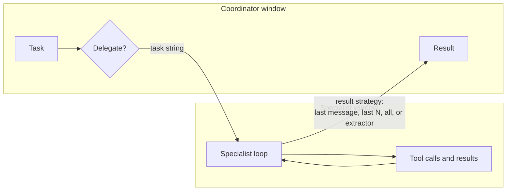

# 14 Context Engineering

Sources:

- Rothman, *Context Engineering for Multi-Agent Systems*, Packt, 2025. Chapters 1 and 3 to 8 build one system, a "Context Engine", step by step.
- Dibia, *Designing Multi-Agent Systems: Principles, Patterns, and Implementation*, 2025, Chapter 1, Chapter 4 sections 4.11 to 4.13, Chapter 11, and Chapter 15.
- O'Brien, *Building Complex Multi-Agent Systems Using Patterns*, Packt, 2026, Chapters 3 and 7.

Topics 01 to 13 come from the classical literature, where an agent's beliefs are limited only by its memory and its time to reason. An LLM agent's beliefs, for one model call, are whatever text is in its context window. The window has a fixed size, every token in it costs money and time, and the model attends to some of it less well than the rest. *Context engineering* is the discipline of deciding what goes into each agent's window, in what form, and what comes back out. None of the classical sources has it, because no classical agent had this constraint.

[01 section 2](01-setting-the-scene.md#2-core-definitions) noted that each subagent has its own context window and that an orchestrator merging summaries loses information. [02 section 6](02-agent-architectures.md#6-where-llm-agents-fit) mapped the context window to BDI beliefs. This topic covers what practitioners now do about both.

**A caution on evidence.** The three books describe practice, not tested results. Rothman reports one token measurement from one run. O'Brien reports none, and his thresholds are rules of thumb. Dibia runs two small studies, each with one run per configuration and an LLM judge. Numbers below are labelled with what they rest on. [15](15-evaluating-agent-systems.md) covers how such claims should be tested.

Each section below states the practice, its nearest classical concept, then its relevance to agentic AI.

## 1. The Context Window as a Constraint

### 1.1 What fills a window

O'Brien lists the parts of a prompt: the system prompt, retrieved context (usually the largest), conversation history, the user message, and the response. Output tokens cost two to four times as much as input tokens (his figure, unsourced). In an agent loop, every tool call and its result is appended, so the window grows with each step.

Dibia names two problems:

- *Context explosion*: tool results and history pile up until the window overflows or the cost becomes prohibitive.
- *Context rot*: the model's recall degrades as the window fills. He cites Liu et al. 2024 ("lost in the middle") for models attending mostly to the start and end of a long context. His claim that degradation begins around 32K tokens has no citation in that section.

### 1.2 How the request is framed

Rothman grades prompts into five levels of context:

| Level | Name | What is added |
|---|---|---|
| 1 | Basic prompt | Nothing. A bare instruction. |
| 2 | Linear context | A preceding sentence |
| 3 | Goal-oriented | An explicit goal line |
| 4 | Role-based | A list of roles: protagonist, antagonist, setting, and so on |
| 5 | Semantic blueprint | A JSON structure of semantic roles: who does what to whom, when, and how |

His support is one example sentence per level, pasted into three chat products and judged by the author. His later point is more useful: the quality of a summary depends on the objective given to the summariser. "Summarize this text" is weak. A precise extraction objective is strong. He calls this *micro-context engineering*. In his legal case study, a vague goal produced "technically fluent nonsense".

### 1.3 Classical counterpart

A BDI agent's belief base has no fixed size, and every belief is equally available to its reasoning. Bounded rationality (Simon, and Russell and Wefald's metareasoning) treats deliberation as costly, but nothing in the classical sources models a window that holds a fixed amount and degrades as it fills. An agent's behaviour also did not depend on how a request was worded. A KQML or FIPA message's content was parsed deterministically ([07 section 4](07-agent-communication.md#4-agent-communication-languages)).

**Agentic AI relevance.**

- The window is the agent's whole world for one call. A fact not in it does not exist for the agent, and a fact buried in the middle of it may be missed.
- Every agent in a team has its own window. Deciding what each one sees is a design task, not a side effect of the framework.

## 2. Assembling Context per Call

### 2.1 Retrieval as per-call belief

Retrieval-augmented generation (RAG) builds part of the window per request: embed the query, find similar chunks in a vector store, insert them. O'Brien models this as the Content Enricher pattern from enterprise integration. What the agent believes for one call is decided by retrieval settings: chunk size and overlap, the number of chunks returned, the similarity function. O'Brien lists about 15 interdependent settings, from chunking strategy to model version, and argues that changing one breaks others. He shows this only as a thought experiment.

### 2.2 Retrieving how as well as what

Rothman's main design splits retrieval into two stores:

| Store | Holds | Retrieved by | Goes into |
|---|---|---|---|
| Knowledge base | Facts | A Researcher agent | The user prompt ("what") |
| Context library | Style and structure templates, called blueprints | A Librarian agent | The system prompt ("how") |

The classical counterpart is the BDI split between beliefs and a plan library ([02 section 3](02-agent-architectures.md#3-belief-desire-intention-bdi-architectures)). The new parts are that a plan is chosen by the embedding similarity of a natural-language intent, and that the plan is a style instruction for a model rather than an executable procedure.

Rothman's version has no similarity threshold. The nearest blueprint is always returned, so the fallback ("generate the content neutrally") can never fire. His own runs show the cost: a request for Hemingway's style received the casual blueprint, and an aspirational marketing request received the technical one. Both are reported as successes.

### 2.3 Memory

Dibia distinguishes two designs:

- *Application-managed memory*: code stores past interactions and the framework inserts relevant ones, by retrieval or recency.
- *Agent-managed memory*: the agent has a memory tool with view, create, edit, and delete operations on a sandboxed directory, and decides itself what to keep.

The classical counterparts are belief bases and case-based reasoning. What is new is that memory helps only once it is put back into a bounded window as text, so memory design is a context design problem.

**Agentic AI relevance.**

- Retrieval changes what an agent believes without any change to its code or prompt. [15 section 6](15-evaluating-agent-systems.md#6-change-control) covers the consequence: adding documents to the store is a deployment.
- Retrieval needs a refusal path. When nothing matches well enough, the agent should say so rather than use the nearest match. That needs a threshold and a tested fallback.

## 3. Context Across Agents

### 3.1 Isolation by delegation

Dibia's main multi-agent technique is to wrap an agent as a tool. The coordinator calls the specialist with a task string. The specialist runs its own loop in its own window and returns a result. In his illustration, the specialist uses 30K tokens and the coordinator sees 200. The specialist's description becomes the tool description the coordinator reads when deciding whom to call.

*Isolation keeps the specialist's tool traffic out of the coordinator's window. The result strategy decides how much of the specialist's work comes back.*

The *result strategy* decides what returns. Dibia offers the last message, the last N messages, all messages, or a custom extractor. The default, last message, can return only "Done!" and lose the content.

The classical counterpart is the holonic organisation, where an agent is itself made of agents ([04 section 3](04-multiagent-organisations.md#3-structure-roles-dependencies-and-scenes)), and delegation by contract ([08 section 3](08-working-together.md#3-task-sharing-the-contract-net)). The new part is that the boundary exists to protect a window, and that the result strategy is the information loss [01](01-setting-the-scene.md#2-core-definitions) described.

### 3.2 Shared transcripts

In Dibia's group-chat pattern, every agent appends to one shared conversation and a selector picks who speaks next: fixed rotation, random, or an LLM reading the transcript. Each turn sends the whole history, so cost grows with the length of the conversation, and early content falls out when the window overflows. The structure resembles a blackboard with a central scheduler. The new part is a scheduler that reads natural-language history rather than a task model.

### 3.3 Planning over capability descriptions

Rothman's Planner is one LLM call. It reads a hand-written prose description of each agent's role, inputs, and output, and emits a plan whose steps pass results through placeholders such as `$$STEP_1_OUTPUT$$`. The classical counterpart is the FIPA directory facilitator plus planning. The new part is that capabilities are prose read by a model rather than an ontology, so plans are stochastic. Rothman never checks a plan before running it. His Chapter 8 traces show the Planner inventing state keys that do not exist and the run ending in a fatal error at execution time.

**Agentic AI relevance.**

- Choosing what a sub-agent returns is choosing what the parent will believe. A summary loses detail, and a full transcript fills the parent's window. Neither default is safe.
- A plan written by a model should be validated against the registry and the available state before it runs. This is a cheap, deterministic check that catches a whole class of runtime failure.
- Dibia's own data qualify isolation. See section 4.3.

## 4. Reducing Context

### 4.1 Compaction

Dibia makes *compaction* a parameter of the agent. His head-tail compaction keeps the head (system prompt and task) and the most recent work (the tail) within a token budget and drops the middle. A tool call and its result are kept or dropped together, because a result without its call, or a call without its result, confuses the model.

### 4.2 Summarisation

Rothman adds a Summarizer agent that compresses text against an objective before the expensive writing step. His one measurement is a 253-token article reduced to 110 tokens, a 56.5 percent reduction, in one run. The accounting leaves out the Summarizer's own call and the Planner call, which already received the full text, so the run used more tokens in total. Nothing in his engine triggers reduction automatically. His production chapter recommends a token threshold that triggers summarisation but does not build one.

### 4.3 Thrashing

Dibia's Chapter 15 gives the only data across all three books that set token savings against quality. One code-review task over 44 files, one run per configuration, quality judged by an LLM:

| Configuration | Input tokens | LLM calls | Duplicate file reads | Quality (of 10) |
|---|---|---|---|---|
| No compaction | 915,591 | 50 | 27% | 6.0 |
| Head-tail, 8K budget | 276,390 | 50 | 55% | 4.0 |
| Head-tail, 8K, no completion hook | 144,136 | 32 | 15% | 5.5 |
| Head-tail, 15K budget | 402,102 | 46 | 46% | 5.1 |
| Isolation | 118,824 | 66 | 0% | 4.5 |

Two findings follow.

- *Thrashing*. With a budget too small, compaction drops a file the agent has read, and the agent reads it again because it has no record of having seen it. Tokens move from useful work into repeated reads. Dibia's rules of thumb are to set the budget at two to three times what one step needs, and to treat more than 15 percent duplicate reads as a sign the budget is too small.
- *Fewer tokens is not better.* Isolation used the fewest tokens and scored second lowest. No compaction scored highest. Dibia's Chapter 4 concludes that isolation beats compaction, from token counts alone on a different task. The book does not reconcile the two.

The completion hook in the table is a judge that sends the agent back if it stops too early. [08 section 9](08-working-together.md#9-stopping-and-human-control) covers it.

**Agentic AI relevance.**

- Reduction has a cost in tokens and a cost in quality. Measure both, on the same tasks, or the saving may be an illusion.
- Duplicate work inside one agent is the single-agent form of the duplicated work in [08 section 8](08-working-together.md#8-coordination-failures). A trace that counts repeated reads detects it.

## 5. Cost and Latency

### 5.1 Tokens as the unit of cost

All three books treat token cost as a design constraint. Their techniques:

| Technique | Source | Evidence |
|---|---|---|
| Log input and output tokens per call, tagged by component | O'Brien Ch 7, Dibia Ch 4 | None needed |
| Cap retrieved chunks at three to five, and set a maximum output length on every call | O'Brien Ch 7 | Rule of thumb |
| Choose the smallest model that passes for each component, for example a small model to route and a large one to write | O'Brien Ch 7, Dibia Ch 11 | Claimed savings of 40 to 70 percent (O'Brien) and "90% performance at 15% cost" (Dibia), both unsourced |
| Run a cheap deterministic filter before the model | Dibia Ch 14 | A regular-expression filter cut 5,622 company descriptions to 1,795 before LLM analysis |
| Spend alert at 150 percent of expected daily cost, hard cap at 200 percent, review any change adding more than 10 percent | O'Brien Ch 7 | Rule of thumb |
| Choose the simplest architecture that works: a direct model call, then a single agent, then a workflow, then autonomous agents | Dibia Ch 1 | His Chapter 10 study (see [15 section 5](15-evaluating-agent-systems.md#5-what-the-evidence-says-about-multi-agent-designs)) |

O'Brien also sets the sampling *temperature* per role: low for judges, routers, and critics, high for an editor. LLM temperature is the same Boltzmann temperature that [13 section 3](13-multiagent-learning.md#3-learning-approaches) uses for exploration in multiagent learning. O'Brien does not make the link.

### 5.2 Latency

An LLM agent makes several remote calls in sequence, each taking seconds. Rothman gives an illustrative budget of 10.7 seconds for a three-step plan. His own measured runs took 148, 151, and 70 seconds. He names parallel calls, caching, and smaller models as fixes and builds none of them.

### 5.3 Classical counterpart

Classical MAS counted communication cost, for example messages exchanged in distributed constraint optimisation, and the cost of computation, through bounded rationality. The Contract Net awards tasks by cost ([08 section 3](08-working-together.md#3-task-sharing-the-contract-net)). None of these priced each message in money by its length, or made the reasoning engine's capability a per-role configuration choice.

**Agentic AI relevance.**

- Every coordination message between LLM agents is billed by length, and a shared transcript is billed again on every turn. Coordination designs from [08](08-working-together.md) should be costed in tokens before they are adopted.
- Model choice per role is an allocation problem. Today a designer fixes it. A Contract Net in which agents bid on cost and capability would make it a run-time decision.

## 6. What Carries Over

| Context engineering practice | Nearest classical concept | What is new |
|---|---|---|
| Context window | Belief base ([02](02-agent-architectures.md)) | Fixed size, uneven attention, per-token cost |
| Retrieval of facts and of templates | Beliefs and plan library | Selection by embedding similarity. A plan is an instruction to a model. |
| Memory reinserted as text | Belief base, case-based reasoning | Memory is useful only through the window |
| Agent as a tool | Holonic organisation ([04](04-multiagent-organisations.md)), delegation ([08](08-working-together.md)) | The boundary protects a window. The result strategy decides what the parent learns. |
| Group chat with a selector | Blackboard with a scheduler | The scheduler reads natural language. Cost grows with history. |
| Planner over prose capabilities | Directory facilitator plus planning ([07](07-agent-communication.md)) | Plans are stochastic and need validation before execution |
| Compaction and summarisation | Information filtering in hierarchies | Thrashing. Savings must be checked against quality. |
| Token budgets and model per role | Bounded rationality, communication cost | Money per token, capability as configuration |

## Key Takeaways

1. An LLM agent's beliefs for one call are the text in its context window. The window is fixed in size, costly, and unevenly attended. No classical agent had this constraint.
2. Context engineering decides what goes into each agent's window and what comes back out. In a multi-agent system, it is part of the coordination design.
3. Retrieval decides what an agent believes per call. Without a similarity threshold and a fallback, an agent silently uses the nearest wrong match.
4. Isolating a sub-agent protects the coordinator's window. What the sub-agent returns decides what the coordinator knows. A one-line result loses the work.
5. Plans written by a model should be checked against the available agents and state before they run.
6. Reducing context can cost quality. In Dibia's one measured task, the configuration with the fewest tokens scored second lowest, and a budget too small caused the agent to re-read the same files.
7. Tokens make every message and every turn of shared history a cost. Classical coordination designs should be costed in tokens before they are adopted.
8. The three books describe current practice with little evidence. Their numbers are single runs or rules of thumb, and [15](15-evaluating-agent-systems.md) covers how to test them.
