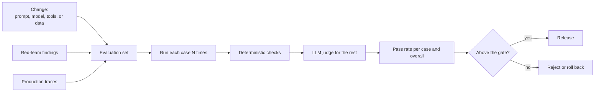

# 15 Evaluating Agent Systems

Sources:

- Dibia, *Designing Multi-Agent Systems: Principles, Patterns, and Implementation*, 2025, Chapter 10 "Evaluating Multi-Agent Systems", Chapter 11 "Optimizing Multi-Agent Systems", and Chapter 13 "Ethics and Responsible AI".
- O'Brien, *Building Complex Multi-Agent Systems Using Patterns*, Packt, 2026, Chapter 3, Chapter 7 "Tips and Best Practices", and Chapter 10 "The Future and Limitations of LLMs".
- Rothman, *Context Engineering for Multi-Agent Systems*, Packt, 2025, Chapters 4 to 7, used here for what its traces show.

Classical MAS judged a design by analysis or by deterministic simulation. A mechanism is strategy-proof or it is not ([11](11-coalitions-and-auctions.md)). A consensus protocol converges under stated network conditions or it does not ([06](06-control-of-cooperative-mas.md)). Testbeds such as RoboCup and the Trading Agent Competition compared agents by outcome. An LLM agent gives different outputs for the same input, writes free text that has many acceptable forms, and changes behaviour when its model, prompt, or retrieved data change. None of the classical methods covers that. This topic covers what replaces them.

It follows [14](14-context-engineering.md), which noted that the claims in the three books are mostly untested. Section 5 applies the methods here to the one study the books contain.

Each section below states the practice, its nearest classical concept, then its relevance to agentic AI.

## 1. Why Classical Evaluation Does Not Transfer

Dibia gives four reasons that text-similarity metrics such as BLEU and ROUGE fail for agents:

1. Different tool orders can reach the same correct outcome.
2. Outputs mix text, data, files, and actions.
3. The quality of the process matters, not only the answer.
4. Agents change external state, so the outcome is not only in the output.

Non-determinism adds a fifth. One run is one sample. O'Brien says it directly: "Testing a non-deterministic system is genuinely hard."

The nearest classical practice is multiagent reinforcement learning ([13](13-multiagent-learning.md)), where stochastic policies are evaluated over many runs with different random seeds and returns are averaged. That evaluates a policy against a reward. An LLM agent has no reward function to evaluate against, so the criterion itself has to be built.

**Agentic AI relevance.**

- Passing once proves little. A test of an LLM agent is a sample from a distribution and must be repeated.
- Without a stated success criterion, there is nothing to measure. Dibia's first step is to write the criteria, the task suite, the metrics, and the baselines before writing agent code.

## 2. The Trajectory as the Unit

Dibia evaluates *trajectories*: the full record of a run, with messages, tool calls, outcomes, timing, and token usage. The same record serves a single model call, an agent, or a team. With tracing in place, any production run can become a test case.

Two problems arise before any scoring:

- *Which message is the answer?* The last message may be "The calculation is complete." Dibia offers three strategies: the last non-empty message, the last assistant message, or all assistant messages.
- *Outcome or process?* Process metrics ask whether the agent chose the right tools in the right order with the right arguments. Dibia describes them, but his judges score final outputs only.

Rothman's traces show what happens without evaluation. His trace marks a run "Success" whenever no exception is raised. In one Chapter 5 run, the Researcher reported that the sources were unrelated to the question, and the trace still recorded success. The final story contained details that were not in the knowledge base. In Chapter 7, the code appends every retrieved file name as a citation, so answers cite files that did not support them, including one where the model itself wrote "Sources: None".

The classical counterpart is the message trace, such as the JADE sniffer agent. The new part is that the trace is the input to evaluation, not only to debugging.

**Agentic AI relevance.**

- "No error" is not success. An agent run needs a check that the goal was met, the claims are grounded, and any refusal was respected.
- A trace that records every agent's messages, tool calls, and tokens is the raw material for both evaluation and the coordination measures of [08](08-working-together.md#1-cooperative-distributed-problem-solving).

## 3. Building an Evaluation Set

O'Brien's and Dibia's practices combine into one loop:

*The evaluation loop. Any change that can alter behaviour runs the set. Failures from red-teaming and production are added back.*

Their recommendations, with what they rest on:

| Practice | Source | Basis |
|---|---|---|
| 50 to 100 cases before the first release, growing to several hundred | O'Brien Ch 7 | Rule of thumb |
| Build cases with domain owners and QA, and add every red-team finding | O'Brien Ch 7 | Practice |
| Run critical cases 5 to 10 times and report a pass rate ("9 of 10 vs 5 of 10") | O'Brien Ch 7 | Rule of thumb |
| Use deterministic checks where there is ground truth, and judges only where there is not | Dibia Ch 10 | Reasoned |
| Filter with cheap checks before calling an expensive judge | Dibia Ch 10 | Reasoned |
| Block a prompt change that lowers the pass rate by more than 2 percent | O'Brien Ch 7 | Example threshold |
| Keep test sets private and fresh, and distrust suspiciously high scores | Dibia Ch 10 | Reasoned |

**Agentic AI relevance.**

- An evaluation set is the specification of an LLM agent. Without one, a prompt change cannot be called better or worse.
- Multi-agent systems need cases that exercise coordination: handoffs, conflicts, partial completion, and refusal. Dibia's ten production failure modes, from his experience on AutoGen, are mostly about single agents. Only three of them concern coordination between agents.

## 4. LLM Judges

When there is no ground truth, an LLM scores the output against a rubric. Dibia describes three formats: a score for one answer, a comparison of two answers (which he judges more reliable for subjective quality), and separate scores per dimension combined with weights.

A judge is itself an LLM agent, with the same failure modes as the system it scores. Dibia's own study shows one. His first results scored the multi-agent configuration 6.82 out of 10 against 7.94 for a direct model call. He found the judge penalised the longer, multi-agent transcripts as verbose, and added these lines to its instructions:

> DO NOT PENALIZE: Multi-agent collaborative process visibility
> DO NOT PENALIZE: Showing reasoning steps or validation

The multi-agent score rose to 9.30. He presents this as removing a bias. It is also a change to the measuring instrument made after seeing results, in the direction the author expected. The judge was the same model as the system under test. Both can be true: the judge may have been biased, and the fix may have introduced a bias of its own. Nothing in the study separates the two.

O'Brien's Chapter 10 goes further: "Do not ask the LLM to evaluate its own outputs." His Chapter 7 still recommends LLM judges and guard calls. The book does not say whether a second model call counts as a separate evaluator.

The classical counterpart is a governor in an electronic institution, which checks each message against the institution's norms ([04 section 4](04-multiagent-organisations.md#4-institutions-norms-permission-and-power)). A governor's check is deterministic. A judge's check is a sample. Combining several judges is an aggregation problem of the kind [10](10-group-decisions.md) covers. None of the books treats it that way.

**Agentic AI relevance.**

- Fix the judge before seeing the results it will score. Changing it afterwards is tuning the instrument to the hypothesis.
- Test the judge on cases with known answers, including cases designed to expose length and style bias.
- Use a different model as judge where possible, and report agreement with human ratings on a sample.

## 5. What the Evidence Says About Multi-Agent Designs

Dibia's Chapter 10 study is the only comparison of single-agent and multi-agent configurations in the three books. Four configurations, all using GPT-4.1-mini: a direct model call, a single agent with tools, three agents taking turns in a fixed order, and three agents with an LLM choosing who speaks next. Ten tasks in four suites, one run each, judged by GPT-4.1-mini after the change in section 4.

| Configuration | Overall (of 10) | Simple reasoning | Tool-heavy | Tokens per task |
|---|---|---|---|---|
| Direct model call | 8.5 | 9.7 | 6.8 | 355 |
| Single agent with tools | 9.2 | | | |
| Multi-agent, fixed rotation | 9.2 | | | |
| Multi-agent, LLM selector | 9.3 | 9.3 | 9.2 | 15,343 |

Blank cells are not reported in the text. One task shows the main effect: on a podcast research task, the direct call scored 3.2 and every configuration with web search scored 9.0.

What the data show:

1. Tools explain the gain. The single agent with tools scored the same as the multi-agent teams.
2. The multi-agent team with an LLM selector used 43 times the tokens of a direct call for a 0.8-point gain overall. On simple reasoning, the direct call scored highest.
3. An LLM choosing who speaks next did no better than fixed rotation.
4. Ten tasks, one run each, and no variance reported. None of these differences is shown to be more than noise.

Dibia's own advice agrees with the reading. His list of ten failure modes ends with a bonus item, "You Probably Don't Need a Multi-Agent System", and his architecture ladder starts at a direct call ([14 section 5](14-context-engineering.md#5-cost-and-latency)).

**Agentic AI relevance.**

- A multi-agent design must beat a single agent with the same tools, not a bare model. That is the baseline that isolates the value of coordination.
- Report tokens and latency alongside quality. A small gain at 43 times the cost may not be worth it.
- None of the three books cites the published research on why multi-agent LLM systems fail, such as the MAST taxonomy (Cemri et al., 2025). [08 section 8](08-working-together.md#8-coordination-failures) maps Sayfan's failure list to classical concepts.

## 6. Change Control

A classical agent's behaviour followed from its program. If the code did not change, neither did the agent. An LLM agent's behaviour changes when any of four things change, three of which are not code:

| What changes | Effect | Practice (source) |
|---|---|---|
| Prompt | Behaviour changes directly | Version each prompt, review changes against the evaluation set, roll prompts back separately from code, and give each prompt an owner (O'Brien Ch 7) |
| Model version | The same prompt behaves differently | Keep prompts per model, re-run the evaluation set on every model change, and re-tune temperature (Dibia Ch 11, O'Brien Ch 7) |
| Retrieved data | New documents change which chunks are retrieved | Treat ingestion as a deployment, with the same quality gates. Sample new embeddings for shifts in similarity. (O'Brien Ch 5, 7) |
| Model training | Behaviour drifts in ways that product metrics may not show | Test for sycophancy (agreeing over being accurate) and for behaviour that differs when unmonitored, and make them launch blockers (Dibia Ch 13) |

Dibia's example for the last row is OpenAI's 2025 rollback of a GPT-4o update that had become sycophantic. Its A/B metrics looked good, and expert testers had flagged the problem.

The nearest classical concept is non-stationarity in [13 section 2](13-multiagent-learning.md#2-why-multiagent-learning-is-hard), where each agent's environment changes as the others learn. Here the agent's own reasoning engine and knowledge change, by other teams' and vendors' actions.

**Agentic AI relevance.**

- A multi-agent system has a prompt and possibly a model per agent. A change to one agent's prompt can change the inputs every downstream agent sees. The evaluation set should run the whole team, not only the changed agent.
- Pin model versions, and treat a model upgrade as a release that must pass the evaluation set.

## 7. What Carries Over

| Practice | Nearest classical concept | What is new |
|---|---|---|
| Repeated runs and pass rates | Averaging over seeds in multiagent learning ([13](13-multiagent-learning.md)) | Evaluation against a written criterion, not a reward |
| Trajectory as the unit | Message traces | The trace feeds evaluation, not only debugging |
| LLM judge | Governor in an electronic institution ([04](04-multiagent-organisations.md)) | The checker is itself stochastic and biased |
| Several judges combined | Aggregation and voting ([10](10-group-decisions.md)) | Not yet treated as aggregation in practice |
| Single agent with tools as the baseline | Coherence and coordination measures ([08](08-working-together.md)) | Coordination must justify its token cost |
| Prompt, model, and data versioning | None. A classical agent's behaviour followed from its code. | Behaviour changes without a code change |
| Behavioural tests for sycophancy | None. Classical agents had designed goals. | The agent's dispositions come from training |

## Key Takeaways

1. Classical MAS evaluated by proof or by deterministic simulation. LLM agents need empirical evaluation, because the same input gives different outputs.
2. The unit of evaluation is the trajectory. "No exception" is not success, and Rothman's traces show runs marked successful that ignored their sources and cited files that did not support them.
3. Run each case several times and report pass rates. Gate every change to prompts, models, tools, or retrieved data on the evaluation set.
4. An LLM judge is an agent with its own biases. Fix and test it before scoring. Dibia's judge was changed after seeing results, in the direction he expected.
5. Compare a multi-agent design against a single agent with the same tools. In Dibia's study, tools explained the gain, and the multi-agent team used 43 times the tokens of a direct call.
6. An LLM agent changes when its prompt, model, or data change. Version all three and treat each change as a release.
7. Behavioural tests for sycophancy and for behaviour that differs when unmonitored have no classical counterpart, because classical agents did not acquire dispositions from training.
