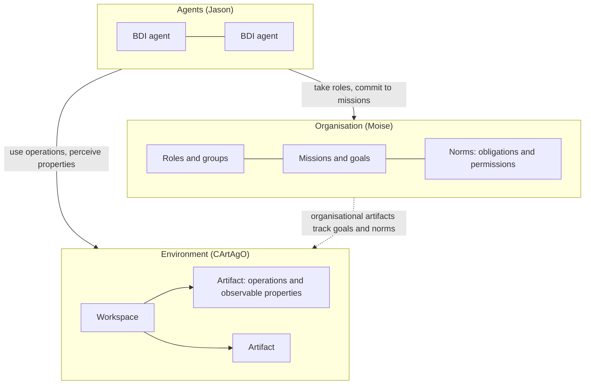

# 16 Agent-Oriented Programming and Platforms

Sources:

- Collier, Mascardi, and Ricci (eds.), *Agents and Multi-Agent Systems Development: Platforms, Toolkits, Technologies*, Springer, 2026. Chapter 1 surveys agent toolkits as of 2025. Chapters 2 to 11 each present one toolkit or mechanism, written by its developers.
- Broda and Broda, *Agentic Mesh: The GenAI-Powered Autonomous Agent Ecosystem*, O'Reilly, 2026, Chapters 1, 3, 5 to 7, 9, 10, and 12 to 14.

[02](02-agent-architectures.md) described agent architectures in principle. [07 section 4.3](07-agent-communication.md#43-conformance-and-platforms) gave JADE one paragraph. This topic covers how agents are actually programmed and run. It sets the platforms built by the agent-oriented software engineering (AOSE) research community against one 2026 industry platform design for LLM agents.

**A caution on evidence.** The Collier chapters are design descriptions by each toolkit's own developers. Only the Jadex chapter reports measurements. *Agentic Mesh* is a reference architecture: its case study is described as a "hypothetical implementation", and it shows no code. The code listings in the Collier EPUB are images, so syntax described below comes from the chapters' prose.

Each section below states the concept, then its relevance to agentic AI.

## 1. Two Communities

Collier, Mascardi, and Ricci define agents as Jennings, Sycara, and Wooldridge did in 1998: autonomous, social, reactive, and proactive ([01 section 8.2](01-setting-the-scene.md#82-what-makes-an-agent-intelligent)). Their survey collects toolkits submitted to a public repository and to a 2024 conference track. It is not a systematic review. Counting toolkits and their extensions:

| Focus | Count |
|---|---|
| Agent-oriented programming (AOP) | 30 |
| Of which, based on the BDI model | 21 |
| Monitoring, verification, or validation | 8 |
| Interaction protocols | 6 |
| Agent-based modelling and simulation | 4 |

More than half the toolkits appeared between 2018 and 2023. No agentic AI framework appears in the tables. The editors explain this as two communities that grew separately. Agentic AI is "agentifying" LLMs, rediscovering agent concepts "with almost no references" to AOSE. They name the risk: repeating the same mistakes and reinventing the same solutions. They describe a smaller movement in the opposite direction, putting LLMs inside existing agent architectures (section 7).

**Agentic AI relevance.**

- This series takes the same view from the other side. Most of its topics map an LLM-era practice to a classical concept the practice does not cite.
- The two directions give two designs. An LLM agent framework puts the model in charge and adds structure around it. An agent platform with an LLM keeps a symbolic loop in charge and calls the model for parts of the work.

## 2. Agent-Oriented Programming Languages

Shoham's *agent-oriented programming* (1993) programs agents in terms of mental states: beliefs, goals, and commitments. The toolkits in Collier implement it in several ways:

| Toolkit | Form | Core abstractions | Interaction |
|---|---|---|---|
| JADE | Java framework, no agent language | An agent class with behaviours | FIPA ACL messages ([07](07-agent-communication.md)) |
| Jason | Interpreter for AgentSpeak(L) | Beliefs, goals, and plans triggered by events: perception, belief change, messages, goals | KQML-style messages |
| Jadescript | Language compiled onto JADE | Behaviours scheduled cooperatively. Message content must be ontology terms. The type checker enforces that a `request` carries an action and an `inform` a predicate. | FIPA ACL with pattern-matched handlers. Unmatched messages stay queued. |
| SARL | Language compiled to Java and Python | *Capacities* (interfaces) bound to *skills* (implementations) that can be swapped at run time. Every agent is a holon that can contain agents. | Events emitted into *spaces* inside *contexts*, a publish-subscribe model |
| Jadex V | Java library | Any Java object becomes an *active component*. Five programming models on one runtime: micro, BDI, behaviour tree, BPMN workflow, and lambda. | Asynchronous service calls returning futures, preferred over messages |
| JaKtA | Kotlin internal DSL | Jason-style BDI written as Kotlin code | In-process only. MQTT planned. |
| JS-son | JavaScript library | Beliefs as JSON, plans as pairs of functions. No intention layer. | Through a shared environment object |

### 2.1 Language or library

The later toolkits move away from a separate agent language. Kampik (JS-son) and the JaKtA authors both name the same barrier: AOP combined with logic programming is too steep for working developers. JS-son gives up formal semantics for a plain JavaScript library. JaKtA keeps Jason's semantics inside Kotlin, so agents get Kotlin's types, IDE, and debugger. The JaKtA authors list four needs for "mainstream BDI": mixing paradigms in one piece of code, a unit of code reuse (BDI has none, so plans are copied), the host language's development tools, and pluggable concurrency and transport. The cost they report is that the debugger shows Kotlin objects, not beliefs and intentions.

### 2.2 Cost of an agent

Jadex V is the only chapter with measurements: start and stop of one agent, and its memory, on one laptop.

| Agent | Memory | Start and stop time |
|---|---|---|
| Jadex 4.x micro agent | 13 kb | 4000 µs |
| Jadex V micro agent | 0.9 kb | 72 µs |
| Jadex V BDI agent (one belief change, goal, and plan) | 5 kb | 115 µs |
| Jadex V BPMN process | 7.3 kb | 1594 µs |
| Jason, one reasoning cycle | 5.6 kb | 59 µs |
| JADE agent | About 3 times Jadex V micro | About 7 times Jadex V micro |

The authors report Akka, an actor framework, as similar to Jadex V. A symbolic BDI cycle costs microseconds. An LLM call costs seconds ([14 section 5.2](14-context-engineering.md#52-latency)).

**Agentic AI relevance.**

- LLM agent frameworks have no agent language. Behaviour is written in prompts and natural-language configuration. The abstractions above (beliefs, goals, plans, capacities, typed speech acts) are what those frameworks leave implicit.
- Jadescript's checks, an `inform` must carry a predicate and content must come from an ontology, are compile-time versions of the schema checks [07 section 7.2](07-agent-communication.md#72-typed-content) recommends for LLM agents.
- A symbolic reasoning step takes tens of microseconds, and a model call takes seconds. Work that a rule or plan can do should not go to the model.

## 3. Agents and Actors

The Jadex chapter compares six platforms on language, architecture, ease of creating agents, distribution, security, logging and testing, customisation, and tools. Its conclusion:

| Group | Examples | Strong on | Weak on |
|---|---|---|---|
| Actor-based frameworks | Akka, Orleans, and, in the authors' grouping, JADE and Janus | Distribution, scaling, fault tolerance | Goal-directed reasoning |
| BDI frameworks | Jason, JaKtA | Goal-directed reasoning | Distribution. JaKtA has none yet. |

Two notes on the actor side. Akka is the only framework credited with supervision trees and event sourcing: restarting failed actors, and rebuilding state by replaying events. Orleans has *virtual actors*: an actor keeps a permanent identity, the runtime activates it when called, and its state is persisted. JADE and Janus have no supervision, so grouping them with actor frameworks is loose. Jadex claims to cover both sides but does not score itself in the table. On security, only Akka and Orleans have built-in TLS.

**Agentic AI relevance.**

- LLM agent frameworks sit in neither group. Most have neither supervision nor a goal model. Production systems add supervision from the actor world and goal tracking from task lists.
- An agent is an actor with goals. Choosing an actor runtime gives distribution and failure handling. The agent layer still has to supply goals, plans, and commitments.
- [R11 and R12](../research/r11-browser-agent/README.md#prior-art-from-agent-platforms) on the research backlog build on the ractor actor framework. This section's comparison is their prior art.

## 4. The Environment as a Programming Abstraction

Classical texts treat the environment as what an agent senses and acts on ([01 section 8.3](01-setting-the-scene.md#83-environment-properties)). The *Agents and Artifacts* (A&A) model makes it something the programmer builds. An *artifact* is a non-autonomous object that agents create, share, and use. It offers operations and observable properties. Artifacts live in *workspaces*. CArtAgO implements A&A, and JaCaMo combines three dimensions into one platform:

*JaCaMo's three dimensions. Agents decide. The environment holds shared objects. The organisation states who should do what, and is itself kept in artifacts.*

### 4.1 Hypermedia environments

Yggdrasil puts the A&A environment on the Web. Every agent, workspace, and artifact has an IRI and an RDF description. Artifacts describe their actions as W3C Web of Things *Thing Descriptions*, and Yggdrasil generates an HTTP interface for each. An agent joining a workspace gets a *body artifact* there, which other agents can observe. Agents perceive changes by subscribing through WebSub. An agent can start from one address and crawl links to find workspaces and artifacts, or query a SPARQL search engine.

The authors report the cost: hypermedia makes agent logic more complex, and they prefer a hard-coded design when loose coupling is not needed. Crawling from one address works in small environments and becomes intractable in large ones. Advertised actions do not yet reflect state: "turn on" stays listed for a fan that is already on.

### 4.2 Compared with MCP and A2A

This comparison is this repo's analysis, not the chapter's.

| Aspect | Yggdrasil | MCP | A2A |
|---|---|---|---|
| Unit described | Artifact, workspace, agent body | Server with tools, resources, prompts | Agent (agent card) |
| Description | RDF with shared ontologies | Natural-language description plus JSON Schema | JSON agent card |
| Discovery | Following links from one address, or search | Client configured with servers. No links between servers. | Well-known URL or registry. No links between cards. |
| Shared place several agents observe | Yes, the workspace | No. Each session is private. | No. Point to point. |
| Perceiving change | WebSub subscription to any resource | Resource subscriptions, list-changed notifications | Task status streaming, push |

A Thing Description action and an MCP tool are close: a named operation with an input schema. The main gap is the workspace. MCP and A2A have nothing several agents can share and observe. LLM systems improvise it with a shared file, a database, or a blackboard.

The Yggdrasil authors report that converting RDF descriptions to text works poorly for LLMs. They propose a controlled natural-language interface and name MCP as a possible extra interface. That is a move toward MCP's choice of natural-language descriptions.

A term clash: in A2A, an *artifact* is a task's output ([07 section 6.2](07-agent-communication.md#62-a2a)). In A&A, it is a shared object in the environment.

**Agentic AI relevance.**

- Multi-agent LLM systems need shared state that agents can observe: a task board, a shared document, a lock. A&A gives it a model with operations, observable properties, and rules on who may use what.
- Bodies separate an agent's presence in a workspace from the process that runs it. Several bodies let one agent present different capabilities in different contexts.

## 5. Protocols as Programs

[07 section 5.3](07-agent-communication.md#53-commitments-social-semantics) described commitment semantics. Chopra, Christie, and Singh's chapter turns protocols into the program. In *interaction-oriented programming*, the designer writes the protocol between roles first, then implements each agent to play a role. Each agent's decision logic stays private.

### 5.1 Information protocols

BSPL, their protocol language, states which information each message depends on, not the order of messages. Each message parameter is marked:

- `in`: the agent must already know it.
- `out`: the agent must not know it yet. Sending the message creates it.

An agent may send any message whose `in` parameters it knows. In their purchase example, after the buyer's request, the buyer may pay and the seller may ship in either order or at once. Messages may arrive in any order, and duplicates are harmless. The protocol runs over unordered, lossy transport such as UDP.

### 5.2 Tools

| Tool | Purpose |
|---|---|
| Tango | Checks that a protocol is *safe* (no parameter gets two values) and *live* (every run can finish). It reduces all possible runs to a few canonical ones: 12 to 1 in the purchase example. On a faulty variant, it returns a deadlocked run and a doubly bound payment as counterexamples. |
| Kiko | An adapter between each agent and the network. It shows the agent the messages it may send now, as partly filled forms. The agent's code completes any of them. The adapter checks each before sending. |
| Mandrake | Agent-level resend and reminder rules for messages that may be lost. A seller cannot tell a delayed payment from one never sent, so it reminds. |
| Cupid, Azorus | Commitments compiled to database queries, and commitment reasoning in Jason |

### 5.3 Refusal

Refusal is a protocol message. Accept and Reject are alternative replies, made mutually exclusive by sharing an `out` parameter. If both are sent, the safety check fails. In Kiko, an agent declines by not completing a form. If the protocol has no explicit Reject, the requester waits forever, and the liveness check finds that. The chapter does not discuss counter-offers.

The authors' view of LLM agent frameworks is direct. Those frameworks compose agents as task graphs, which they call rigid, with weaknesses "known for decades". Their challenge is agents that reason about protocols.

**Agentic AI relevance.**

- An orchestrator calling subagents is a fixed workflow. A protocol states what each party may say and when, and leaves each agent to decide. That is the difference between a subagent and an agent from [01](01-setting-the-scene.md#84-agents-versus-objects).
- Protocols can be checked before any agent exists. A missing refusal path or a double commitment shows up as a counterexample, not a production incident.
- [R7](../research/README.md) on the research backlog, an agent that can decline or counter a request, can use this directly. Refusal is a declared message, liveness catches a missing one, and resend rules handle silence.

## 6. Exceptions and Accountability

Baldoni and colleagues add two mechanisms to JaCaMo's organisation layer:

| | Exception handling | Accountability |
|---|---|---|
| Trigger | A predefined failure condition | An agent's need for information |
| Activation | Automatic | On request by the account-taker |
| Response | A designated handler | An account from the account-giver |
| Outcome | Resilience | Informed decisions |

One construct, a *notification policy*, covers both. It names a target goal, a trigger (failure, delay, achievement, or a custom condition), and a report to be filled in. Roles commit to raising, handling, giving accounts, and acting on them as obligations, in the same missions as their business goals. Requesting an account is only a permission, and may require prior authorisation. Who answers to whom is set per role, not per agent. Their production-cell example covers a motor fault with handlers chosen by condition, escalation to a human operator, and a collective shutdown.

Other toolkits handle failure more locally. SARL has exception spaces where agents register as raisers or handlers. Jadex has an exception registry whose default kills the component. Jadescript has `on exception` and `on behavior failure` handlers.

**Agentic AI relevance.**

- Partial completion in [08 section 8](08-working-together.md#8-coordination-failures) is addressed. Failure and delay trigger reports, and a group goal does not count as done when only some members finished.
- Lost context at handoffs is addressed by structured reports with required fields.
- Fabricated success is not addressed. Agents still report their own success, and the report check only ensures every field is filled. This is this repo's reading, not the chapter's. For LLM agents, a report must be checked against evidence ([15 section 2](15-evaluating-agent-systems.md#2-the-trajectory-as-the-unit)).

## 7. LLMs Inside Agent Platforms

The toolkits' work on LLMs, by status:

| Toolkit | Where the LLM sits | Status |
|---|---|---|
| Jadex | Generates BDI plans. BDI keeps strategic control, the LLM supplies tactical steps. | Built. No results reported. |
| JS-son | Inside one plan body. Feedback arrives as percepts, the plan builds a prompt from beliefs, and the reply is the action. The symbolic loop owns stopping and memory. | Built, as an example |
| ASTRA | A library for calling LLMs from plans. Separately, learning templates turn experience into plans by Q-learning or decision trees, and could be adapted to LLM-generated plans. | Library built. Combination proposed. |
| VEsNA | Translates between natural language and KQML for Jason agents in a virtual world. The agents make every decision. | Built. The authors call the error rate high, do not measure it, and plan to move away from generative models. |
| JaKtA | Called selectively by an explicit BDI loop to generate beliefs, goals, or plans | Proposed |
| SARL | Generates capacities and skills | Planned |
| Jadescript | As an event processor, inside handlers, or for natural-language interaction | Proposed |
| Yggdrasil | Language agents as one more kind of agent in a shared environment, through a controlled natural-language or MCP interface | Proposed |

In every case, the symbolic loop decides what to do and the LLM fills a slot: a plan, a message translation, or an action's text. That is the reverse of LLM agent frameworks, where the model decides and code fills slots.

**Agentic AI relevance.**

- The hybrid gives what [02 section 6](02-agent-architectures.md#6-where-llm-agents-fit) found missing from LLM agents: explicit goals, an inspectable intention structure, and a stop condition the model does not control ([08 section 9](08-working-together.md#9-stopping-and-human-control)).
- The evidence for the hybrid is thin. None of the built integrations reports a measured comparison with an LLM-first agent.

## 8. A 2026 Industry Platform: Agentic Mesh

Broda and Broda design a platform for LLM agents in large organisations. An agent must be powered by an LLM, have a stated purpose and an accountable owner, act autonomously within limits, and use tools and other agents. The agent is the unit of reasoning, a *fleet* the unit of management, and the *mesh* the unit of governance. The book cites no classical MAS work. It traces its lineage to service mesh and data mesh.

### 8.1 Components

| Component | What it does | Classical counterpart |
|---|---|---|
| Registry | Records agents (name, version, purpose, description, roles, policies, certifications, allowed collaborators, tools), conversations, interactions, workspaces, policies, and users | FIPA directory facilitator and agent management system ([07](07-agent-communication.md)) |
| Interaction management | One queue per agent on an event stream such as Kafka or NATS. A sender posts a short message, and the receiver fetches the conversation history from the registry. Interactions move through states: ground, ready, working, pending, error, complete. | FIPA message transport, conversation identifiers, and the request protocol |
| Discovery | An agent sees only collaborators it is allowed (a list or a regular expression). Its LLM picks one by reading purposes and descriptions. | Matchmaking middle agents |
| Workspace | A queue shared by many agents. Each decides whether to respond, by LLM judgement, sender list, keywords, or embedding similarity. | Blackboard, tuple space, A&A workspace (section 4) |
| Marketplace | A catalogue of agents with ratings. No prices, bids, or allocation. | Contract Net in name only ([08 section 3](08-working-together.md#3-task-sharing-the-contract-net)) |
| Policies | Natural-language statements of purpose and rules | Norms ([04 section 4](04-multiagent-organisations.md#4-institutions-norms-permission-and-power)), but with no obligation or prohibition structure and no sanctions |

MCP is used for tools. A2A is mentioned once and not used. The book asks for a messaging and collaboration standard above MCP, which is a request for an agent communication language.

### 8.2 Trust and governance

The book's seven-layer trust framework runs from identity and authorisation, through purpose and policies, plan explainability, and observability, to certification and lifecycle governance. *Certification* is modelled on product certification bodies such as Underwriters Laboratories. Approvers publish standards, and an agent can check a peer's certification before working with it. Certifications are renewed, revoked, and expire. The book sets certification against reputation. In [05](05-trust-and-reputation.md) terms, it is institutional trust rather than reputation, and in [04](04-multiagent-organisations.md) terms, an exercise of institutional power.

Autonomy is set by risk tier, and is reduced or paused automatically when an agent exceeds its error budget. That is adjustable autonomy ([08 section 9.5](08-working-together.md#95-human-control)) driven by a reliability measure. Each agent has a product owner and a safety owner. Secrets are injected outside the LLM so that the model never sees them.

**Agentic AI relevance.**

- The mesh is a FIPA-style platform (registry, transport, conversations) plus a shared environment and an institution layer, built on enterprise identity and event streaming. Its concepts are the classical ones under new names.
- It has no agent programming model. An agent is a natural-language configuration read by an LLM. Sections 2 and 7 are what that leaves out.
- Natural-language policies without obligations or sanctions cannot be checked mechanically. The Moise norms in section 6 can.
- The book's "agent factory" builds agents from certified templates. Agent Factory is also the name of an earlier AOP platform from University College Dublin, where ASTRA was developed.

## 9. What Carries Over

| Concept | From | LLM-era counterpart | Gap |
|---|---|---|---|
| Agent language with beliefs, goals, plans | Jason, JaKtA, Jadex | Prompts and natural-language config | No explicit goals or intentions to inspect |
| Typed speech acts and ontology content | Jadescript | JSON Schema on tool calls | Schemas check shape, not act type |
| Supervision and virtual actors | Akka, Orleans | Retries in orchestration code | No restart strategy or persistent identity |
| Shared environment of artifacts | CArtAgO, Yggdrasil | Shared files and databases, improvised | No model of operations, observation, or access |
| Protocols checked for safety and liveness | BSPL, Tango, Kiko | Task graphs and workflows | No refusal paths, no verification |
| Exceptions and accountability in the organisation | JaCaMo | Logs and traces | Reports are not obligations, and success is self-reported |
| Directory facilitator and agent management system | JADE, FIPA | Registries, agent cards, the mesh registry | Similar |
| Institutional power and certification | Organisations ([04](04-multiagent-organisations.md)) | Mesh certification | Similar, without a norm language |

## Key Takeaways

1. Agent platforms and LLM agent frameworks grew in separate communities. The 2025 toolkit survey contains no agentic AI framework, and agentic AI frameworks rarely cite agent platforms.
2. Agent-oriented programming gives agents explicit beliefs, goals, plans, and typed messages. LLM agent frameworks leave these implicit in prompts.
3. Recent toolkits move agent programming into mainstream languages as libraries or internal DSLs, because a separate logic language was the barrier to adoption.
4. Actor frameworks distribute and recover well but do not reason about goals. BDI frameworks reason but distribute poorly. An LLM agent framework usually has neither supervision nor a goal model.
5. The environment can be programmed: artifacts in workspaces that agents share and observe. MCP and A2A have no shared workspace.
6. Protocols can be the program. Stating what each message depends on allows any order, and makes safety, liveness, and refusal paths checkable before deployment.
7. Exceptions and accountability can be obligations in the organisation, which addresses partial completion and lost context but not fabricated success.
8. Where agent platforms use LLMs, the symbolic loop decides and the model fills a slot. No measured comparison with LLM-first agents exists in these sources.
9. *Agentic Mesh*, a 2026 industry design, rebuilds the FIPA platform, a shared workspace, and institutional certification under new names, without an agent programming model or checkable norms.
