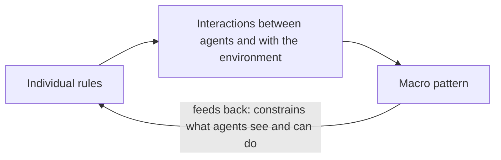

# 17 Agents in Complex Systems

Sources:

- Wilensky and Rand, *An Introduction to Agent-Based Modeling: Modeling Natural, Social, and Engineered Complex Systems with NetLogo*, MIT Press, 2015, Chapters 0, 1, 3, 5, 6, 7, and 8.
- Burguillo, *Self-organizing Coalitions for Managing Complexity*, Springer, 2018, Chapters 2, 3, 6, 7, 10, and 12.

Topics 01 to 16 treat a multi-agent system as something designed: build each agent (the micro problem) and build the society (the macro problem), from [01 section 3](01-setting-the-scene.md#3-the-two-central-problems-micromacro). LLM agents are now deployed into systems nobody designed: markets, platforms, infrastructure, and populations of other agents. In those systems, outcomes emerge from interaction and are not chosen by anyone. This topic covers what agent-based modelling (ABM) and complex-systems research know about such systems. [01 section 5.2](01-setting-the-scene.md#52-agents-as-a-tool-for-understanding-human-societies) gave this field one paragraph.

**A caution on sources.** Both books predate LLM agents. Their agents follow simple, readable rules. Every link to LLM agents below is this repo's analysis, labelled as such. Burguillo's simulations use honest, identical agents updated in synchronised rounds, and his largest real-world study has 50 agents.

Each section below states the concept, then its relevance to agentic AI.

## 1. Complex Systems and Emergence

Wilensky and Rand define a *complex system* as many interacting parts whose aggregate behaviour cannot be predicted from the parts themselves. *Emergence* is the arising of new, coherent patterns from those interactions. Emergent patterns have four features in their account:

1. They arise with no orchestrator or central coordinator.
2. They are processes rather than objects. Disturbed, they re-form, recognisably the same but not identical.
3. Randomness often helps create the order rather than destroy it.
4. They need no designer.

Burguillo adds five tests for emergence: the pattern is visible at the macro level, it is novel (not predictable from the micro level), it cannot be reduced to the parts, micro causes macro while macro constrains micro, and it is non-linear through positive and negative feedback.

*Emergence as a loop. The pattern is produced by the agents and then shapes their next actions.*

Wilensky and Rand distinguish two hard tasks. *Integrative* understanding predicts the aggregate from known rules. *Differential* understanding finds rules that produce an observed aggregate. They also report two common errors, from interviews by Wilensky and Resnick:

- *The deterministic-centralised mindset.* People explain patterns by a leader or central cause, and see no role for randomness. They assume the goose at the front of a V leads it, or that a traffic jam needs an accident.
- *Levels slippage.* People transfer properties between the individual and the aggregate. A jam is imagined to move forward like a car. It moves backward.

**Agentic AI relevance.**

- The deterministic-centralised mindset is the orchestrator habit. When many agents produce a pattern, the first explanation sought is usually one agent's decision.
- Levels slippage applies in both directions. A population of well-behaved agents can produce bad aggregate behaviour, and a bad aggregate does not imply a bad agent.

## 2. Outcomes Nobody Chose

Wilensky and Rand's models show simple individual rules producing macro outcomes that no agent intends:

| Model | Rule | Macro outcome | Lesson |
|---|---|---|---|
| Ants | Wander, follow pheromone, lay it when carrying food | Trails form, and food sources are used nearest first | Coordination through traces in the environment, *stigmergy*, with no planner |
| Fire | A burning tree ignites its four neighbours | Fire almost never crosses the forest below about 59 percent tree density, and almost always does above it | A *tipping point*: a small change in one input gives a large change in outcome |
| Segregation (Schelling) | Move if fewer than 30 percent of neighbours are like you | 72.7 percent of agents end up surrounded by their own colour | Mild individual preferences give an extreme collective result. Reducing prejudice is not the *leverage point* unless it falls nearly to zero. |
| El Farol (Arthur) | Predict attendance from past weeks, and go only if it will not be crowded | Mean attendance settles near capacity. Rewards split into a few winners and many losers. | An efficient average can hide an unequal distribution (section 3) |
| Predator-prey | Eat, move, reproduce, die | Population cycles, and sometimes extinction | Discrete agents show extinctions that equation models miss |

On the tipping point, the authors' practical advice is to find out whether a system has one and how close it is. Effort that shows no result may still be moving the system toward a threshold.

**Agentic AI relevance.**

- Improving each agent does not guarantee a better system. If an outcome is structural, as segregation is, the fix belongs in the environment: matching rules, pricing, rate limits, quotas. Dibia (2025, Chapter 13) calls agents flooding systems built for human pace "agentic noise". It is this kind of problem.
- Platforms of agents can have tipping points: the share of automated traffic, retry rates, or how many agents read the same signal. Below the threshold nothing visible happens. Above it, cascades follow.
- Agents already coordinate by stigmergy. Repositories, issue trackers, shared files, and marketplaces carry traces that other agents follow. [16 section 4](16-agent-programming-and-platforms.md#4-the-environment-as-a-programming-abstraction) gave the environment a programming model. This section adds that traces also produce herding and need to decay.
- Report distributions, not only means. An agent platform can look efficient while a few agents, or the agents of a few vendors, capture most of the value.

## 3. Monoculture

In El Farol, 100 people decide each week whether to go to a bar that is pleasant only if 60 or fewer attend. Each agent holds a set of rules of thumb for predicting attendance, such as last week's number or the average of the last three weeks. It acts on whichever has recently predicted best. Arthur posed the problem to study *bounded rationality*: agents with limited computation reasoning inductively from experience. Wilensky and Rand show attendance settling near 60 without perfect information or optimisation.

Arthur's 1994 paper, not this book, makes the point that matters here. If every agent used the same predictor, the forecast would defeat itself. A forecast of "not crowded" sends everyone, so the bar is crowded. A forecast of "crowded" keeps everyone home, so it is empty. The equilibrium depends on agents predicting differently.

**Agentic AI relevance.** This subsection is this repo's analysis.

- LLM agents built on the same base model, with similar prompts and reading the same news, are close to "everyone using the same predictor". Where they compete for a limited resource (a cheap booking slot, a price drop, an API endpoint, a trade), expect them to rush and retreat together.
- Diversity is then a design choice, not an accident: different models, randomised policies, or private information.
- Testing an agent against fixed environments misses this. Test it against copies of itself.
- [R14](../research/README.md#backlog) on the research backlog runs El Farol with LLM agents to test this.

## 4. Self-Organisation

Burguillo defines *self-organisation* as a system changing its internal organisation to adapt, without external control. He separates two kinds:

- *Strong self-organisation*: no central control, inside or outside.
- *Weak self-organisation*: an internal coordinator with large influence, as a termite queen has. External control is still absent.

Self-organisation and emergence usually occur together but are different. Self-organisation is how the system adapts. Emergence is what results.

He classifies how self-organising agents use information, following Serugendo and colleagues:

| Question | Options |
|---|---|
| What is exchanged | *Markers*: explicit signals with shared meaning, such as a pheromone or an alarm call. *Sematectonic* information: the state of the work itself, such as a pile that prompts others to add to it. |
| How it flows | Point to point, to neighbours only, or broadcast |
| How it is used | As a trigger for one action, or followed through as a sequence, such as a trail |

AMAS theory adds agents that detect and repair "non-cooperative situations" locally: misunderstanding, conflict, or a useless contribution. Burguillo's own conclusion is cautious. Engineering self-organisation toward a chosen goal has worked only for trivial problems, so artificial systems copy natural ones and are validated by simulation.

**Agentic AI relevance.**

- Strong and weak self-organisation turn the orchestrator question into a spectrum. Most LLM agent systems are under external control. A coordinator with large but not total influence is weak self-organisation.
- The information table is a vocabulary for LLM agent coordination. Typed messages and protocol calls are markers. A shared repository or task board is sematectonic: the state of the work prompts the next action.
- The AMAS pattern suits LLM agents: each agent checks whether its contribution is understood, conflicting, or useless, and repairs locally before escalating.
- Burguillo's caution applies. A self-organising design for LLM agents needs simulation before deployment (section 8).

## 5. Networks and Hubs

[06](06-control-of-cooperative-mas.md) treated the communication graph as something designed for consensus or coverage. Real agent populations form networks with structure nobody chose. Burguillo summarises the standard types:

| Type | Structure | Property |
|---|---|---|
| Regular lattice | Each node linked to its spatial neighbours | High clustering, long paths |
| Random (Erdős-Rényi) | Links at random | Short paths, low clustering |
| Small world (Watts-Strogatz) | A lattice with a few long-range links | Short paths and high clustering |
| Scale-free (Barabási-Albert) | New nodes attach preferentially to well-connected ones | A few hubs with many links. Survives random failures, breaks when hubs are removed. |

Which structure helps depends on the task. Across Burguillo's own studies:

| Task | Best structure |
|---|---|
| Evolutionary optimisation (Ch. 8) | Spatial lattice with small neighbourhoods. Scale-free worst. |
| Trade between agents (Ch. 11) | Static networks. Random partner switching made results worse. |
| Cooperation by reputation (Ch. 12) | Scale-free. Hubs converge fastest. |

His explanation: optimisation needs diversity and exploration, which small, homogeneous neighbourhoods preserve. Cooperation needs influential, well-informed nodes that others copy, which hubs supply.

**Agentic AI relevance.** These points are this repo's analysis.

- Agent registries, popular marketplace agents, and shared skills are hubs, formed by preferential attachment. A hub spreads whatever it adopts quickly, whether a good norm or a malicious update ([05 section 5](05-trust-and-reputation.md#5-attacks-on-reputation)).
- Hubs make a network robust to random failure and fragile to targeted attack or compromise.
- The design question is which dynamic the network should speed up, not how connected it should be. Diversity of solutions and fast convergence pull in opposite directions.

## 6. Coalitions Under Real Constraints

[11 section 2.5](11-coalitions-and-auctions.md#25-coalition-structure-generation) covered coalition structure generation: finding the best partition of agents, which is NP-complete and solved centrally. Burguillo's Chapter 10, with Ramos and Bazzan, applies coalition formation to a real system. Electric vehicles parked and plugged in sell stored energy to the grid. One vehicle cannot reliably meet a supply commitment, so vehicles group into virtual power plants.

The approach has three parts:

1. **Real constraints define who can group.** Two vehicles are neighbours only if their constraint distance is below a threshold. The constraint is either geographic (distance, standing in for power-line capacity) or the similarity of how long each will stay plugged in. A coalition must be a clique: every member a neighbour of every other.
2. **Agents negotiate locally.** A central assignment is ruled out because owners act on private interests.
3. **A hub informs but does not decide.** The electrical substation shares each agent's profile and current coalition and routes messages. It does not assign coalitions.

Three negotiation protocols:

| Protocol | How agents negotiate |
|---|---|
| DCCF | Each agent computes the best feasible coalition among its neighbours and invites its members |
| SACF | Each agent asks to join the best existing coalition it is allowed into |
| SACF+ | As SACF, and members keep looking for a better coalition and switch to it |

Results:

| Measure | DCCF | SACF | SACF+ |
|---|---|---|---|
| Time to solve, 20 agents (the exact solver takes about 6 hours, or over 24 hours with the second constraint) | About 20 ms | About 60 ms | Under 10 ms |
| Solution value against the optimum, 10 to 20 agents | 98.1% | 95.7% | 96.5% |
| Extra income over acting alone, 50 agents with arrivals and departures, 30 runs | 19.9% | 15.9% | 46.6% |
| Messages per simulated day | 5,966 | 468 | 4,160 |

The SACF+ figure comes from a different constraint, period, and value function, so it is not directly comparable. Its coalitions also lasted about one tenth as long. The authors' weaknesses are clear: no test above 50 agents, comparisons only with slow exact solvers, "stability" meaning coalition duration rather than the core, and honest, identical agents.

**Agentic AI relevance.** These points are this repo's analysis.

- Constraints come first, negotiation second. For LLM agents, the constraints are data residency, jurisdiction, latency, budget, tool compatibility, clearance, and how long each agent or its owner is available. They define which teams are feasible. Pruning by real constraints is what makes local negotiation fast.
- Quality costs messages. Inviting gave the best solutions at about 13 times the messages of asking. For LLM agents, every message is tokens and money ([14 section 5](14-context-engineering.md#5-cost-and-latency)).
- The substation is a precise model for an agent registry such as the Agentic Mesh registry ([16 section 8](16-agent-programming-and-platforms.md#8-a-2026-industry-platform-agentic-mesh)). It publishes information and scopes who can see whom, and agents decide. That is weak self-organisation.
- Grouping by expected availability reduces breakage. With real churn, fast re-forming mattered more than durable coalitions.

## 7. Reputation and Partner Switching

Burguillo's Chapter 12, with Peleteiro, studies a donation game: an agent decides whether to help another at a cost, based on the other's reputation for helping. Agents form coalitions that share reputation scores, and may *rewire*, dropping a link and connecting to the most reputable member of their coalition. 1,600 agents, 100 runs per setting. Share of agents with cooperative strategies:

| Network | Coalitions only | Coalitions and rewiring |
|---|---|---|
| Scale-free | About 80% | 93% |
| Small world | 59% | 96% |
| Lattice | 17% | 95% |
| Random | 60% | 96% |

Without coalitions, cooperation was close to zero, and rewiring alone changed nothing. Robustness checks:

- Random rewiring, instead of toward reputable agents, gave about 60%.
- Random strategy changes (mutation) pushed cooperation toward 50%.
- Cooperation disappeared in every network once defectors exceeded about 40% of the starting population.
- The networks evolved toward hubs and, usually, one coalition holding almost everyone's scores.
- No agent ever lied about reputation.

**Agentic AI relevance.** These points are this repo's analysis.

- Letting agents drop bad counterparties helps only if they have a reputation channel wider than their own experience, such as an operator's fleet or a federated reputation group. This extends [05 section 4](05-trust-and-reputation.md#4-reputation).
- Decentralised trust rebuilt central structure: hubs and one dominant reputation pool. Expect open agent ecosystems to grow dominant registries or reputation brokers. Decide who they are and how they are held to account, rather than assume decentralisation lasts.
- The 40 percent threshold says launch matters. Seed a new agent platform with verified, cooperative agents.
- LLM agents are noisy: sampling, model updates, prompt drift. The mutation result suggests reputation-based cooperation among them will be weaker than in clean simulations.
- The book models no lying. [05 section 5](05-trust-and-reputation.md#5-attacks-on-reputation)'s attacks are the open test of this mechanism.

## 8. Studying a Population

[15](15-evaluating-agent-systems.md) covered evaluating one agent or one team. Wilensky and Rand cover studying a population whose behaviour emerges.

### 8.1 Analysis

- **Multiple runs and spread runs.** Plot every run, not only the mean. Compare distributions, for example with a Kolmogorov-Smirnov test.
- **Invariant and variant results.** Separate what happens in every run from what differs between runs.
- **Path dependence.** Where early events decide the outcome through positive feedback, the early period is a leverage point.
- **Sensitivity.** Sweep parameters, and decide whether a claim is quantitative (the number holds) or qualitative (the pattern holds). Search for settings that break the system.
- **Update order.** In synchronous updating, all agents change at once and order does not matter. In asynchronous updating, order matters, and the authors report the choice "can make quite a bit of difference".

### 8.2 Verification, validation, and replication

A surprising result has three possible causes: a bug, a miscommunication between the designer's intent and the implementation, or genuine emergence. *Verification* checks that the implementation matches the intended model. *Validation* checks that the model matches the world, on two axes:

| | Face (looks plausible) | Empirical (matches data) |
|---|---|---|
| Micro (individual agents) | Agents do nothing implausible | Agents' choices match individual data |
| Macro (the population) | The aggregate looks right | Aggregate output matches real aggregates |

Matching patterns at several levels at once is stronger evidence than matching one.

*Replication* means re-implementing a model independently. A replication can differ from the original in time, hardware, language, toolkit, algorithm (including update order), and author. It can aim for one of three standards:

1. *Numerical identity*: the same numbers.
2. *Distributional equivalence*: statistically indistinguishable outputs.
3. *Relational alignment*: the same direction of effect when an input changes.

*Docking* runs two separately built models of the same thing and checks that they agree.

### 8.3 Humans and agents together

The HEV-M framework (Blikstein, Rand, and Wilensky) connects human, embedded (robotic), and virtual agents only through a central mediator that receives, transforms, and relays messages. The authors note that humans can be "obstinate or malicious" toward virtual agents. In *participatory simulation*, humans control agents and their logged choices become rules for virtual agents. The authors present ABM as a "flight simulator" for policy, not a forecaster.

**Agentic AI relevance.** These points are this repo's analysis.

- Before deploying many LLM agents into a shared system, simulate the population. Vary the number of agents, the mix of models, the network, and the update order. A pass rate per agent ([15](15-evaluating-agent-systems.md)) says nothing about the population.
- Multi-agent frameworks fix an update order (turn order, round-robin, parallel) without stating it. It is a hidden parameter.
- The three causes of a surprising result are a triage for multi-agent LLM debugging: bug, prompt or specification mismatch, or emergence.
- LLMs used to simulate people mostly show micro-face validity: believable individuals. Micro-empirical and macro-empirical validation are what is usually missing.
- Hosted models change underneath a study, so numerical identity is out of reach. Relational alignment is the realistic replication standard. Model version, provider, decoding settings, and prompts join the replication dimensions.
- Docking an LLM-agent simulation against a rule-based model of the same problem shows whether its results come from the problem or from the model.
- HEV-M is a design for systems mixing humans, LLM agents, and conventional software, some of them hostile, with a mediator in between.
- The credibility of ABM rests on readable rules that anyone can check. LLM agents give that up. They gain richer behaviour and lose transparency and easy verification.

## 9. What Carries Over

| Complex-systems concept | Where the series stood | What it adds for LLM agents |
|---|---|---|
| Emergence, observed rather than designed | Macro problem as design ([01](01-setting-the-scene.md)) | Outcomes nobody chose, and the habit of blaming one agent for them |
| Tipping points and leverage points | Not covered | Thresholds in automated traffic and retries. Fixes in the environment rather than in agents. |
| Inductive agents and monoculture (El Farol) | Repeated games ([09](09-strategic-interaction.md)), replicator dynamics ([13](13-multiagent-learning.md)) | Agents on one base model act as one predictor. Diversity as a design choice. |
| Strong and weak self-organisation | Consensus and coverage by design ([06](06-control-of-cooperative-mas.md)) | Orchestration as a spectrum. Markers and sematectonic information. |
| Hubs and preferential attachment | Designed communication graphs ([06](06-control-of-cooperative-mas.md)) | Registries and popular agents as hubs: fast spread, fragile to targeted attack |
| Coalitions under real constraints | Central coalition structure generation ([11](11-coalitions-and-auctions.md)) | Constraint graphs, local protocols, quality against message cost, a hub that informs but does not decide |
| Reputation with partner switching | Reputation and attacks ([05](05-trust-and-reputation.md)) | Partner switching needs shared reputation. A tipping point at launch. |
| Validation, replication, docking | Evaluating one agent or team ([15](15-evaluating-agent-systems.md)) | Evaluating populations. Micro and macro validation of LLM simulations. Relational alignment. |

## Key Takeaways

1. The rest of the series treats multi-agent systems as designed. LLM agents are also deployed into complex systems that nobody designed, where outcomes emerge from interaction.
2. Simple individual rules produce collective outcomes no agent intends, with tipping points and leverage points that intuition misplaces. Improving each agent does not guarantee a better system.
3. People explain emergent patterns by a leader or central cause. With agent systems, the first suspect is usually one agent's decision.
4. Agents that predict the same way crowd the same resource at the same time. LLM agents built on one base model may behave as one predictor, so diversity should be designed in and agents tested against copies of themselves.
5. Self-organisation runs from strong (no coordinator) to weak (an influential internal coordinator). Engineering it toward a chosen goal has worked only for simple problems, so it must be validated by simulation.
6. Which network structure helps depends on the task. Hubs speed up the spread of whatever they adopt and are fragile to targeted attack.
7. Real constraints make local coalition formation fast and near-optimal. Better solutions cost more messages, which for LLM agents means tokens.
8. Partner switching supports cooperation only with shared reputation, and fails when too many agents start out uncooperative.
9. A population of agents needs its own evaluation: many runs, distributions, sensitivity to update order and mix, and validation at both the individual and the population level.
