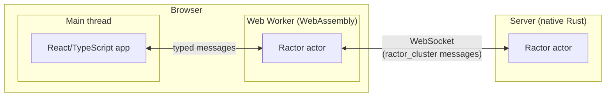

# R11 Ractor in the Browser

Status: viability pass done (2026-11-01). Not started.

## Question

Can ractor actors run in the browser as WebAssembly, act as a helper to a React/TypeScript web app, and exchange typed messages with a server-side ractor actor over a WebSocket?

## Findings

| Code | Finding | Effect |
|---|---|---|
| F1 | ractor supports the browser target `wasm32-unknown-unknown` since v0.15.3, with browser-run tests and thread-local actors. Current version is 0.16. | A ractor actor can run in the browser. |
| F2 | `ractor_cluster` supports "bring your own transport": implement `ClusterBidiStream` and inject the connection. Remote actors exchange serialized messages. No ready-made WebSocket adapter was found. Whether `ractor_cluster` compiles to `wasm32-unknown-unknown` is unconfirmed. | The main unknown. If it compiles, browser and server actors join one cluster. If not, messages need a hand-written protocol over WebSocket. |
| F3 | WebAssembly threads need cross-origin isolation headers. Memory64 (over 4 GB) is not in Safari. | Plan for single-threaded actors under 4 GB. |
| F4 | Rust compiled with `wasm-bindgen` imports into a React/TypeScript app as an ES module. Message types defined in Rust can generate TypeScript types (`tsify` or `ts-rs`) and cross the boundary with `serde-wasm-bindgen`. | React talks to the actor through a typed interface defined once in Rust. Running the actor in a Web Worker keeps it off React's rendering thread. |

## Risk

`ractor_cluster` does not compile to WebAssembly, forcing a hand-written message protocol between browser and server actors.

## Spike Plan

| Code | Question | Smallest test |
|---|---|---|
| Q1 | Can a browser actor and a server actor exchange typed messages using `ractor_cluster` over a WebSocket `ClusterBidiStream`? | One actor in the browser and one native actor on a server exchanging a typed request and reply. |
| Q2 | Does ractor run inside a Web Worker? | Run the Q1 browser actor in a Web Worker instead of the main thread. |
| Q3 | Can a React app use the actor as a helper through generated TypeScript types? | A React component sends a typed request to the worker actor and renders a stream of typed replies. Check UI responsiveness under a fast stream. |

## Possible Follow-ups

Ideas raised during the viability pass, out of scope for R11:

- Use the browser actor as an agent orchestrator, with a small hosted gateway holding API keys and proxying LLM calls.
- Run worker agents, source, and tools in a per-user dev container, with the orchestrator in the browser.
- Host the agent in VS Code, using VS Code Remote for files, terminal, and search.

## Sources

- [ractor releases](https://github.com/slawlor/ractor/releases)
- [ractor repository](https://github.com/slawlor/ractor)
- [ractor_cluster README](https://docs.rs/crate/ractor_cluster/latest/source/README.md)
- [Memory64 browser support (web-features explorer)](https://web-platform-dx.github.io/web-features-explorer/features/wasm-memory64/)
