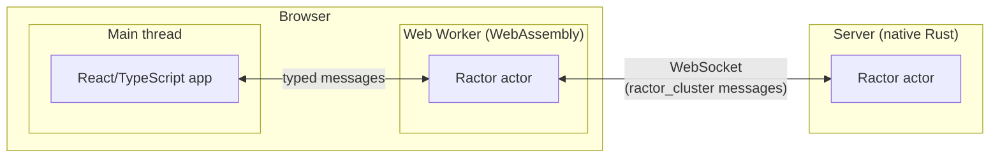

# R11 Ractor in the Browser

Status: viability pass done (2026-11-01). Spike Q1 and Q2 done, Q3 not started (2026-11-03). See [Spike Results](#spike-results).

## Question

Can ractor actors run in the browser as WebAssembly, act as a helper to a React/TypeScript web app, and exchange typed messages with a server-side ractor actor over a WebSocket?

## Findings

| Code | Finding | Effect |
|---|---|---|
| F1 | ractor supports the browser target `wasm32-unknown-unknown` since v0.15.3, with browser-run tests and thread-local actors. Current version is 0.16. | A ractor actor can run in the browser. |
| F2 | `ractor_cluster` supports "bring your own transport": implement `ClusterBidiStream` and inject the connection. Remote actors exchange serialized messages. No ready-made WebSocket adapter was found. Whether `ractor_cluster` compiles to `wasm32-unknown-unknown` is unconfirmed. | The main unknown. If it compiles, browser and server actors join one cluster. If not, messages need a hand-written protocol over WebSocket. |
| F3 | WebAssembly threads need cross-origin isolation headers. Memory64 (over 4 GB) is not in Safari. | Plan for single-threaded actors under 4 GB. |
| F4 | Rust compiled with `wasm-bindgen` imports into a React/TypeScript app as an ES module. Message types defined in Rust can generate TypeScript types (`tsify` or `ts-rs`) and cross the boundary with `serde-wasm-bindgen`. | React talks to the actor through a typed interface defined once in Rust. Running the actor in a Web Worker keeps it off React's rendering thread. |

## Risk

`ractor_cluster` does not compile to WebAssembly, forcing a hand-written message protocol between browser and server actors.

## Spike Plan

| Code | Question | Smallest test |
|---|---|---|
| Q1 | Can a browser actor and a server actor exchange typed messages using `ractor_cluster` over a WebSocket `ClusterBidiStream`? | One actor in the browser and one native actor on a server exchanging a typed request and reply. |
| Q2 | Does ractor run inside a Web Worker? | Run the Q1 browser actor in a Web Worker instead of the main thread. |
| Q3 | Can a React app use the actor as a helper through generated TypeScript types? | A React component sends a typed request to the worker actor and renders a stream of typed replies. Check UI responsiveness under a fast stream. |

## Prior Art from Agent Platforms

From Collier, Mascardi, and Ricci (eds.), *Agents and Multi-Agent Systems Development*, Springer, 2026, and [learn/16](../../learn/16-agent-programming-and-platforms.md). Covers R11 and [R12](../README.md#backlog). None of the platforms addresses messages sent while offline, reconnection, or supervising an absent node.

| Code | Prior art | Use |
|---|---|---|
| P1 | JS-son shadow agent (Ch. 5.5.2). The server holds a proxy agent whose runner forwards percepts over a WebSocket to the real agent on a client. Each environment cycle starts when the client's message arrives. The wire format, and whether the client is a browser, are not stated. | R11: a server-side proxy actor standing in for the browser actor. R12: if the cycle waits on the client, a disconnected client stalls it, so the proxy must not block. |
| P2 | Orleans virtual actors (Ch. 3.3.6). An actor has a permanent identity, is activated when called, and has its state persisted. | R12: reclaiming identity and state after reconnecting. |
| P3 | Akka supervision trees and event sourcing (Ch. 3.3.5). Restart failed actors and rebuild state by replaying events. | R12: restart and catch-up. |
| P4 | Jadex 4 overlay network (Ch. 3.7.7). Relay nodes and hole punching reach peers behind firewalls. Being ported to Jadex V. | R11: the WebSocket server plays the relay role for a browser that cannot accept inbound connections. |
| P5 | Jadex V boundaries (Ch. 3.4.5, 3.4.7). Calls between components copy arguments and results to keep isolation. The exception registry's default kills the component, with no restart strategy. | R11: copy semantics at the browser-server boundary. Contrast with ractor supervision. |
| P6 | JaKtA virtualisation API (Ch. 6.4.3). Time, scheduling, perception, and randomness sit behind one interface for reproducible simulation. | R12: deterministic tests of disconnect and reconnect. |
| P7 | Yggdrasil body artifacts (Ch. 7.3.1). An agent's presence in a workspace is separate from the process running it. WebSub perception needs a reachable subscriber, which a browser is not. | R12: a server-side presence for an offline frontend. |
| P8 | BSPL information protocols and Mandrake (Ch. 8.3.1, 8.3.4). Messages depend on information, not order, so reordering and duplicates are harmless. Agents resend or remind when a reply may be lost. | R12: design messages so that redelivery after reconnecting is safe. |

## Spike Results

Run on 2026-11-03 in this repo's container (aarch64 Linux). Code in [spike/](spike/). Versions: ractor and ractor_cluster 0.16.5 (published 2026-08-07, the latest), rustc 1.99.1, wasm-bindgen 0.2.130, gloo-net 0.6.0, tokio-tungstenite 0.28, Node 22.23.3, headless Chromium 131.0.6778.33.

| Code | Result | Effect |
|---|---|---|
| S1 | ractor 0.16.5 builds for `wasm32-unknown-unknown` with its default features, and with `default-features = false` plus `tokio_runtime`. On wasm it runs on `tokio_with_wasm` 0.9.2, which uses `setTimeout` and `queueMicrotask` on `globalThis`. | Confirms F1. |
| S2 | ractor's own `cluster` feature does not build for wasm. Two type errors in `src/factory/job.rs` (lines 208 and 242) mix `std::time::SystemTime` with `web_time::SystemTime`. The same feature builds natively. | A small upstream bug. Even if fixed, S3 still blocks clustering. |
| S3 | ractor_cluster 0.16.5 does not build for wasm. The first error is from mio 1.2.4: "This wasm target is unsupported by mio. If using Tokio, disable the net feature." `aws-lc-sys` (through `tokio-rustls`) also fails. ractor_cluster requires tokio's `net` feature, `socket2`, and `tokio-rustls`, and has no feature to turn them off. | Answers F2: no. The risk is realised. Browser and server actors cannot join one ractor cluster, so messages need a hand-written protocol. |
| S4 | ractor's `Actor` requires `State: Send`. A browser WebSocket is not `Send`. `ractor::thread_local::ThreadLocalActor` with `ThreadLocalActorSpawner::new()` (which has a wasm32 build) accepts state that is not `Send`. | The browser actor that owns the socket is a thread-local actor. |
| S5 | Q1 passes with a hand-written protocol: serde JSON text frames over a WebSocket. Shared types `Request` and `Reply` are in `proto`. The browser actor uses gloo-net, the server uses tokio-tungstenite and a ractor actor. Under Node 22, a wasm actor sent two requests and got two typed replies with matching ids. In headless Chromium it did the same from the page's main thread. | Q1 answered: yes, without ractor_cluster. Node was a stand-in, and Chromium confirmed the result in a real browser. |
| S6 | Q2 passes. The same wasm module ran inside a module Web Worker in Chromium (`self instanceof WorkerGlobalScope` was true), ran a local actor, and exchanged two requests with the server actor. The static server sent no cross-origin isolation headers. | Q2 answered: yes. Single-threaded actors in a worker need no special headers, consistent with F3. |
| S7 | Under Node 22 the process crashed after the replies with "closure invoked recursively or after being dropped". Node 22 has no global `CloseEvent`, so gloo-net's drop cannot send the synthetic close event that uses up its one-shot close listener. The real close event then calls a dropped callback. A minimal `CloseEvent` class in `run.mjs` fixes it. Chromium needed no change. gloo-net's `Sink::poll_close` does nothing, so closing through the sink does not close the socket. | A Node stand-in issue only. Close sockets with `WebSocket::close`, or drop them, not through `Sink::close`. |

Q3 (React app with generated TypeScript types and a stream of replies) is not started. The current `ask` export is request and reply, not a stream, and the React toolchain is not set up.

How to reproduce, from `research/r11-browser-agent/spike/`:

1. Install Rust and tools: `curl --proto '=https' --tlsv1.2 -sSf https://sh.rustup.rs | sh -s -- -y --profile minimal`, then `rustup target add wasm32-unknown-unknown` and `cargo install wasm-bindgen-cli --version 0.2.130 --locked`.
2. S1 and S2: `cd probe-ractor && cargo build --target wasm32-unknown-unknown`, then the same with `--features ractor/cluster`.
3. S3: `cd probe-cluster && cargo build --target wasm32-unknown-unknown`.
4. Build: `cargo build -p server` and `cargo build -p browser --target wasm32-unknown-unknown`, then `wasm-bindgen --target nodejs --out-dir pkg target/wasm32-unknown-unknown/debug/browser.wasm` and `wasm-bindgen --target web --out-dir pkg-web target/wasm32-unknown-unknown/debug/browser.wasm`.
5. Start the server: `./target/debug/server 127.0.0.1:9001`.
6. S5 under Node: `node run.mjs`.
7. S5 and S6 in Chromium: `npm install`, then `node browser-test.mjs`. It uses the Playwright Chromium in `~/.cache/ms-playwright`, or the path in `CHROMIUM`.

## Possible Follow-ups

Ideas raised during the viability pass, out of scope for R11:

- Use the browser actor as an agent orchestrator, with a small hosted gateway holding API keys and proxying LLM calls.
- Run worker agents, source, and tools in a per-user dev container, with the orchestrator in the browser.
- Host the agent in VS Code, using VS Code Remote for files, terminal, and search.

## Sources

- Collier, Mascardi, and Ricci (eds.), *Agents and Multi-Agent Systems Development: Platforms, Toolkits, Technologies*, Springer, 2026, Chapters 3, 5, 6, 7, and 8.
- [ractor releases](https://github.com/slawlor/ractor/releases)
- [ractor repository](https://github.com/slawlor/ractor)
- [ractor_cluster README](https://docs.rs/crate/ractor_cluster/latest/source/README.md)
- [Memory64 browser support (web-features explorer)](https://web-platform-dx.github.io/web-features-explorer/features/wasm-memory64/)
